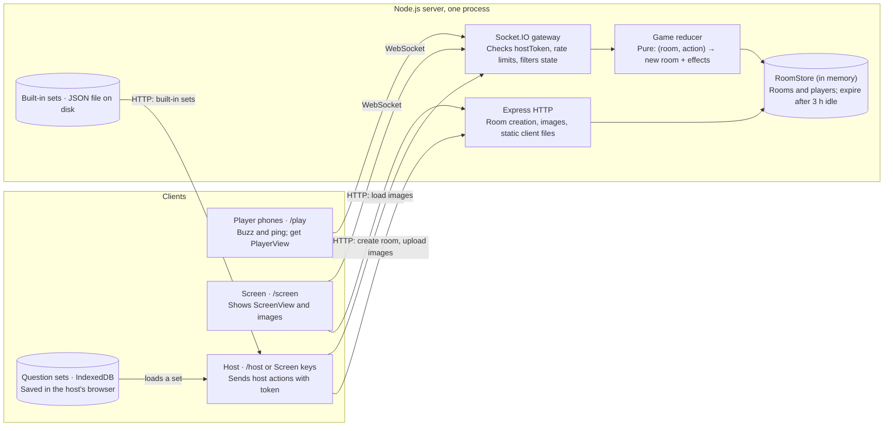
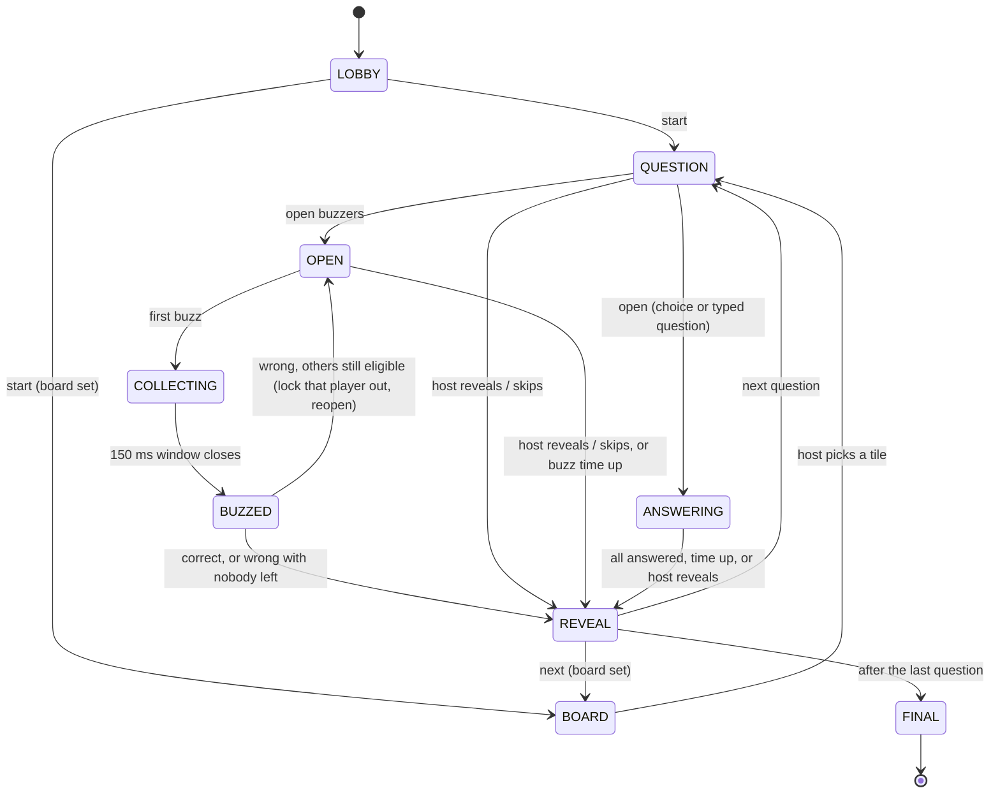

# Buzzer Game Show App — Build Spec

Oct 27, 2026

## Note to Claude Code

Build this as one TypeScript web app: a Node server with Socket.IO that serves a React client. Work through the milestones in the last section in order, and keep the app runnable after each one.

- The game logic lives in one pure, unit-tested reducer on the server. The server is the only source of truth; clients render state they are sent.
- Decisions already made by the product owner are marked **[decided]**. Defaults chosen on their behalf are marked **[default]** and can change later.
- If something here is ambiguous, pick the simplest option that satisfies the acceptance criteria and leave a `// SPEC-QUESTION:` comment, rather than inventing features.
- No accounts, no database, no paid services in v1.

## Overview

A browser-based game show buzzer: a big **Screen** shows the questions, each **Player** uses their phone as a buzzer, the Screen announces who buzzed first, and the **Host** judges the answer and moves to the next question. Working name: **Buzzr** (rename freely).

Goals for v1:

1. Anyone can join from a phone browser in under 15 seconds: scan a QR code or type a 4-letter room code. No app install, no account.
2. The first-buzz decision is fair and feels instant: the winner appears on the Screen within 300 ms of the press on a normal connection.
3. One person can run a full game alone, from a phone or from the laptop driving the TV.

Scope decisions:

| Topic | Decision |
| --- | --- |
| Connection | **[decided]** Online with a room code, like Kahoot or Jackbox. Requires a small hosted server. |
| Host controls | **[decided]** Both: a host remote page on a phone, and keyboard/on-screen controls on the Screen device. |
| After a buzz | **[decided]** Host marks Correct or Wrong. Correct awards points. Wrong locks that player out and reopens buzzers for everyone else. |
| Questions | **[decided]** Built-in question editor with saved question sets, and images in questions. |
| Where question sets are saved | **[default]** In the browser (IndexedDB) of the device that made them, with JSON export/import to move them between devices. No database. |
| Points | **[default]** 100 per question, editable per question. Wrong-answer penalty is off by default (toggle per game). |
| Teams, timers, multiple choice | Optional, off by default: teams, an answer timer, a buzz time limit, and choice or typed questions (see Scoring rules, Host remote and Set editor). |

## Roles and devices

Every room has three roles. The Screen is public, so it never receives anything secret; only the Host receives answers.

| Role | Device | URL | What it sees | Needs a secret? |
| --- | --- | --- | --- | --- |
| Screen | Laptop on a TV or projector, any big display | `/screen/:code` | Lobby with QR + code, question and image, who buzzed, revealed answer, scoreboard | No. Anyone with the code may open it. Several Screens per room are allowed. |
| Host | The device that created the room, plus any phone paired to it | `/host/:code` | Everything the Screen sees, plus the answer, host notes, and all controls | Yes: `hostToken` |
| Player | Each contestant's phone | `/play/:code` | One giant buzzer button, their name, status and score | A `playerId` stored on their device (for reconnects) |

### Creating and joining a room

1. **Create.** On the landing page `/`, the host taps **Host a game**, picks a question set from this browser's saved sets, and taps **Create room**. The server returns a room `code` and a secret `hostToken`. The device stores the token in `localStorage` and is now a Host.
2. **Choose where the Screen is.** The create page offers four buttons:
   - **Use this device as the Screen** (typical laptop + TV setup). Opens `/screen/:code` on this device. Because this device holds the `hostToken`, the Screen also shows host controls (see Screen host controls in the UI section).
   - **Open the Screen on another device**: shows the Screen URL and code to type on the TV device.
   - **Use this phone as the host remote**: opens `/host/:code` on this device.
   - **Run from this phone (no TV)**: the remote in read-aloud layout, with the join QR in the lobby.
3. **Pair a host phone (optional).** The Screen's lobby has a **Pair host phone** button. It shows a QR code linking to `/host/:code#t=<hostToken>` and a 6-digit PIN for 60 seconds, then hides them. The token is in the URL hash so it is never sent to the server in request logs. A phone may instead open `/host/:code` and type the PIN. Any number of host devices may be paired.
4. **Players join** by scanning the lobby QR (`/play/:code`) or by going to the site and typing the code. They enter a display name (1 to 16 characters, unique in the room, case-insensitive) and get an automatic colour.

Room codes are 4 letters from an alphabet without look-alikes (`ABCDEFGHJKMNPQRSTUVWXYZ`, no I, L or O). Generate randomly, retry on collision, and block a short list of offensive words.

## Tech stack and architecture

One TypeScript project, deployed as a single always-on Node process that serves both the realtime API and the built React app.

One super-admin, set by the `ADMIN_PASSWORD_HASH` environment variable, curates the built-in sets. They live in one JSON file on the server (`DATA_DIR`), seeded once from the 60 starter sets. There are no user accounts; My sets stay in the host's browser.



Every device talks to the server over one WebSocket; the host device also uses HTTP to upload the question set and images when it creates a room. Every action passes through the gateway into the reducer, and the resulting state is filtered per role and pushed back out.

| Layer | Choice | Notes |
| --- | --- | --- |
| Language | TypeScript, `strict: true` | Shared types between client and server |
| Server | Node.js (current LTS), Express, Socket.IO | One instance only: rooms are in memory |
| Client | React + Vite, React Router, Tailwind CSS | Mobile-first; Screen view scales with viewport units |
| Client state | Zustand store holding the latest `state` snapshot | No client-side game logic |
| Validation | zod | Same schemas on client (import) and server (events) |
| Browser storage | Dexie (IndexedDB) | Question sets and image blobs |
| QR codes | `qrcode.react` | Join QR and host-pairing QR |
| Reordering | `@dnd-kit` | Question list in editor |
| Sound | Howler.js with short sound files in `client/public/sounds` | Buzz, correct, wrong, join, final fanfare; use royalty-free or self-made sounds |
| Tests | Vitest | Reducer, fairness, role filtering |
| Deploy | Dockerfile; any host that supports WebSockets and stays always-on (e.g. Railway, Render, Fly.io) | Free tiers that sleep will drop live rooms; check before choosing |

Folder layout:

```
buzzr/
  shared/        types.ts, schemas.ts, constants.ts (palette, limits)
  server/        index.ts, http.ts, sockets.ts, reducer.ts, fairness.ts,
                 roomStore.ts, views.ts (toView), codes.ts, *.test.ts
  client/        src/pages/{Landing,Play,Screen,Host,Sets,SetEditor,PrintSheet}.tsx
                 src/components/, src/lib/{socket,db,images,sounds}.ts
                 public/sounds/
  Dockerfile
  README.md
```

## Game flow and state machine

Each question is one round that loops between open buzzers and the host's judgement until someone answers correctly, everyone eligible has answered wrong, or the host reveals the answer.



The scoreboard is an overlay (`showScoreboard`), not a phase, so it can appear over any phase. The host can also jump to FINAL from any phase with End game.

### Transitions

Implement these in `server/reducer.ts` as a pure function `reduce(room, action, now) → {room, effects}`. Any action not listed for the current phase is rejected with an error.

| From | Trigger | To | Side effects |
| --- | --- | --- | --- |
| LOBBY | `host:start` (at least 1 player) | QUESTION, index 0 | |
| QUESTION | `host:open`, or automatically when `autoOpenBuzzers` is on | OPEN | Clear `buzzes` |
| OPEN | First valid `player:buzz` | COLLECTING | Schedule `windowClosed` in 150 ms |
| COLLECTING | `windowClosed` | BUZZED | Rank buzzes, set `winnerId`, emit `fx buzz`; when `answerSeconds` > 0, start the answer timer and schedule `answerTimeUp` |
| BUZZED | `answerTimeUp` (fresh) | BUZZED | Mark the timer up, emit `fx timeUp`. The host still judges |
| BUZZED | `host:judge correct` | REVEAL | Winner + question points, emit `fx correct` |
| BUZZED | `host:judge wrong`, others still eligible | OPEN after 1.5 s | Add winner to `lockedOut`, apply penalty if on, emit `fx wrong`, schedule `reopen` |
| BUZZED | `host:judge wrong`, nobody eligible | REVEAL | Same as above, no reopen |
| QUESTION, OPEN, COLLECTING, BUZZED | `host:reveal` | REVEAL | No points; an unjudged buzz is discarded |
| REVEAL | `host:next` | QUESTION, index + 1, or FINAL after the last question | Reset `buzzes`, `winnerId`, `lockedOut`; set `showScoreboard` when the finished question number is a multiple of `scoreboardEvery` |
| Any question phase or REVEAL | `host:prev` | QUESTION, index − 1 | Scores unchanged |
| BUZZED, OPEN or REVEAL of the same question | `host:undo` | BUZZED with the undone player as winner | Reverse the newest judgement of this question (points and lockout); repeatable until none are left |
| OPEN | `buzzTimeUp` (fresh) | REVEAL | No points |
| QUESTION | `host:open` on a choice or typed question | ANSWERING | Schedule `answeringClosed` after `choiceSeconds` |
| ANSWERING | All connected players answered, `answeringClosed`, or `host:reveal` | REVEAL | Score choice answers; typed answers as the host marked them |
| LOBBY or REVEAL | `host:start` / `host:next` on a board set | BOARD | |
| BOARD | `host:pick` (an unused tile) | QUESTION | Mark the tile used |
| Any | `host:end` | FINAL | |

Scheduled effects (`windowClosed`, `reopen`, `answerTimeUp`, `buzzTimeUp`, `answeringClosed`) carry the question index and an opening counter; the server ignores them if the room has moved on, so a host clicking fast never causes a stale transition.

### Scoring rules

- Correct: + the question's `points` (default 100).
- Wrong: 0 by default; − `points` when the wrong-answer penalty setting is on. Scores may go negative.
- Only the buzz winner is ever judged; locked-out players cannot buzz again on that question.
- Final ranking sorts by score; equal scores share a rank.
- Half: + half the question's points, rounded.
- With the false-start setting on, a press before the buzzers open locks that player out for 0.5 or 1 s after they open.
- With teams on, a team's score is the sum of its members' scores; players still buzz alone.

## Buzzer fairness and timing

The server decides who was first, using arrival time corrected for each player's measured network delay, so a player on slow mobile data is not always beaten by one on fast Wi-Fi.

1. **Measure latency.** Every player client sends `ping` every 2 seconds; the server answers `pong`. The server keeps a rolling median round-trip time (RTT) of the last 10 samples per player. One-way latency = RTT / 2.
2. **Collect.** When the first valid `buzz` of a round arrives, the server starts a **150 ms collection window** and accepts other buzzes during it.
3. **Rank.** Each buzz gets `adjustedTime = serverReceiveTime − min(oneWayLatency, 150 ms)`. The lowest `adjustedTime` wins. The cap stops a player from gaining by faking a slow connection.
4. **Announce.** After the window closes, the server locks buzzers and broadcasts the winner. Buzzes after the window are recorded only for the "also buzzed" list.

Rules:

- A buzz only counts while the phase is `OPEN` or `COLLECTING` and the player is not locked out. Anything else is ignored silently, except a press in QUESTION when the false-start setting is on (see Scoring rules).
- One buzz per player per opening. Extra presses are ignored.
- Use `performance.now()`-based monotonic timers on the server, not `Date.now()`.
- Every buzz records `{playerId, serverReceiveTime, oneWayLatency, adjustedTime}` in the round log, so ties can be inspected while testing.
- Show the gap to second place on the Screen (for example "+0.12 s"); it makes close calls feel fair.

Client-side speed:

- Trigger on `pointerdown`, not `click` (removes the tap delay). Also allow the Space bar on desktop.
- Show instant local feedback (button press animation, `navigator.vibrate(30)` where supported) before the server replies.
- Keep the socket warm: connect on page load, use the WebSocket transport only (no long-polling fallback once connected).

## UI spec by view

The look is bold and game-show-like: dark background, one bright accent, very large type. Each player gets a colour from a fixed 12-colour palette, used on their phone and wherever their name appears on the Screen.

### Landing page `/`

- A one-line explainer under the logo.
- Two big choices: **Join a game** (code input, auto-uppercase, 4 letters) and **Host a game**, with the same weight. The **Host a game** set picker replaces the Join card while open.
- A link to **My question sets** (`/sets`, the editor).

### Player view `/play/:code`

1. **Join form:** name input, optional avatar, Join button. Name, avatar and `playerId` are remembered on the device, so a refresh rejoins automatically.
2. **Buzzer screen:** the whole viewport is one circular button, with the player's avatar, name, colour, score and rank ("3rd of 8") in a slim top bar, and the team when teams are on. Its states:

| Room state for this player | Button look | Label |
| --- | --- | --- |
| Lobby | Live, muted colour | "Tap to test your buzzer", with a "Who's here" list below |
| Question shown, buzzers locked | Grey, disabled | "Get ready…" |
| Pressed too early (false start on) | Amber | "Too early!" |
| Choice or typed question | Choice buttons or a text box | "Answer sent" once sent |
| Buzzers open | Bright red, pulsing | "BUZZ!" |
| Pressed, waiting for result | Pressed-in red | "Buzzed…" |
| This player won the buzz | Green | "You're first! Answer now", with the seconds left when an answer time is set, then "Time's up!" |
| Someone else won | Dim | "&lt;Name&gt; buzzed first" |
| Locked out after a wrong answer | Dark with an X | "Locked out this round" |
| Answer revealed | Grey | The answer text, and "+100" if they scored |
| Game over | n/a | Final rank and score |

- Request a Screen Wake Lock so the phone doesn't sleep; prevent zoom, text selection and the long-press menu on the button.
- Show a small connection dot (green / amber / red) and auto-reconnect.
- A menu in the top bar offers **Change name** (lobby only) and **Leave game**.
- Vibrate on correct, wrong and lockout.

### Screen view `/screen/:code`

Designed for 1920×1080, legible from 5 metres; scale with viewport units. First load shows a **Click to start** overlay, needed to unlock audio and enter fullscreen.

- **Lobby:** huge room code, QR code to `/play/:code`, the join URL in text, and joined players as coloured name chips that pop in. Buttons: **Pair host phone**, **Start game** (Start only when this device is a Host). When this device is a Host, the lobby also shows the room settings (the remote's Settings tab) beside Start game. The join address shows once; with a host phone paired, the settings fold behind a **Settings** button; test buzzes pop the player's chip.
- **Sound:** a sound button and the `M` key cycle Sound on, Quiet and Muted.
- **Title card:** before question 1 of each game, a title card with the set's title, category and difficulty.
- **Question:** "Question 3 of 20", the question text (auto-shrinks to fit), and the image if present (contained, never cropped). Status line: "Buzzers locked" or "Buzzers OPEN" with a visible change of colour. With a buzz time set, a countdown around "Buzzers open". With standings on, a top-5 rail on the right.
- **Buzzed:** the winner's name in a giant banner in their colour, with a buzz sound. Below: "also buzzed" names with time gaps ("+0.12 s"). With an answer time set, a large countdown beside the winner's banner. At zero: "Time's up!", a red flash and the time's-up sound. The host still judges.
- **Judged:** Correct = green flash, sound, "+100" floating up from the name. Wrong = red flash, buzz sound, the player's chip greyed out, then back to Buzzers open after 1.5 s.
- **Reveal:** the answer in large type under the question.
- **Scoreboard:** shown between questions on demand, and automatically every 5 questions **[default]**. Ranked list, animated reordering.
- **Final:** top-3 podium, then full ranking. For one or two players, only their steps. From game 2, a Tonight panel with the night's totals.
- **Board:** board sets show the category board between questions.
- A thin bottom strip always shows the room code and "Join at &lt;url&gt;" so late joiners can get in.

### Host remote `/host/:code`

Phone-first layout. Never shown on the Screen.

- **Top:** question number, the question text, the **answer** and host notes in a highlighted box, and the image thumbnail.
- **Primary action button** (full width, changes with state): Start game → Open buzzers → (after a buzz) **Correct** / **Half** / **Wrong** side by side, with the answer countdown beside them when one is set → Reveal answer → Next question → Show final results.
- **Secondary actions:** Skip question (reveals answer), Show/hide scoreboard on the Screen, Undo last judgement, Previous question, End game.
- **Players tab:** list with scores, connection status, +/− buttons to adjust a score by the question's value or a custom amount, and Kick. With teams, grouped by team with a team select.
- **Settings tab:** wrong-answer penalty on/off, auto-open buzzers when a question appears on/off **[default: off]**, answer time Off / 3 / 5 / 7 / 10 s **[default: off]**, scoreboard every N questions, buzz time Off / 5 / 10 / 15 / 20 / 30 s, false start Off / 0.5 / 1 s, standings rail on/off, teams Off / 2 / 3 / 4, phone and Screen language English / Taglish. Two presets, Party and Competitive.
- **Read-aloud layout:** large question, covered answer, same controls.
- **Game over:** **Share results** (image).

### Screen host controls (when the Screen device holds the hostToken)

The same actions as the remote, without ever showing the answer on the Screen. Host notes and answers stay on the remote or a printed answer sheet.

- A collapsible control bar along the bottom edge, auto-hiding after 3 s without mouse movement.
- Keyboard shortcuts, listed on a `?` help overlay:

| Key | Action |
| --- | --- |
| Space | Primary action (Start / Open buzzers / Reveal / Next) |
| C | Correct |
| V | Half points |
| X | Wrong |
| R | Reveal answer / skip |
| N or → | Next question |
| ← | Previous question |
| S | Toggle scoreboard |
| U | Undo last judgement |
| F | Toggle fullscreen |
| H | Show/hide control bar |
| M | Sound on / Quiet / Muted |

## Question editor and images

Question sets are created and saved in the browser (IndexedDB, via the `idb-keyval` or `Dexie` library), with no server storage. They are uploaded to the server only when a room is created, and live in server memory for that room's lifetime.

### Set list `/sets`

- Cards for each saved set: title, number of questions, last edited. Actions: Open, Duplicate, Delete (with confirm), **Export JSON**, **Host this set**.
- **New set** and **Import JSON** buttons. Import validates against the schema (use `zod`) and shows clear errors.
- Two tabs: **Built-in** (the sample and the server's built-in sets, 60 starters at first; read-only: Host this set, Duplicate to My sets) and **My sets** (this browser's sets, every action). The sample set has 10 general-knowledge questions with 2 images, so the app can be tried immediately. The starter sets cover 20 categories at Easy (100 points), Medium (200) and Hard (300), 15 questions each.
- When signed in at `/admin`, the Built-in tab adds **Import to built-ins** (live at once; a set with the same id is replaced; sets with pictures are refused), **Export built-ins**, **Hide sample** / **Show sample**, and per set **Edit** and **Delete** (with confirm).
- Every set list, here and in the pickers, has search, difficulty chips and grouping by category, and a Preview (not on the Screen).
- **Build a game** draws questions from chosen categories and difficulties into a new set or a category board.
- **Export all** saves every playable set in one file; Import accepts one set or many.

### Set editor `/sets/:setId`

- Set title at the top, with Category and Difficulty (optional). Autosave on every change (debounced 500 ms) with a "Saved" indicator.
- **Paste questions**: one per line as `Question | Answer | points` or spreadsheet cells.
- Per question, a mode: Buzz (default), Choice (2–4 choices, one correct) or Typed (answer plus alternatives in host notes).
- Questions in a vertical list, each a card with:
  - Question text (required unless an image is present; up to 300 characters)
  - Image (optional): pick a file, drag and drop, or paste from the clipboard. Thumbnail with Remove.
  - Answer (required; shown to the host only until revealed; up to 200 characters)
  - Host notes (optional; accepted alternative answers, pronunciation; host only)
  - Points (integer, default 100)
- Reorder by drag handle (`@dnd-kit`) and up/down buttons. Duplicate and delete per question.
- **Preview** button opens the question as it will look on the Screen.
- **Print answer sheet**: a print-friendly page listing number, question, answer and notes, for hosts running from the Screen without a phone.
- Limits: 100 questions per set.
- A built-in set opens at `/admin/sets/:setId` for the admin only. Changes autosave to a draft that only the admin sees; **Publish** makes it live, **Discard draft** drops it. No pictures.

### Images

- On add, resize in the browser to a longest side of 1600 px and re-encode as WebP (fallback JPEG) at quality 0.8 using a canvas. Reject files that are still above 1.5 MB after compression.
- Accept PNG, JPEG, WebP and GIF (a GIF is stored as its first frame in v1).
- Store image blobs in IndexedDB, referenced from questions by an `imageId`. Exported JSON embeds images as base64 data URLs so one file carries a whole set.
- At room creation, upload the set as JSON via `POST /api/rooms` and each image via `POST /api/rooms/:code/images/:imageId` (authorised by the hostToken). The server keeps images in memory and serves them at `GET /api/rooms/:code/images/:imageId` with a long cache header.
- **Preload:** when a question is shown, the Screen and Host also preload the next question's image, so it appears instantly.
- Total upload limit per room: 50 MB.

## Data model

These types live in `shared/types.ts` and are imported by both server and client. Validate every incoming payload with matching `zod` schemas.

```typescript
// ---------- Saved in the browser (editor) ----------
export interface QuestionSet {
  id: string;              // nanoid
  title: string;
  questions: Question[];
  createdAt: number;
  updatedAt: number;
  schemaVersion: 1;
  category?: string;       // 1–40 characters
  difficulty?: 'easy' | 'medium' | 'hard';
  board?: { columns: { title: string; questionIds: string[] }[] }; // category board: 2–6 columns of Easy, Medium, Hard
}

export interface Question {
  id: string;
  text: string;            // may be '' if imageId is set
  imageId?: string;        // key into the image store
  answer: string;          // for a choice question, the correct choice's text
  hostNotes?: string;
  points: number;          // default 100
  mode?: 'buzz' | 'choice' | 'typed'; // default 'buzz'
  choices?: string[];      // choice questions: 2–4
  correctChoice?: number;  // choice questions: index into choices
}

// ---------- Server room state (in memory) ----------
export type Phase =
  | 'LOBBY'
  | 'QUESTION'        // shown, buzzers locked
  | 'OPEN'            // buzzers open
  | 'COLLECTING'      // first buzz received, 150 ms window
  | 'BUZZED'          // winner shown, waiting for host judgement
  | 'ANSWERING'       // choice or typed question: every player answers
  | 'BOARD'           // category board: host picks the next tile
  | 'REVEAL'          // answer shown
  | 'FINAL';

export interface Player {
  id: string;              // playerId, generated by client, stored on device
  name: string;
  color: string;           // from palette
  score: number;
  connected: boolean;
  rttMs: number;           // rolling median
  joinedAt: number;
  avatar?: string;         // one of a fixed emoji list
  team: number | null;     // null when teams are off
}

export interface Buzz {
  playerId: string;
  receivedAt: number;      // server monotonic ms
  oneWayMs: number;
  adjustedAt: number;
}

export interface Judgement {
  questionIndex: number;
  playerId: string;
  result: 'correct' | 'half' | 'wrong';
  pointsDelta: number;
}

export interface RoomSettings {
  wrongPenalty: boolean;           // default false
  autoOpenBuzzers: boolean;        // default false
  scoreboardEvery: number;         // default 5, 0 = never auto
  answerSeconds: 0 | 3 | 5 | 7 | 10; // default 0 = off
  buzzSeconds: 0 | 5 | 10 | 15 | 20 | 30; // default 0 = off
  falseStartMs: 0 | 500 | 1000;    // default 0 = off
  showStandings: boolean;          // default true
  teams: 0 | 2 | 3 | 4;            // default 0 = off
  choiceSeconds: number;           // 5–30, default 10
  copy: 'en' | 'taglish';          // phone and Screen language, default 'en'
}

export interface Room {
  code: string;
  hostTokenHash: string;           // store a hash, never the raw token
  set: QuestionSet;                // without image blobs
  settings: RoomSettings;
  players: Record<string, Player>;
  kickedIds: string[];
  phase: Phase;
  questionIndex: number;           // -1 in lobby
  openingCounter: number;          // increments each time buzzers open
  buzzes: Buzz[];                  // for the current opening
  winnerId: string | null;
  lockedOut: string[];             // playerIds wrong this question
  judgements: Judgement[];         // whole game, enables undo
  undo: UndoPoint[];               // this question's judgements, newest last
  answerTimer: { seconds: number; endsAt: number; up: boolean } | null; // set in BUZZED while the winner's answer time runs
  buzzTimer: { seconds: number; endsAt: number } | null; // set in OPEN while the buzz time runs
  session: { gameNumber: number; totals: Record<string, number> }; // the night's games in this room
  usedQuestionIds: string[];       // category board tiles already played
  showScoreboard: boolean;         // overlay, independent of phase
  createdAt: number;
  lastActivityAt: number;
}
```

Role-filtered views sent to clients (built by `toView(room, role, playerId?)`):

- **ScreenView**: everything except `answer`, `hostNotes` and token data. `answer` is included only when phase is `REVEAL` or `FINAL` for that question.
- **HostView**: everything, including the current and next question's answer and notes.
- **PlayerView**: phase, the player's own name, colour, score and rank, winner name, whether they are locked out, and the answer only after reveal. No question text is needed on the phone in v1.
- `correctChoice`, typed answers and their groups follow the answer rule: never in Screen or Player views before REVEAL.

## Realtime events and HTTP API

After every state change the server sends each connected client a fresh, role-filtered snapshot (`state`). Snapshots make reconnects trivial: a client that rejoins just renders the latest one. A few one-off `fx` events drive sounds and animations.

Each socket joins a Socket.IO room per role: `room:<code>:screen`, `room:<code>:host`, and `room:<code>:player:<playerId>`.

### HTTP

| Method and path | Auth | Purpose |
| --- | --- | --- |
| `POST /api/rooms` | none (rate-limited: 10 per IP per hour) | Body: `{set, settings}`. Returns `{code, hostToken}`. |
| `POST /api/rooms/:code/images/:imageId` | `Authorization: Bearer <hostToken>` | Upload one image (binary body, max 1.5 MB). |
| `GET /api/rooms/:code/images/:imageId` | none | Serve an image. |
| `GET /api/rooms/:code/exists` | none | For the join form: `{exists, phase}`. |
| `POST /api/rooms/:code/pairing` | `Authorization: Bearer <hostToken>` | Create a 6-digit pairing PIN: valid 60 s, single use. |
| `POST /api/rooms/:code/pair` | none (rate-limited) | Body: `{pin}`. Returns `{hostToken}`. |
| `GET /api/built-in-sets` | none | The live built-in sets and whether the sample is hidden: `{sets, sampleHidden}`. Never drafts. |
| `POST /api/admin/login` | none (rate-limited: 5 per IP per minute) | Body: `{password}`. Sets the admin session cookie (12 h). |
| `/api/admin/*` | admin session cookie | Session and logout; list, import, delete, export the built-in sets; hide the sample; read, save, discard and publish a draft. 404 when no admin password is set. |
| `GET /healthz` | none | Health check for the host platform. |

### Client → server (Socket.IO)

Every event has an acknowledgement callback returning `{ok: true}` or `{ok: false, error: string}`.

| Event | Sent by | Payload | Effect |
| --- | --- | --- | --- |
| `screen:join` | Screen | `{code}` | Subscribe to ScreenView |
| `host:join` | Host | `{code, hostToken}` | Verify token, subscribe to HostView |
| `player:join` | Player | `{code, playerId, name, avatar?}` | Add or reconnect player; name must be unique |
| `ping` | Player | `{t}` | Server replies `pong {t}` for RTT |
| `player:buzz` | Player | `{}` | Buzz (see fairness rules) |
| `player:practice` | Player | `{}` | Test buzz in the lobby; emits `fx practice` |
| `player:rename` | Player | `{name}` | Change name in the lobby; name must be unique |
| `player:leave` | Player | `{}` | Leave the room; the device may rejoin as a new player |
| `player:answer` | Player | `{choice}` or `{text}` | Answer a choice or typed question in ANSWERING |
| `host:start` | Host | `{}` | LOBBY → QUESTION (index 0) |
| `host:open` | Host | `{}` | QUESTION → OPEN |
| `host:judge` | Host | `{result: 'correct', 'half' or 'wrong'}` | Score the winner |
| `host:reveal` | Host | `{}` | Any question phase → REVEAL |
| `host:next` | Host | `{}` | REVEAL → next QUESTION, or FINAL after the last |
| `host:prev` | Host | `{}` | Go back one question (scores unchanged) |
| `host:scoreboard` | Host | `{show: boolean}` | Toggle the scoreboard overlay |
| `host:undo` | Host | `{}` | Reverse the newest judgement of this question and its points |
| `host:adjustScore` | Host | `{playerId, delta}` | Manual score change |
| `host:kick` | Host | `{playerId}` | Remove a player; their device shows "Removed by host" |
| `host:settings` | Host | `Partial<RoomSettings>` | Change settings |
| `host:setTeam` | Host | `{playerId, team}` | Move a player to another team |
| `host:markTyped` | Host | `{groups}` | Mark which typed-answer groups are correct |
| `host:pick` | Host | `{questionIndex}` | BOARD → QUESTION for an unused tile |
| `host:end` | Host | `{}` | Jump to FINAL |

### Server → client

| Event | To | Payload |
| --- | --- | --- |
| `state` | Each role | ScreenView, HostView or PlayerView |
| `pong` | Player | `{t}` |
| `fx` | Screen + Host + Players | `{kind: 'buzz', playerId, gaps}` · `{kind: 'correct', playerId, points}` · `{kind: 'wrong', playerId}` · `{kind: 'join', playerId}` · `{kind: 'practice', playerId}` · `{kind: 'buzzTimeUp'}` · `{kind: 'falseStart', playerId}` |
| `kicked` | Player | `{}` |
| `room:closed` | All | `{reason}` |

## Reconnects, security and edge cases

### Reconnects

- **Player:** `playerId` (nanoid) and name live in `localStorage` per room code. On reconnect, `player:join` with the same id restores their score and lockout status. A disconnected player stays in the list, greyed out, for the whole game.
- **Host and Screen:** the hostToken lives in `localStorage` per room code; a refresh rejoins silently.
- If a player who won the buzz disconnects before judgement, the host can still judge them.
- Rooms are deleted after **3 hours without activity** **[default]**. Rooms live in memory only, so a server restart ends all games; clients then show "This game has ended" with a link home. (Acceptable for v1; see Out of scope.)

### Security

- `hostToken`: 32 random bytes, base64url. Server stores only a SHA-256 hash and compares in constant time.
- Answers and host notes are never sent to Screen or Player sockets before reveal. Add a unit test that serialises every PlayerView and ScreenView for an unrevealed question and asserts the answer string does not appear.
- Escape all user text (React does this by default; never use `dangerouslySetInnerHTML`).
- Rate limits: `player:buzz` max 5 per second per socket, `player:join` max 10 per minute per IP, room creation 10 per hour per IP.
- Limits: 50 players per room, names 1 to 16 characters with whitespace trimmed, socket message size 100 KB (images go over HTTP, not sockets).
- The admin password is stored only as a scrypt hash in the environment and compared in constant time. Admin sessions are 32 random bytes, kept in memory as SHA-256 hashes, in an HttpOnly, SameSite=Strict cookie scoped to `/api/admin`, Secure over HTTPS. Admin writes also require a JSON body and a same-origin `Origin`.

### Edge cases to handle

- **Two buzzes inside the window:** lowest `adjustedAt` wins; equal values → earliest `receivedAt`; still equal → the player who joined first.
- **Everyone locked out:** after the last eligible player is judged wrong, go straight to REVEAL.
- **Nobody buzzes:** host taps Reveal / Skip, or the buzz time runs out when one is set.
- **Host judges twice quickly:** only accept `host:judge` in phase BUZZED; the second is rejected.
- **Two host devices act at once:** server processes events in arrival order; a stale action fails its phase check and the device shows a brief toast.
- **Undo** reverses the newest judgement of the current question (score, lockout) and returns to the state right after that buzz. Repeated undos walk back through every judgement of the question.
- **Player joins mid-game:** allowed, starts at 0 points and can buzz from the next opening.
- **Kicked player:** cannot rejoin with the same `playerId` in that room.
- **Duplicate name:** join form shows "That name is taken".
- **Question with only an image:** Screen shows the image large, no text block.
- **Phone screen locks or app backgrounded:** socket drops; on return, auto-reconnect and render the latest state.

## Out of scope for v1

Do not build these yet, but avoid choices that make them hard later.

| Idea | Why later | What keeps the door open |
| --- | --- | --- |
| User accounts and cloud-saved My sets | Needs a database and auth | Sets already serialise to one JSON file |
| Surviving server restarts | Needs Redis or a database | All room state goes through one `RoomStore` interface |
| Audio/video questions | Larger UI work | Image pipeline is generic media upload |
| Native apps | Browser is enough | n/a |

## Milestones and acceptance criteria

Build in this order; each milestone ends with the app running and its checks passing.

1. **Skeleton.** Monorepo layout, `npm run dev` starts server + Vite with hot reload, shared types, landing page, `/healthz`.
2. **Rooms and joining.** Create a room with the built-in sample set, Screen lobby with code and QR, players join and appear live, host pairing QR.
3. **Buzzer core.** Game reducer with unit tests, open buzzers, latency measurement, 150 ms window, winner on Screen and phones.
4. **Host controls and scoring.** Host remote, Screen keyboard shortcuts and control bar, correct/wrong with lockout and reopen, reveal, next, scoreboard, final podium, undo, score adjust, kick, settings.
5. **Question editor and images.** Set list, editor, autosave, reorder, import/export JSON, image compression and upload, preload, print answer sheet.
6. **Polish.** Sounds, animations, reconnects, wake lock, fullscreen, connection indicators, error toasts, empty states.
7. **Deploy.** Dockerfile + README with step-by-step deploy instructions for one host with WebSocket support.

### Dev tool: fake players

Add `/dev/bots/:code` (only when `NODE_ENV !== 'production'`): spawns N simulated players in the browser with a "buzz all with random 0–300 ms delays" button, so one person can test a full game on one computer.

### Automated tests (Vitest)

- [ ] Reducer: every transition in the state machine, including invalid ones being rejected
- [ ] Fairness: given buzzes with set receive times and latencies, the expected winner; latency cap of 150 ms is applied; tie-breaks
- [ ] Lockout: wrong → player locked, others can buzz; last eligible wrong → REVEAL
- [ ] Undo restores score and lockout exactly
- [ ] Role filtering: no answer or host notes in Screen or Player views before reveal
- [ ] Import: valid JSON round-trips; invalid JSON gives readable errors

### Manual acceptance checklist

- [ ] Host creates a room on a laptop; 3 phones join by QR and by typed code in under 15 s each
- [ ] Host pairs a phone as a remote and runs a full 10-question game only from the phone
- [ ] The same game can be run only from the laptop keyboard, and the answer never appears on the Screen before reveal
- [ ] With two players pressing "at the same time", the Screen shows a winner and the gap
- [ ] Wrong answer locks the player out and reopens buzzers for the rest within 1.5 s
- [ ] Refreshing any device mid-game (Screen, host phone, player phone) returns it to the right state with the right score
- [ ] A set with 5 photo questions made on the laptop exports to JSON, imports on another browser, and plays with images loading instantly
- [ ] Works on current iOS Safari, Android Chrome, and desktop Chrome/Edge/Firefox
- [ ] Deployed URL works for players on mobile data, not only on the same Wi-Fi
