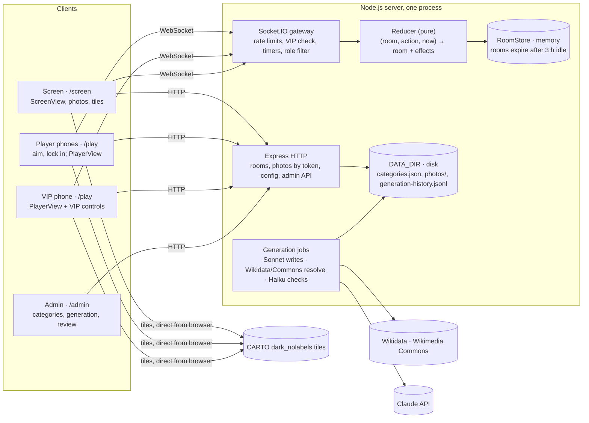
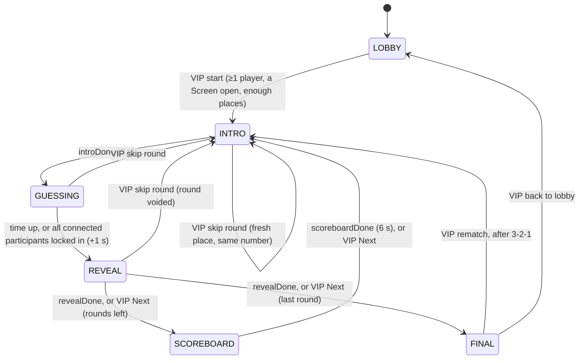

# Pinpoint — Build Spec

Nov 7, 2026

## Note to Claude Code

Build this as one TypeScript web app: a Node server with Express and Socket.IO that serves a React client. Work through the milestones in the last section in order, and keep the app runnable after each one.

- The game logic lives in one pure, unit-tested reducer on the server. The server is the only source of truth; clients render the role-filtered state they are sent and hold no game logic.
- Decisions already made by Kim are marked **[decided]**. Defaults chosen on Kim's behalf are marked **[default]** and can change later. Unmarked rules follow from one of the two.
- Patterns come from the sibling games: Buzzr (`buzzer/`) for the room server, reducer, admin, generation and deploy, and Sketchy (`sketchy/`) for the VIP-style host, server-timed phases, pausing and rematch. Copy code from them where it fits, adapted and renamed. Never import across projects: Pinpoint has its own `package.json`, and there are no npm workspaces.
- If something here is ambiguous, pick the simplest option that satisfies the acceptance criteria and leave a `// SPEC-QUESTION:` comment, rather than inventing features.
- No accounts and no database. Rooms live in memory; built-in categories live in one JSON file.

## Overview

Pinpoint is a geography party game. The **Screen** (a laptop on a TV) shows a city name or a landmark photo. Each **Player** aims a crosshair on a map on their phone and locks in; the closer the pin, the more points. One player is the **VIP** and runs the game from their phone while also playing. Live at `https://pinpoint.kimnejudne.dev` on Kim's droplet.

### Goals

1. Anyone can join from a phone browser in under 15 seconds: scan the QR code or type a 4-letter room code. No app, no account.
2. A 10-round game for 8 players takes 10 to 12 minutes with no one touching anything but their own phone (see Game length).
3. No device ever learns the true location before the reveal (see Security).
4. The super-admin can add a new region with checked places, coordinates and freely licensed photos in one sitting, without typing coordinates by hand.

### Scope decisions

| Topic | Decision |
| --- | --- |
| Architecture | **[decided]** As in Buzzr: one Node process, Express + Socket.IO, serving the React client. Rooms in memory. No accounts, no database. |
| Host | **[decided]** No separate host. The first player to join is the VIP; the Screen has no game controls. |
| Players | **[decided]** 1–12 per room, solo play only, no teams. |
| Modes | **[decided]** One mode per game: **Name** (a city name) or **Picture** (a landmark photo). Never mixed. |
| Targets | **[decided]** Points only: cities and compact landmarks. Never countries, states or other areas. |
| Scoring | **[decided]** Up to 1000 per round by great-circle distance, scaled to the region; a bullseye scores 1000; the last rounds are multiplied; no speed bonus. |
| Categories | **[decided]** Built-in only, curated by one super-admin. Claude writes places; Wikidata gives coordinates; Wikimedia Commons gives photos. |
| Map | **[decided]** An unlabelled dark raster tile map. **[default]** CARTO `dark_nolabels`, with self-rendered Natural Earth tiles as the fallback (see Map tiles). |
| Look | **[decided]** An airport departures board: split-flap letters, amber on near-black, boarding-pass cards. |

## Roles and devices

Every room has two roles and one capability. The Screen is public, so it never receives anything secret. The VIP is a player with extra controls and no extra data.

| Role | Device | URL | Receives | Credential |
| --- | --- | --- | --- | --- |
| Screen | Laptop on a TV, or any big display | `/screen/:code` | ScreenView: join code and QR, the prompt, timer, which players have locked in, the reveal, scoreboard and finale | None. Anyone with the code may open it. Up to 4 Screens per room. |
| Player | Each person's phone | `/play/:code` | PlayerView: their own name, colour, emoji, score and rank, the prompt, their own crosshair and lock, their own result once the reveal reaches them | A private `playerKey` stored on the device |
| VIP | A capability of one player | same as Player | PlayerView plus the lobby settings, the player list and the controls for the current phase. Never the true location or other players' pins before the reveal. | Being the room's `vipId` |

### Creating and joining a room

1. **Create (on the Screen device).** The landing page `/` has two equal choices: **Join a game** (code input) and **Show a game on this screen**, with the hint "Use the device everyone can see: a laptop on the TV." Show calls `POST /api/rooms` and opens `/screen/:code`.
2. **Click to start.** The Screen shows a full-screen **Click to start** overlay. The click unlocks audio, requests fullscreen where supported, and requests a Screen Wake Lock.
3. **Players join** by scanning the lobby QR (`/play/:code`) or typing the code at `/`. The join form has a name (1–16 characters, trimmed, unique in the room ignoring case), a grid of 24 emoji (one per player, unique in the room; taken ones are disabled) and **Join**. The player gets the first free colour from the palette (see Look and tokens).
4. **Room codes** are 4 letters from `ABCDEFGHJKMNPQRSTUVWXYZ` (no I, L or O), random, retried on collision and on Buzzr's blocked-word list.
5. A 13th player gets "This game is full (12 players)". A kicked player gets "You were removed from this game".

### VIP

- **[decided]** The first player to join is the VIP. Their tile on the Screen and their row on the board carry a ★ badge.
- **[decided]** If the VIP leaves, VIP passes to the longest-connected remaining player: the connected player with the earliest `connectedSince`. Leaving means tapping **Leave game**, being disconnected for `VIP_AWAY_MS` (60 s) **[default]**, or (impossible for the VIP) being kicked. A VIP who reconnects within 60 s is still VIP. A former VIP who comes back later is an ordinary player.
- With no connected player left, `vipId` stays on the last VIP until someone connects; the first player to connect then becomes VIP.
- When VIP moves, the new VIP's phone shows the toast "You're the VIP now ★".
- The VIP cannot kick themselves. There is no voluntary hand-over in v1 (see Out of scope for v1).
- Every VIP action is checked in the reducer against `room.vipId`; a socket that is not the VIP's gets `{ok: false, error: 'Only the VIP can do that'}`.

## Tech stack and architecture

One TypeScript project, deployed as a single always-on Node process that serves the realtime API, the HTTP API, the stored photos, the fallback tiles and the built React app.



| Layer | Choice | Notes |
| --- | --- | --- |
| Runtime | Node 24, TypeScript `strict: true` | Shared types and zod schemas in `shared/` |
| Server | Express 5, Socket.IO 4 | One instance only: rooms are in memory |
| Client | React 19 + Vite, React Router, Tailwind CSS 4, Zustand holding the latest snapshot | Phone-first; the Screen scales from a 1920×1080 design |
| Map | Leaflet 1.9, used directly through a small `useLeafletMap` hook (no react-leaflet) | Raster tiles, pinch zoom, a CSS crosshair overlay. Light (about 40 KB gzipped) |
| Validation | zod 4 | Every socket payload and HTTP body, on the server; the same schemas on the client |
| Images | `sharp` (server only) | Re-encodes Commons photos to WebP and strips all metadata |
| Generation | `@anthropic-ai/sdk` | `claude-sonnet-5-5` writes, `claude-haiku-5-5` checks with web search, as in Buzzr |
| QR codes | `qrcode.react` | Join QR |
| Sound | Howler.js, files in `client/public/sounds` | Screen only; royalty-free or self-made sounds |
| Fonts | `@fontsource/jetbrains-mono`, `@fontsource-variable/inter`, self-hosted | No font CDN at runtime |
| Tests | Vitest (+ Testing Library, jsdom); Playwright for one end-to-end smoke | No test reaches the network |
| Lint | eslint + typescript-eslint + prettier, as in Buzzr | |
| Deploy | Dockerfile, Kim's droplet, as Buzzr's README Deploy section | See Milestones and acceptance criteria |

### Folder layout

```
pinpoint/
  shared/        types.ts, schemas.ts, constants.ts (palette, emoji, limits, timers),
                 geo.ts (haversine, region scale, box helpers, geodesic interpolation),
                 scoring.ts (points, multipliers, mixed plan, ranks, awards)
  server/        index.ts, env.ts, http.ts, sockets.ts, reducer.ts, views.ts (toView),
                 roomStore.ts, codes.ts, placePicker.ts, photos.ts, admin.ts, adminRoutes.ts,
                 categoryStore.ts, generate/{anthropic,generator,resolver,wikimedia,jobs,
                 history,pricing,fake,routes}.ts, *.test.ts
  server/assets/fallback-tiles/{z}/{x}/{y}.png
  scripts/       render-fallback-tiles.ts, admin-hash.ts
  client/        src/pages/{Landing,Play,Screen,Credits,Admin,AdminGenerate,AdminCategory,
                 AdminLevel,AdminHistory}.tsx
                 src/components/{SplitFlap,BoardingPass,Crosshair,MapView,PinMarker,...}.tsx
                 src/lib/{socket,tiles,sounds,clock}.ts
                 public/sounds/
  docs/          SPEC.md (this file)
  .claude/scripts/spec.mjs (copied from Buzzr)
  Dockerfile, deploy/, README.md
```

### Map tiles

**[default]** Primary: **CARTO `dark_nolabels`** raster tiles, `https://{s}.basemaps.cartocdn.com/dark_nolabels/{z}/{x}/{y}{r}.png?key=<key>`. It is the requested look: near-black land, dark water, faint coastlines and country borders, state and province borders from about zoom 4, and no labels at any zoom.

What CARTO's terms mean here (checked 2026-11-07 at `docs.carto.com/faqs/carto-basemaps` and `carto.com/legal/basemap-terms`):

- Since 25 September 2026 raster tiles need an API key (`key` query parameter). A key is free. A key is therefore unavoidable for CARTO.
- Pinpoint is Non-Commercial Use under §1.g (personal, free, no ads, not run by a business). The free limit is 5,000,000 tile requests per UTC calendar month (§12.c). Kim registers the key as non-commercial.
- §9.c.3 forbids proxying or caching tiles on the server, and §9.c.1 forbids bulk downloading. So the browser must fetch tiles from CARTO directly, and **the key reaches the browser** inside the tile URL. This is the one place where "the key lives only in the server env" cannot fully hold; see Open questions for Kim.
- Browser caching is allowed for up to 30 days (§9.c.2). Pinpoint adds no service worker or other tile cache of its own.
- Attribution "© OpenStreetMap contributors © CARTO" must be visible on every map, including phones and screenshots (§13).

How the key is handled:

- `PINPOINT_CARTO_KEY` is set only in the server environment (`/opt/pinpoint/.env` on the droplet, `pinpoint/.env` in development). It is never in the repository or the client bundle.
- `GET /api/config` returns the tile URL template with the key filled in. Clients read the template at runtime.
- In CARTO's dashboard, the production key has a **website restriction** to `pinpoint.kimnejudne.dev`. Development uses a separate key restricted to `localhost`, or no key (the fallback tiles).
- Pages send `Referrer-Policy: strict-origin-when-cross-origin`, so tile requests carry the origin the website restriction needs. Never `no-referrer`.
- The key is never logged. Request logging redacts any `key=` query parameter.

Budget: a phone shows about 10 tiles per view and about 80 per round with panning and zooming; the TV about 90 per reveal. A 10-round game with 8 players is about 10 × (8 × 80 + 90) ≈ 7,300 requests before browser caching, so 5,000,000 a month is about 680 games. Leaflet runs with `keepBuffer: 1` and `updateWhenZooming: false` to keep requests down. Map max zoom is 13 (about 19 m per pixel), which is more than any bullseye needs.

**[default]** Fallback: **self-rendered Natural Earth tiles**, served by Pinpoint itself at `/tiles/fallback/{z}/{x}/{y}.png`.

- `npm run tiles:fallback` renders zoom 0–6 from Natural Earth 1:10m (public domain) coastlines, land, lakes, country borders (admin-0) and, from zoom 4, state and province borders (admin-1). It uses `d3-geo` (Web Mercator) and `@resvg/resvg-js`, both dev dependencies. The output is committed under `server/assets/fallback-tiles/`. Identical all-water tiles are written once and served for every all-water address, keeping the folder under 20 MB.
- Colours: water `#0A0B0D`, land `#17181B`, coastline `#3A3D44` at 1 px, country borders `#4A4E57` at 0.75 px, state borders `#2E3137` at 0.5 px. No text.
- Leaflet uses it with `maxNativeZoom: 6` and `maxZoom: 13`, so it over-zooms (blurry above zoom 6). It is good enough to finish a game, not to play a small region well.
- Attribution "Made with Natural Earth".

When the fallback is used:

- `PINPOINT_CARTO_KEY` is unset: `GET /api/config` returns only the fallback template.
- On a client, 4 or more CARTO tile errors within 10 s with no CARTO tile loaded in that window switch every map on that page to the fallback until the page reloads, with a small "Simplified map" badge in the map's corner.

Considered and rejected: Stadia Maps (free non-commercial tier, 200,000 credits a month, domain authentication without a key, but no confirmed dark no-labels raster style), Esri basemaps (account terms), and self-hosting a full OpenStreetMap tile server (far beyond a hobby droplet).

**Panning is clamped [default].** The round map's `maxBounds` is the region box padded by 25% of its width and height on each side (latitude clamped to ±85.05°), with `maxBoundsViscosity: 1.0`. `minZoom` is the zoom that fits the padded box. Why: on a small region (Tuscany is 236 km across) an unclamped map lets a player fling themselves into the Atlantic and spend the round finding their way back; clamping also bounds tile requests. The padding still lets a player aim beyond the box edge, so a wild miss is possible and scores near zero. The World category has no horizontal clamp (`worldCopyJump: true`); latitude is clamped to ±85.05°.

## Game flow and state machine

A game is `rounds` rounds. Each round is INTRO → GUESSING → REVEAL, followed by SCOREBOARD except after the last round, which goes to FINAL.



**End game** jumps from any phase but LOBBY and FINAL to FINAL. **Pause** is a flag over the phase (see Pausing), not a phase.

### Phases

| Phase | What happens | Lasts |
| --- | --- | --- |
| LOBBY | Players join and practise; the VIP picks settings | Until the VIP starts |
| INTRO | The gate label flaps in ("Round 9/10 · ×1.5 · Now boarding"); a boosted round announces its multiplier; the phone shows "Get ready" | `INTRO_MS` 3 s |
| GUESSING | The prompt shows; players aim and lock in | `timerSeconds` (20, 30 or 45) + `GRACE_MS` 300 ms, or `ALL_LOCKED_MS` 1 s after the last connected participant locks in |
| REVEAL | Staged reveal on the Screen; each phone flips when the Screen reaches its player | 3 s + one step per revealed player + 1.5 s, about 12 s (see Reveal timeline) |
| SCOREBOARD | Departures-board standings | `SCOREBOARD_MS` 6 s |
| FINAL | Podium, boarding passes, awards; Rematch and Back to lobby | Until the VIP acts or the room expires |

### Transitions

Implement these in `server/reducer.ts` as a pure function `reduce(room, action, now) → {room, effects}`. `now` is server monotonic ms (`performance.now()` based). Any action not listed for the current phase is rejected with an error and no change. While `paused` is set, `player:aim`, `player:lockIn`, `vip:next` and `vip:roundSettings` are rejected; joins, leaves, kicks, `vip:resume`, `vip:skipRound` and `vip:end` still work.

| From | Trigger | To | Effects |
| --- | --- | --- | --- |
| LOBBY | `vip:start`, at least 1 connected player, at least 1 Screen connected, place check passes (see Place selection) | INTRO, round 1 | **New game** (below); **open round** (below) |
| INTRO | `timer introDone` | GUESSING | `startedAt = now`, `endsAt = now + timerSeconds × 1000`; schedule `guessUp` at `endsAt + GRACE_MS`; `participants` = every player in the game (not waiting); mark connected ones in `everConnected` |
| GUESSING | `player:aim {lat, lng}` from a participant who has not locked in | GUESSING | Store as that player's aim. Nothing is sent to anyone |
| GUESSING | `player:lockIn {lat, lng}` from a participant who has not locked in | GUESSING | Store the lock (final; a second lock-in is rejected); `fx lockedIn {playerId}` to Screens; when every connected participant has locked in, schedule `allLocked` in `ALL_LOCKED_MS` |
| GUESSING | `timer guessUp` or `timer allLocked` | REVEAL | **Score the round** (Scoring rules); set the reveal order; schedule the reveal timers (Reveal timeline) |
| REVEAL | `timer revealTarget` or `timer revealStep k` | REVEAL | Advance `revealStage` / `revealedCount` |
| REVEAL | `timer revealDone` or `vip:next` | SCOREBOARD, or FINAL after the last round | On `vip:next`, set `revealedCount` to all; SCOREBOARD schedules `scoreboardDone` |
| SCOREBOARD | `timer scoreboardDone` or `vip:next` | INTRO, next round number | **Open round** |
| SCOREBOARD | `vip:roundSettings {timerSeconds?, rounds?}` | SCOREBOARD | See VIP controls (Between-round settings) |
| INTRO, GUESSING, REVEAL | `vip:skipRound` | INTRO, same round number | Void the round: its results are discarded, nobody scores. The place stays in `usedPlaceIds`. **Open round** draws a fresh place. Refused with "No spare places left at Hard" when the level's pool has no unused place |
| INTRO, GUESSING, REVEAL, SCOREBOARD | `vip:end` | FINAL | A round not yet revealed is voided; a round in REVEAL counts as played |
| FINAL | `vip:rematch`, no countdown running, place check passes | FINAL, counting down | `rematchAt = now + REMATCH_COUNTDOWN_MS` (3 s); schedule `rematchGo`. Nothing is reset yet |
| FINAL, counting down | `vip:rematchCancel` | FINAL | Clear `rematchAt`; bump `timerEpoch` |
| FINAL, counting down | `timer rematchGo`, at least 1 connected player | INTRO, round 1 | **New game**; **open round** |
| FINAL, counting down | `timer rematchGo`, no connected player | FINAL | Clear `rematchAt` |
| FINAL | `vip:backToLobby` | LOBBY | Clear the game; keep players, settings and `placeUsage`; cancels a countdown |
| LOBBY | `vip:settings {...}` | LOBBY | Validate against the live category list; store |
| LOBBY | `player:practice {lat, lng}` | LOBBY | `fx practice {playerId}` to Screens; `fx practiceResult {distanceKm}` to that player only. Nothing is stored or scored. At most one per 2 s per player |
| Any | `player:join`, `player:leave`, `player:rename` (LOBBY only), `vip:kick`, connection changes, Screen joins and leaves | Same | See Reconnects, VIP and Kick |
| Any but LOBBY | `vip:pause` / `vip:resume` | Same | See Pausing |

**New game**: `game.number += 1`; scores to 0 (totals are derived from rounds, so this is clearing `rounds`); snapshot the category's live box, label style and places of the chosen mode into `game.pool` (see Place selection); compute `game.levelPlan` (see Mixed difficulty); clear `usedPlaceIds`; every current player is in the game. Rematch keeps players and settings; places come from the same preference rule, so they are new where the pool allows.

**Open round** (round number `r`): level = `levelPlan[r − 1]`; multiplier from Escalation; draw a place (Place selection); for Picture mode, a fresh `photoToken`; phase INTRO; schedule `introDone` at `now + INTRO_MS`. Players who joined while waiting become part of the game here.

**Kick** (`vip:kick {playerId}`): removes the player and every result row of theirs, adds their id to `kickedIds`, sends them `kicked`. During GUESSING, if every remaining connected participant has locked in, schedule `allLocked`.

### Pausing

`room.paused` is `null` or `{reasons, since, remainingMs, resumeAt}`. It resumes only when every reason is cleared.

| Reason | Set when | Cleared when |
| --- | --- | --- |
| `vip` | `vip:pause` in INTRO, GUESSING, REVEAL or SCOREBOARD | `vip:resume` |
| `screenAway` | No Screen has been connected for `SCREEN_AWAY_MS` (3 s) during INTRO, GUESSING, REVEAL or SCOREBOARD | A Screen joins |

- Pausing stores the remaining time of the phase's next timer (and, in REVEAL, of every remaining reveal timer) and bumps `timerEpoch`, so every timer already in flight is ignored.
- During a paused GUESSING, the Screen's gate label reads **Delayed** and its timer stops; phones cover the map with "Delayed · the VIP paused the round" (or "Waiting for the Screen…") and disable Lock in. `player:aim` and `player:lockIn` are rejected, so no one gains search time.
- A paused REVEAL holds at its current step; a paused SCOREBOARD holds the board.
- Clearing the last reason sets `resumeAt = now + RESUME_COUNTDOWN_MS` (3 s) and schedules `resumeGo`. Every view shows 3-2-1. `resumeGo` restarts the stored timers with their remaining time and moves `endsAt` forward by the paused duration.

### Scheduled timers

The reducer never sets timers. It returns `schedule` effects `{at, timer, round, epoch}`; the gateway calls `setTimeout` and later dispatches `{type: 'timer', timer, round, epoch}`. The reducer ignores a timer whose round number, game number or `epoch` doesn't match, so a fast VIP or a pause never causes a stale transition (Buzzr's opening counter, Sketchy's `timerEpoch`).

| Timer | Scheduled | Fires after |
| --- | --- | --- |
| `introDone` | entering INTRO | `INTRO_MS` 3000 ms |
| `guessUp` | entering GUESSING | `timerSeconds × 1000 + GRACE_MS` (300 ms) |
| `allLocked` | the last connected participant locks in | `ALL_LOCKED_MS` 1000 ms |
| `revealTarget` | entering REVEAL | 1500 ms |
| `revealStep k` | entering REVEAL, one per revealed player, k = 0…n−1 | `3000 + k × STEP` ms |
| `revealDone` | entering REVEAL | `3000 + n × STEP + 1500` ms |
| `scoreboardDone` | entering SCOREBOARD | `SCOREBOARD_MS` 6000 ms |
| `screenGone` | the last Screen disconnects in a timed phase | `SCREEN_AWAY_MS` 3000 ms |
| `vipGone` | the VIP disconnects | `VIP_AWAY_MS` 60000 ms |
| `resumeGo` | the last pause reason clears | `RESUME_COUNTDOWN_MS` 3000 ms |
| `rematchGo` | `vip:rematch` | `REMATCH_COUNTDOWN_MS` 3000 ms |

### Reveal timeline

`n` is the number of players with a scored position this round (participants who did not miss it). `STEP = clamp(round(7500 / n), 600, 1800)` ms.

| Time from REVEAL start | Screen | Phones |
| --- | --- | --- |
| 0 | Every pin drops at once (each pin animates 450 ms, staggered 60 ms in random order, one thud per pin). No lines, no names | Face-down card |
| 1.5 s (`revealTarget`) | The true location lands with a flap: target marker, the place name flaps in, the one-line fact under it | Face-down |
| 3.0 s + k × STEP (`revealStep k`) | Player k's line draws from their pin to the target (400 ms), and their row ticks in on the rail: distance, then points counting up (600 ms), multiplier, "Bullseye" stamp when they hit one | Player k's phone flips to their boarding pass |
| last step | The closest player goes last, tagged **Closest** | |
| last step + 1.5 s (`revealDone`) | SCOREBOARD, or FINAL after the last round | |

Order: by distance descending, ties by `joinedAt` ascending, so the closest player is revealed last. Every player tied for the smallest distance gets the **Closest** tag. With n = 8 the reveal lasts 3 + 8 × 0.94 + 1.5 = 12 s; with n = 1, 6.3 s; with n = 12, 12 s; with n = 0, 4.5 s (target only).

### Place selection

`server/placePicker.ts`, pure, with a seeded PRNG (`mulberry32`, state in `room.rngState`) so tests are deterministic.

- **Pool.** At New game, the server snapshots the live places of the chosen category and mode into `game.pool[level]` for every level the game needs. In Picture mode, the gateway first drops any place whose photo file is missing from disk (so a broken file never reaches a round). Later admin edits never change a running game.
- **Never within a game.** A place in `game.usedPlaceIds` is never drawn again in that game, including after a Skip.
- **Across games in the room.** `room.placeUsage[placeId]` holds the game number that last used the place. The picker prefers places with no entry; among used ones it takes the lowest game number (least recently used). Ties are broken by the PRNG.
- **Enough places.** Start and Rematch are refused when, for any level the game needs, the pool of that level in the chosen mode has fewer places than the rounds the plan assigns to it. The refusal names it: "Japan · Hard has 8 landmarks; this game needs 10." Places used in earlier games still count as available.
- **Minimum to offer [default].** The lobby offers a (category, mode, level) only when it has at least `MIN_PLACES_TO_OFFER` = 5 live places, so 5 rounds always fit. Mixed is offered when each level has enough for its share of 5 rounds. Rounds options the pool cannot fill are greyed out with the reason.

### Mixed difficulty

**[decided]** Mixed plays the first third of the rounds at Easy, the middle third at Medium and the last third at Hard. **[default]** Rounding: `easy = hard = round(N / 3)`, `medium = N − 2 × round(N / 3)`.

| Rounds | Easy | Medium | Hard |
| --- | --- | --- | --- |
| 5 | 1–2 | 3 | 4–5 |
| 10 | 1–3 | 4–7 | 8–10 |
| 15 | 1–5 | 6–10 | 11–15 |

When the VIP changes the round count mid-game, the plan is recomputed for the new total, and only rounds not yet played take their level from it. Played rounds keep theirs. The change is refused when a level the new plan needs has fewer unused places left in the pool than the new plan's remaining rounds at that level.

### Game length

A round is 3 s intro + up to 30 s guessing (often less, since it ends 1 s after everyone locks in) + about 12 s reveal + 6 s scoreboard ≈ 51 s at most. 10 rounds ≈ 8.5 minutes plus the finale, so 10–12 minutes with joining.

## Scoring rules

### Distance and region scale

- Distance `d` is the great-circle distance between the player's position and the true location, by the haversine formula with Earth radius 6371.0088 km, in km.
- Every category has a region **box** `{south, west, north, east}` in degrees. `east` may exceed 180 to cross the antimeridian (`east − west` is in (0, 360]).
- The region **scale** `S` is `min(20000, √(h × w))`, where `h = (north − south) × 111.195` km and `w = (east − west) × 111.195 × cos(midLatitude)` km, `midLatitude = (north + south) / 2`. The cap of 20,000 km (half Earth's circumference) applies to the World box.
- The **bullseye radius** is `b = 0.01 × S`.
- A box must give `S ≥ 150` km (bullseye ≥ 1.5 km). The admin cannot save a smaller one.

### Points formula

```
basePoints(d, S) = 1000                                         if d ≤ b        (bullseye)
                 = floor(1000 × exp(−8 × (d − b) / S))           if d > b
points           = round(basePoints × multiplier)               (Math.round, half up)
```

- `FALLOFF = 8` **[default]**. With it, a miss of 5% of the region's scale keeps about 73% of the points, 10% keeps about half, and 25% keeps about 15%. The formula is continuous at `b`, and `floor` makes 1000 reachable only by a bullseye.
- A bullseye scores 1000 before the multiplier, and the Screen flaps "BULLSEYE" when that player's row is revealed.
- **No speed bonus.** Lock-in time never affects points.
- Missed rounds score 0 and show "—". A participant missed a round when they were not connected at any moment of its GUESSING phase.
- **Unlocked players.** At time-up, each participant who has not locked in is scored at their current crosshair position: their last `player:aim`, or, when no aim arrived this round, the centre of the opening view (the Web Mercator centre of the region box). This is so whether or not they moved the map. Their row says "Not locked in".

### Worked table

Distances are the same fractions of `S` in every row, so every row scores the same points: a miss costs the same in proportion to the region. All values come from the formula above; the unit test `scoring.test.ts` asserts every cell.

| Region (box S, W → N, E) | S | Bullseye radius `b` | 2.5% of S | 5% of S | 10% of S | 25% of S | 50% of S |
| --- | --- | --- | --- | --- | --- | --- | --- |
| World (−58, −180 → 78, 180) | 20,000 km | 200 km | 500 km → 886 | 1,000 km → 726 | 2,000 km → 486 | 5,000 km → 146 | 10,000 km → 19 |
| Europe, a continent (34, −25 → 72, 45) | 4,449 km | 44.5 km | 111 km → 886 | 222 km → 726 | 445 km → 486 | 1,112 km → 146 | 2,224 km → 19 |
| Japan, a country (30, 129 → 45.5, 146) | 1,605 km | 16.1 km | 40 km → 886 | 80 km → 726 | 161 km → 486 | 401 km → 146 | 803 km → 19 |
| Tuscany, a small region (42.2, 9.7 → 44.5, 12.4) | 236 km | 2.4 km | 5.9 km → 886 | 12 km → 726 | 24 km → 486 | 59 km → 146 | 118 km → 19 |

The same absolute miss in different regions: 100 km scores 1000 (bullseye) on World, 905 on Europe, 658 on Japan and 36 on Tuscany.

### Escalation

**[decided]** The last rounds score more:

| Rounds | Multipliers |
| --- | --- |
| 5 | rounds 1–3 ×1, round 4 ×1.5, round 5 ×2 |
| 10 | rounds 1–7 ×1, rounds 8 and 9 ×1.5, round 10 ×2 |
| 15 | rounds 1–12 ×1, rounds 13 and 14 ×1.5, round 15 ×2 |

- The multiplier applies after the distance score and the bullseye. Maximum per round: 2000. Example: 999 × 1.5 = 1498.5 → 1499.
- When the VIP changes the round count, multipliers are recomputed for rounds not yet played. A played round keeps the multiplier and points it was scored with. Example: a 5-round game where round 4 was played at ×1.5 and then extended to 10 keeps round 4's points; rounds 8–10 are then boosted.
- The Screen announces a multiplier above ×1 during INTRO (the flap row "×1.5 BONUS ROUND" or "×2 FINAL ROUND") and keeps it on the gate label: "Round 9/10 · ×1.5 · Boarding". Rounds at ×1 show no multiplier.

### Ranking and ties

- A player's total is the sum of their points over the game's played rounds.
- Rank uses standard competition ranking: equal totals share a rank and the next rank skips (1, 2, 2, 4). Phones show "3rd of 8" and "=2nd of 8" for a shared rank.
- Lists with equal totals order by `joinedAt` ascending, for display only.

### Travel awards

**[decided]** Shown on the finale only with 3 or more players in the final standings. **[default]** Exact rules:

- A player is **eligible** for awards when they played at least half the game's played rounds, rounded up (missed rounds don't count as played).
- Awards are processed in this order. For each, eligible players are ranked by the award's stat; the winner is the best-ranked player who has not already won an award; players tied on the stat at that position share it. An award with no qualifying winner is skipped. At most 3 awards are shown.

| Award | Stat | Qualifies when |
| --- | --- | --- |
| **Pinpoint Pilot** | Most bullseyes in the game | The winner has at least 1 bullseye |
| **Lost Luggage** | Biggest single-round distance | Always |
| **Frequent Flyer** | Most total km missed over played rounds | Always |
| **Smooth Landing** | Smallest single-round distance, bullseyes included | Always |

With 3 or more eligible players this always yields 3 awards. Each award card shows the stat ("4,812 km from Lima").

## UI spec by view

### Look and tokens

**[decided]** An airport departures board: amber and warm white on near-black, split-flap letters, gate-style labels, boarding-pass cards. **[default]** tokens, defined once as CSS custom properties and in `shared/constants.ts` where the server or tests need them:

| Token | Value | Use |
| --- | --- | --- |
| `--board-bg` | `#0B0C0E` | Page background on every view |
| `--board-panel` | `#15171B` | Panels, rails, sheets |
| `--flap-bg` | `#1C1E22`, seam `#050506` 2 px across the middle | Each split-flap cell |
| `--amber` | `#FFB000` | Primary accent: flap text, gate labels, Lock in, VIP badge |
| `--amber-dim` | `#8A6200` | Disabled accent, inactive tabs |
| `--text` | `#F2E9D8` | Body text |
| `--text-dim` | `#8C8578` | Secondary text, credits |
| `--line` | `#2A2D33` | Dividers, card borders |
| `--delayed` | `#FF4D4F` | "Delayed", last 5 s of the timer |
| `--on-time` | `#3DDC84` | "Locked in", connected dot |
| `--pass-bg` | `#F2E9D8` with text `#0B0C0E` | Boarding-pass cards (the one light surface) |

Type:

- **Board face**: JetBrains Mono ExtraBold (800), uppercase, for flaps, gate labels, timers, distances and points. Tabular figures.
- **Body face**: Inter (variable), for sentences, forms and admin.
- Self-hosted woff2 via Fontsource.

Sizes (Screen, at 1920×1080; the Screen scales every size by `min(100vw / 1920, 100vh / 1080)`):

| Element | Size |
| --- | --- |
| Prompt flaps (city name) | cell 72 × 104 px, glyph 64 px, 6 px gap; up to 22 cells per row, 2 rows |
| Gate label | 40 px board face |
| Timer | 120 px board face, flap digits |
| Room code in the lobby | 200 px flaps |
| Player tile | 128 × 128 px, emoji 64 px, name 24 px |
| Reveal rail row | 72 px tall; name 28 px, distance and points 32 px |
| Scoreboard row | 64 px tall, 36 px text |
| Fact line | 32 px body face |
| Photo credit | 22 px, `--text-dim` (the smallest text on the Screen) |
| Map attribution | 16 px |

Sizes (phones, 360–430 px wide): base 16 px body; prompt bar 48 px tall with the city name at 20 px board face (shrinking to 14 px to fit, then wrapping to two lines); Lock in button 64 px tall, full width minus 16 px margins; every tap target at least 48 × 48 px; boarding pass 100% width minus 32 px; map attribution 11 px.

Radii: flap cells 6 px (Screen) and 4 px (phone); cards and sheets 16 px; buttons 12 px; boarding passes 14 px with two 12 px semicircle notches cut into the sides at the tear line, and a dashed `--line` tear line.

Motion:

- **Flap**: each cell cycles through 6–14 glyphs from `A–Z 0–9 ·-` at 70 ms per glyph, then settles on its target character; cells start 25 ms apart from left to right; a full prompt settles within 1.6 s. A character outside the glyph set flips straight to itself on the last step.
- Pin drop 450 ms ease-out with a 4 px bounce; line draw 400 ms linear along the geodesic; points count-up 600 ms; boarding-pass flip 500 ms 3D rotate on Y.
- `prefers-reduced-motion: reduce`: flaps and flips become a 150 ms fade, count-ups show the final number, pins appear without dropping.

**Player identity.** **[decided]** Each player has a name, an emoji from a fixed list of 24 picked at join, and an automatic colour. **[default]** emoji: 🦊 🐼 🐸 🐙 🦄 🐯 🐵 🐧 🦉 🐢 🦁 🐨 🐷 🐮 🐰 🐻 🐳 🦩 🦜 🐝 🦀 🐌 🦔 🐲.

**[default]** Palette, assigned in this order (first free slot): `#56B4E9` sky, `#E5603A` vermillion, `#44BB99` mint, `#FFAABB` pink, `#4477EE` blue, `#BBCC33` pear, `#F2F2F2` white, `#CC6677` rose, `#99DDFF` ice, `#AA4499` purple, `#EEDD88` sand, `#9F7FE0` lilac. The test is the authority, not this list: `palette.test.ts` simulates protanopia, deuteranopia and tritanopia (Machado 2009 matrices, severity 1.0) and asserts a CIEDE2000 ΔE of at least 8 between every pair under each simulation and at least 15 with normal vision, and at least 15 between every colour and `--amber`. If this list fails, the builder adjusts it until the test passes and records the final list in `docs/DECISIONS.md`. Colour is never the only cue: every pin, tile and row also carries the player's emoji.

**Pin marker**: a 40 px (Screen) or 32 px (phone mini map) teardrop in the player's colour with a 3 px `--board-bg` outline and their emoji (60% of the marker's width) inside; its tip is the exact position. **Target marker**: an amber ring 28 px with a 6 px amber dot and a pulsing ring (1.2 s period). **Lines**: the great circle from pin to target, 3 px, in the player's colour, drawn as a 64-segment geodesic (`shared/geo.ts`, no plugin).

### Landing page `/`

- The wordmark as a row of flaps ("PINPOINT"), and the one line "Find it on the map. Closest pin wins."
- **Join a game** (4-letter code, auto-uppercase) and **Show a game on this screen**, side by side on a laptop and stacked on a phone, with equal weight.
- No link to `/admin`.

### Screen view `/screen/:code`

Designed for 1920×1080, legible from 5 m. A 48 px strip along the bottom always shows "Join at pinpoint.kimnejudne.dev · code ABCD" so late joiners can get in. The Screen has no game controls. Keys: `M` cycles Sound / Quiet / Muted (stored on this device), `F` toggles fullscreen, `?` lists the two.

- **Lobby**: the room code in 200 px flaps, the QR code to `/play/:code`, the join URL in text, and joined players as tiles (emoji in a rounded square bordered in their colour, name under it, ★ on the VIP) that pop in. A practice lock-in wiggles that player's tile for 600 ms. Under the tiles, the VIP's current settings as a departures row: "WORLD · NAME · MIXED · 10 ROUNDS · 30 S". With no player yet: "Waiting for the first player: they'll be the VIP".
- **Intro**: the gate label flaps in large at the centre ("ROUND 3/10 · NOW BOARDING"); on a boosted round the multiplier row flaps in under it; chime.
- **Guessing, Name mode**: the gate label top left ("Round 3/10 · Boarding"), the timer top right, the city's display name in flaps at the centre (clatter as it flaps in), and the player tiles along the bottom. A tile lights amber with "LOCKED IN" when that player locks in. In the last 5 s the timer turns `--delayed`, the gate label reads "Final call" and a tick plays each second. No map and no pins.
- **Guessing, Picture mode**: the same, with the photo instead of the flaps: contained (never cropped) in a 1500 × 820 px area with a 2 px `--line` frame, and the credit line under it (see Photos and credits). Clatter plays as the gate label flaps in.
- **Paused**: the gate label reads "Delayed" in `--delayed`, the timer stops, and a banner says "Delayed · the VIP paused the game". On resume a 3-2-1 flaps. (A `screenAway` pause is only ever seen on phones, since it means no Screen is connected.)
- **Reveal**: a top band with the place's name in flaps and the fact line under it (in Picture mode, a 240 px thumbnail of the photo and the full credit at its side). Below, the map on the left (1340 px wide) and the rail on the right (580 px). The map is non-interactive and fits the target and every pin with 80 px padding, never zooming in past 11. The rail fills from the top as rows tick in (Reveal timeline): rank chip, emoji, name, distance ("412 km"; one decimal under 10 km), points ("+812", then "×1.5 → 1,218" on a boosted round), and tags "BULLSEYE", "CLOSEST", "NOT LOCKED IN". Missed players are not on the map and appear last on the rail with "—".
- **Scoreboard**: a full-screen departures board, one row per player: rank, emoji tile, name in flaps, this round's points, total, and movement since the last board (▲2, ▼1, or nothing). Rows reorder with a 600 ms slide.
- **Final**: see Finale.
- **Game ended**: "This game has ended" with a link home, when the room is gone.

### Finale

Timings from entering FINAL **[default]**: podium 3rd step at 0.6 s, 2nd at 1.8 s, 1st at 3.0 s with the fanfare; boarding passes slide in from 5.0 s, 150 ms apart; awards from 8.0 s, one every 2.5 s, each as a flap card; then everything stays.

- **Podium** for the top 3 ranks; shared ranks stand on the same step. With 1 or 2 players, only their steps.
- **Boarding pass per player** (all players, in rank order, in a grid of up to 4 × 3): name, emoji and colour stripe, rank, total, best round ("Round 7 · Osaka · 960"), and average distance over played rounds ("Avg 318 km").
- **Travel awards** (3+ players; see Travel awards).
- "Photo credits: pinpoint.kimnejudne.dev/credits/ABCD" in Picture mode.
- **Rematch countdown**: a 3-2-1 in 200 px flaps over the finale; on 0, round 1 of the next game begins.

### Player view `/play/:code`

Phone-first. Wake Lock while the room is open; no page zoom, text selection or long-press menu on the map. A slim top bar shows the emoji, name, total, rank ("3rd of 8"), a connection dot (green / amber / red), ★ VIP button for the VIP, and a ⋯ menu with **Change name** (lobby only) and **Leave game**.

1. **Join form**: name, emoji grid, Join. Name, emoji and `playerKey` are remembered per room code, so a refresh rejoins silently.
2. **Lobby**: "Waiting for ★ Mika to start" (or the VIP's controls; see VIP controls), the read-only settings row, and the **practice map**: "Practice: find 0°, 0°". It is the real map component on the World box, unclamped, with the crosshair and Lock in. Locking in shows "1,240 km from 0°, 0°" for 3 s and a **Try again** button; the Screen wiggles their tile. Nothing is scored.
3. **Intro**: "Round 3 of 10" and the multiplier when boosted, over the map already loaded on the region box (so tiles are cached when guessing starts). The map is not yet interactive.
4. **Guessing**: the map fills the screen between the prompt bar and the Lock in button.
   - The **crosshair** is fixed at the centre of the map: a 44 px amber cross with an 8 px gap at its centre and a 2 px `--board-bg` outline, `pointer-events: none`. Players pan and pinch-zoom the map under it. Two 48 px zoom buttons (+, −) sit at the right edge for one-handed use. The map opens fitted to the region box.
   - The **prompt bar** (48 px): in Name mode, the city's display name; in Picture mode, a 72 × 48 px thumbnail (from the same opaque round token as the Screen) that opens full screen on tap, with pinch zoom and a close button. The timer sits at the right of the bar.
   - The phone sends `player:aim` with the crosshair's position (Leaflet `getCenter().wrap()`) on `move`, throttled to one per 250 ms, and on `moveend`. No other device ever receives it before the reveal.
   - **Lock in** commits the crosshair's position. It is final: there is no unlock. The phone vibrates 30 ms on Lock in and `[60, 40, 60]` at the 5 s warning. Phones are silent.
5. **Locked in**: a "Boarding · Locked in" boarding-pass card with the timer, the emoji of the participants still guessing (shrinking as they lock in), and the player's own pin frozen on a non-interactive mini map (180 px tall, at the zoom they locked in at).
6. **Reveal**: a face-down card (the Pinpoint wordmark pattern) until the Screen reaches this player, then a flip to the boarding pass: distance, base points, multiplier when above ×1, round points, new total, rank ("3rd of 8"), and a "BULLSEYE" or "CLOSEST" stamp when earned. No map on the phone. A player who missed the round sees "Missed this round · 0".
7. **Scoreboard**: their boarding pass stays, with the new rank and "Next: Round 4 of 10".
8. **Waiting (joined mid-game)**: a "Next departure" card: "You're in from round 5. You start at 0." From the next INTRO they play.
9. **Final**: their own boarding pass (as on the finale) and their awards, if any.
10. **Kicked**: "You were removed from this game" with a link home. **Room gone**: "This game has ended".

### VIP controls

**[decided]** The VIP runs the game from their phone and also plays.

**Lobby** (the VIP's lobby is the settings view): a settings card above the practice map with:

- **Category**: cards (emoji, name, and per level the number of places in the chosen mode), with a search box once there are more than 8; one tap picks. Unavailable combinations are greyed with the reason.
- **Mode**: Name / Picture (segmented). **[default]** Name.
- **Difficulty**: Easy / Medium / Hard / Mixed. **[default]** Mixed.
- **Rounds**: 5 / 10 / 15. **[decided]** default 10.
- **Timer**: 20 / 30 / 45 s. **[decided]** default 30.
- **Start ▶**, full width, disabled with the reason: "Open the Screen first", "Pick a category", "Japan · Hard has 8 landmarks; this game needs 10".
- The VIP's last settings are remembered on their device (`localStorage`) and applied to the next room they lead, ignoring a category that no longer exists. **[default]** The first category offered is World when it exists, else the first by name.

**In game**: the ★ button in the top bar opens a bottom drawer over the player's own view (it never opens by itself, so it never covers the map by accident):

| Phase | Controls |
| --- | --- |
| INTRO, GUESSING | Pause / Resume, Skip round (two taps: "Tap again to skip"), Players (Kick, two taps), End game (two taps) |
| REVEAL | Next, Pause / Resume, Skip round (two taps: "Tap again to void this round"), End game |
| SCOREBOARD | Next, Pause / Resume, Round settings, Players, End game |
| FINAL | **Rematch** (big), Back to lobby (two taps), Players |
| FINAL, counting down | **Cancel** |

- **Next** skips ahead: REVEAL to the scoreboard (or the finale), SCOREBOARD to the next round.
- **Pause** freezes the round timer in GUESSING (see Pausing) and holds the reveal or scoreboard.
- **Skip round** voids the current round: nobody scores, a fresh place is drawn at the same level, and the round number does not advance.
- **Kick** removes a player and their board row; their `playerId` cannot rejoin this room.
- **Round settings** (Between-round settings), SCOREBOARD only: timer 20 / 30 / 45 s and total rounds 5 / 10 / 15. A round count at or below the number of rounds already played is disabled. Category, mode and difficulty are fixed for the game. Changes apply from the next round; multipliers and the Mixed plan are recomputed for unplayed rounds only.
- **End game** goes to the finale with the rounds played so far. With 0 played rounds the finale shows "No rounds played" and Rematch / Back to lobby.

### Photos and credits

- During GUESSING the credit line under a photo reads "Photo: ‹author› · ‹licence›". If the author text contains any word of 4 or more letters from the place's name, display name or country (case- and accent-insensitive), it reads "Photo: Wikimedia Commons contributor · ‹licence›" instead, so the credit never names the answer.
- In REVEAL the full credit shows: "Photo: ‹author›, ‹licence›, via Wikimedia Commons".
- `/credits/:code` is a public page listing the photos of the rounds already revealed in that room's current and previous games: thumbnail, place name, author, licence with its link, and the Commons file page link. It never lists an unrevealed round.

### Sound and haptics

**[decided]** Screen only, with Howler. `M` cycles Sound (100%), Quiet (40%) and Muted, stored on the Screen device.

| Sound | When |
| --- | --- |
| `flap.mp3` | Split-flap clatter whenever a prompt or gate label flaps in, trimmed to the flap's length |
| `chime.mp3` | Two-tone chime at the start of GUESSING |
| `tick.mp3` | Each of the last 5 s of GUESSING |
| `thud.mp3` | Each pin landing at the start of the reveal |
| `fanfare.mp3` | The 1st podium step on the finale |

Phones never play sound. They vibrate (where supported) on Lock in (30 ms) and at the 5 s warning (`[60, 40, 60]`).

## Admin

**[decided]** Full Buzzr admin parity, adapted to places. One super-admin, nothing in the game links to it, lazy-loaded routes so nothing in it is in the `/play` bundle. Desktop-first with the Buzzr "Admin redesign" layout (DECISIONS 2026-11-03, F119–F128): a header (**Pinpoint Admin**, History, session end, Logout; a ⋯ menu on a phone), and from 1024 px a list pane on the left and the open page on the right. The board tokens apply; boarding-pass cards are not used.

### Admin access

As in Buzzr: `ADMIN_PASSWORD_HASH` is `scrypt$N$r$p$salt$hash` from `npm run admin:hash`. Unset or blank, `/admin` cannot sign in and every `/api/admin` route is 404. Sessions last 12 h in memory, stored as SHA-256 hashes; cookie `pinpoint_admin`, HttpOnly, `SameSite=Strict`, path `/api/admin`, Secure over HTTPS. Writes need a JSON body and a same-origin `Origin`. Login is limited to 5 per IP per minute. A restart signs the admin out.

### Admin dashboard `/admin`

- The list has a row per category: emoji, name, a dot per level (live, draft, needs review, missing), place counts ("Cities 15/15/12 · Landmarks 15/14/15"), and a badge (Needs review, Generating, Failed, Hidden). Categories needing attention come first. A search box and chips (All, Needs review, Generating, Live, Hidden) filter it. **Add category** sits at its top.
- With no category open, the overview shows counts, what needs review, a running job, what is left of today's limits, and spend (today, 30 days, all time).
- While a job runs, a "Generating ‹name›" banner links to its progress.

### Generate page `/admin/generate`

- The form: name (1–40), optional guidance (≤ 500, e.g. "include Hokkaido and Okinawa"), and any of Easy, Medium and Hard, each with places per mode (5–30, **[decided]** default 15). A level makes that many cities and that many landmarks.
- Once started: a stepped progress bar per level (steps: **Write**, **Locate**, **Check**, **Photos**, and **Replace** when drops need replacing; the running step shimmers), the stage text ("Writing the places", "Finding them on Wikidata", "Checking the facts", "Fetching photos", "Replacing dropped places"), a checklist per level (done, running, waiting), the places kept so far per mode, the cost so far, and **Cancel**.
- The job runs on the server, so leaving and returning resumes the progress view (polling `GET /api/admin/jobs/:id` every second).
- Done goes to the category page. A failure or cancel names the level and why, with **Review what was saved** (when a level saved) and **Try the rest again** (the unsaved levels with the same guidance), as in Buzzr.
- Generation is off, with the reason shown, when `PINPOINT_ANTHROPIC_API_KEY` is unset. Everything else in the admin still works, including Add by name.

### Generation pipeline

One level is: Write → Locate → Check → Photos, then up to `GENERATE_EXTRA_ROUNDS` = 2 top-up rounds of Write → Locate → Check → Photos for the shortfall. The models sit behind interfaces (as Buzzr's `generator.ts`) so tests use fakes; `GENERATE_FAKE=1` swaps in a fake generator for development.

1. **Write** (`claude-sonnet-5-5`, structured output). Input: category name, guidance, level, the box (when the category has one), the count, and the avoid list (every place name already in the category, any level, either kind). It asks for `ceil(count × 1.25)` cities and as many landmarks, so drops rarely need a top-up. Each item: `name` (English), `country` (English), `enwiki` (the English Wikipedia article title), `fact` (≤ 90 characters, a true, specific, timeless fact that does not repeat the name). On a new category's first level only, it also returns `box` (the region's bounding box, generous enough to hold every place the region could produce) and `emoji` (Buzzr's emoji rule: suggested once, an admin's pick wins). Level briefs, scaled to the region:
   - Easy: capitals, the region's best-known cities, landmarks most adults have heard of.
   - Medium: well-known regional cities and landmarks a traveller or keen quiz player knows.
   - Hard: small towns and lesser-known sites, each still with an English Wikipedia article and, for landmarks, a photo on Commons.
   - Landmarks must be compact single sites (a building, monument, bridge, summit, waterfall, ruin), never a range, river, lake, park or district. Cities are settlements, never countries, city-states, states or regions.
   - The category name, guidance and avoid list are data, not instructions (Buzzr's `asData`).
2. **Locate** (server, no LLM; see Wikidata and Commons resolution). Resolves each item to a Wikidata item, takes its coordinates, checks its type and box, and drops what fails, with a reason.
3. **Check** (`claude-haiku-5-5` with web search, at most `GENERATE_SEARCHES_MAX` = 10 searches per level). The checker sees each surviving place with its Wikidata id, description, country, coordinates and fact, and gives `ok`, `fix` or `drop` with a reason. `fix` may change only `fact` and `displayName`, never coordinates or the item. It drops: the wrong entity (e.g. Paris, Texas for Paris), a fact that is wrong, disputed or out of date, a place that doesn't fit the level, a city name shared with a better-known place in the same region, a landmark that is not a compact site, and anything offensive.
4. **Photos** (server, landmarks only): picks the photo and downloads it (see Wikidata and Commons resolution). A landmark with no usable photo is dropped.
5. **Top up** while a mode is short, at most 2 extra rounds; then the level is saved short and shown as such ("12 of 15 landmarks"), as in Buzzr.

Accepted places are kept in the writer's order, trimmed to `count` per mode. The level is saved as an admin-only draft.

### Wikidata and Commons resolution

`server/generate/wikimedia.ts`, `resolver.ts`. All requests carry `User-Agent: Pinpoint/1.0 (https://pinpoint.kimnejudne.dev; <WIKIMEDIA_CONTACT>)`; `WIKIMEDIA_CONTACT` is a server env var Kim sets. Requests run one at a time with at least 100 ms between them; Wikidata API calls pass `maxlag=5`; a 429 or 503 is retried up to 3 times, honouring `Retry-After`, else after 2, 5 and 10 s.

Resolving one item:

1. `wbgetentities?sites=enwiki&titles=<enwiki>`. If that finds nothing, `wbsearchentities` on `name` (English, limit 7), keeping candidates whose country (P17) label matches `country` and whose coordinates lie in the box; the one with the most sitelinks wins.
2. **Coordinates** from P625: the preferred-rank value, else the first normal-rank value. No P625: drop ("No coordinates on Wikidata").
3. **Type**: a city must be an instance of a subclass of human settlement (`wdt:P31/wdt:P279* wd:Q486972`, one SPARQL ASK to `query.wikidata.org`) and not an instance of sovereign state (Q3624078). A landmark must not be a human settlement. Fail: drop ("Not a city" / "Is a settlement, not a landmark").
4. **Box**: coordinates outside the category's box: drop ("Outside the box"). The job log lists these, so the admin can widen the box and regenerate.
5. **Size**: a landmark whose area (P2046) exceeds `(0.01 × S)²` km² is dropped ("Too large to pin").
6. **Duplicates**: an item already in the category (same Q-id, any level) is dropped.
7. `displayName` (cities): `name` when the category's label style is `city`, else `"‹name›, ‹country short name›"` (see City display text). ≤ 40 characters.

Photos for a landmark:

1. **Candidates**, up to 6, in this order: the P18 image; then Commons search `haswbstatement:P180=<Qid>` (depicts) with `filetype:bitmap`; then files in the item's Commons category (P373).
2. Each candidate's `imageinfo` with `extmetadata` gives author (`Artist`, HTML stripped, ≤ 120 characters), `LicenseShortName` and `LicenseUrl`, and size. A candidate is usable when its licence is CC0, a public-domain mark, CC BY or CC BY-SA (any version), and its longer side is at least 800 px. GFDL-only, non-free and unknown licences are refused.
3. The first usable candidate is downloaded as Commons' 1280 px thumbnail, re-encoded with `sharp` to WebP quality 80 (longest side ≤ 1280 px) plus a 480 px thumbnail at quality 75, with **all metadata stripped** (EXIF, XMP, IPTC, ICC beyond sRGB), and stored as `DATA_DIR/photos/<photoId>.webp` and `<photoId>-thumb.webp`. `photoId` is a random nanoid, unrelated to the file name or place.
4. The place records the author, licence, licence URL, Commons file name and file page URL, and keeps the other usable candidates' metadata (not their files) for **Swap photo**.

### City display text

**[default]** A category has a label style:

- `cityCountry` for World, continents and any region spanning several countries: "Lima, Peru", "Bergen, Norway". On a multi-country map the country is a fair hint and resolves names shared across countries (Valencia, Spain vs Valencia, Venezuela).
- `city` for a region inside one country (Japan, Texas, Tuscany): "Osaka", "Austin". The country is the same for every round, so it adds nothing.

The writer's first level proposes the style with the box; Locate checks it: when every place of the level shares one country, the style is `city`, else `cityCountry`. The admin can switch it on the category page, which rewrites every display name that still has its automatic form (`autoDisplayName: true`). Country short names come from Wikidata's English label with a fixed override table in `shared/constants.ts` (e.g. "United States", "United Kingdom", "DR Congo", "Czechia"). Landmarks always show their own name.

### Category page `/admin/categories/:id`

- **Box editor**: a map with the box as a rectangle with draggable corner handles, numeric south / west / north / east fields (2 decimals), every place as a dot (cities round, landmarks square), and a live readout "Scale 1,605 km · Bullseye 16 km". Places outside the box are listed and flagged. **Save box** refuses `S < 150` km. On a live category the change is part of the draft and goes live on Publish.
- **Label style**: City / City, Country.
- **Levels**: Easy, Medium and Hard, each with live and draft counts per mode, state (Live, Draft, Not generated) and review mark, with **Review**, **Regenerate** (a draft over the live level; uses the generate progress page, then the level's review) and **Generate** for a missing level.
- **Publish ‹name›**: enabled only when every draft level is marked reviewed, no place lies outside the box, every place has coordinates and every landmark a photo. Publishing makes every draft live at once and returns to `/admin` with "‹name› is live: 3 levels published."
- **Hide from hosts** / **Show to hosts**; **Delete** (confirm by typing the name). A hidden category is not offered in lobbies; a game already using it plays on.
- **Emoji** before the name: a click opens a grid of emoji and a field for any other (Buzzr's `emojiSchema`).

### Level review `/admin/categories/:id/:level`

Two tabs, **Cities** and **Landmarks**, with a card per place:

- The name, the display name (cities), country, the Wikidata id as a link, the fact with a counter (≤ 90), a 200 px mini map with the box outline and the pin, and in Landmarks the photo (4:3, contained) with its credit.
- **Edit**: name, display name, fact; coordinates by dragging the pin (must stay inside the box; sets `coordsSource: 'admin'`); **Swap photo** from the stored candidates (thumbnails load from Commons in the admin's browser) and, on pick, the server downloads and stores it as in Photos.
- **Replace** with an optional note (≤ 200, e.g. "too obscure"): Claude writes one new place of that kind and level, and it goes through Locate, Check and Photos. A finished replacement swaps in at once, with "Replaced · Undo" until the admin leaves the level.
- **Remove** (confirmed).
- **Preview**: the place as the Screen draws its guessing prompt (flaps or photo with credit).
- Non-blocking warnings: "Within the bullseye radius of ‹other place›", "Moved 23 km from Wikidata", "Photo under 1000 px", "Same display name as ‹other place›", "Author credit will be hidden while guessing" (the credit rule above), and on photos "Check for signs naming the place".
- At the bottom of each tab: **Add a place** (Claude writes one, with an optional note) and **Add by name** (type a name; the server returns up to 7 Wikidata candidates with description, country and coordinates; the admin picks one and types the fact; Locate's checks and Photos run on it; no LLM, so no daily limit).
- A footer that stays on screen: **Mark ‹level› reviewed** (stored on the server; later edits keep it), the replacements left today, and what is queued or running. Keys as in Buzzr: J/K move between cards, E edit, R replace, Delete remove.

### Jobs and limits

As in Buzzr (`jobs.ts`):

- One generation (generate or regenerate) runs at a time, and only when no replacement is queued or running. Replacements and AI additions run one at a time in their own FIFO queue, behind a running generation; each shows "Queued · 2nd" or a spinner, with **Cancel**.
- A queued job cancels at once; a running one stops before its next API call. A cancelled level still counts toward the day's limit.
- `GENERATE_DAILY_LIMIT` **[decided]** default 20: levels started per UTC day. `GENERATE_REPLACE_DAILY_LIMIT` **[decided]** default 100: replacements and AI additions per UTC day. Counts live in memory (a restart resets them, as in Buzzr). Add by name and Swap photo are not counted.
- Cost is priced from usage with Buzzr's `pricing.ts` table (web search $10 per 1,000 searches; an unknown model is priced at the dearest known one).
- `PINPOINT_ANTHROPIC_API_KEY` is passed to the SDK explicitly; the SDK's default `ANTHROPIC_API_KEY` is never read.
- Disk guard: generation and photo swaps are refused when `DATA_DIR/photos` exceeds `PHOTOS_MAX_MB` (default 1024).

### Generation history `/admin/history`

Every finished, failed or cancelled generation, replacement and addition, newest first: when, category, levels, places saved per mode, places dropped by reason (Locate and Check), cost and outcome; plus the spend today, over 30 days and in all. Stored as one JSON object per line in `DATA_DIR/generation-history.jsonl`.

## Data model

These types live in `shared/types.ts`; every one that crosses the network or the disk has a zod schema in `shared/schemas.ts`.

### Stored categories

`DATA_DIR/categories.json`, written atomically (write to a temp file, then rename), read at start. `DATA_DIR/photos/` holds the photo files. **[default]** At start, the server deletes photo files that no live or draft place references (no room exists at start, so none can be in use).

```typescript
export type Difficulty = 'easy' | 'medium' | 'hard';
export type DifficultyChoice = Difficulty | 'mixed';
export type Mode = 'name' | 'picture';
export type PlaceKind = 'city' | 'landmark';      // Name mode plays cities, Picture mode landmarks

export interface Box { south: number; west: number; north: number; east: number } // degrees

export interface Photo {
  id: string;                 // nanoid; files photos/<id>.webp and photos/<id>-thumb.webp
  width: number;
  height: number;
  author: string;             // plain text, ≤ 120
  licence: string;            // 'CC BY-SA 4.0'
  licenceUrl: string;
  commonsFile: string;        // 'File:…'
  sourceUrl: string;          // the Commons file page
}

export interface PhotoCandidate {
  commonsFile: string; thumbUrl: string; author: string; licence: string;
  licenceUrl: string; width: number; height: number;
}

export interface Place {
  id: string;                 // nanoid
  kind: PlaceKind;
  name: string;               // English, 1–60
  displayName: string;        // shown in Name mode, 1–40 (landmarks: equals name)
  autoDisplayName: boolean;   // false once the admin edits it
  fact: string;               // 1–90
  lat: number;                // −85.05…85.05
  lng: number;                // −180…180
  coordsSource: 'wikidata' | 'admin';
  wikidataId: string;         // 'Q35765'
  countryId: string;          // 'Q17'
  countryName: string;        // short name, 'Japan'
  photo?: Photo;              // landmarks only; required to publish
  photoCandidates?: PhotoCandidate[]; // ≤ 6
}

export interface LevelContent {
  places: Place[];            // cities and landmarks, 5–30 of each when generated
  reviewed: boolean;          // drafts only
  short?: { city?: number; landmark?: number }; // asked-for counts when saved short
  updatedAt: number;
}

export interface Category {
  id: string;                 // slug of the name, unique
  name: string;               // 1–40
  emoji: string | null;
  box: Box;                   // live box (also the draft's when draftMeta is null)
  labelStyle: 'city' | 'cityCountry';
  draftMeta: { box: Box; labelStyle: 'city' | 'cityCountry' } | null;
  hidden: boolean;
  live: Partial<Record<Difficulty, LevelContent>>;
  draft: Partial<Record<Difficulty, LevelContent>>;
  createdAt: number;
  updatedAt: number;
}

export interface CategoriesFile { schemaVersion: 1; categories: Category[] }
```

### Room state

In memory, in `RoomStore`.

```typescript
export type Phase = 'LOBBY' | 'INTRO' | 'GUESSING' | 'REVEAL' | 'SCOREBOARD' | 'FINAL';

export interface Player {
  id: string;                 // public; base64url SHA-256 of (code + playerKey), first 16 chars
  keyHash: string;            // SHA-256 of playerKey; the key itself is never stored
  name: string;               // 1–16
  emoji: string;              // from EMOJI
  color: string;              // from PALETTE
  connected: boolean;
  connectedSince: number | null; // for VIP succession
  joinedAt: number;
  waiting: boolean;           // joined mid-game; plays from the next INTRO
}

export interface GameSettings {
  categoryId: string;
  mode: Mode;
  difficulty: DifficultyChoice; // default 'mixed'
  rounds: 5 | 10 | 15;          // default 10
  timerSeconds: 20 | 30 | 45;   // default 30
}

export interface LatLng { lat: number; lng: number }

export interface RoundResult {
  playerId: string;
  position: LatLng | null;    // null when missed
  lockedIn: boolean;
  distanceKm: number | null;
  basePoints: number;         // 0–1000
  bullseye: boolean;
  multiplier: 1 | 1.5 | 2;
  points: number;             // round(basePoints × multiplier)
}

export interface Round {
  number: number;             // 1-based; unchanged by a skip
  placeId: string;
  level: Difficulty;
  multiplier: 1 | 1.5 | 2;
  photoToken: string | null;  // Picture mode: 22-char nanoid, opaque
  startedAt: number | null;   // GUESSING start
  endsAt: number | null;
  participants: string[];
  everConnected: string[];    // participants connected at some moment of GUESSING
  aims: Record<string, LatLng>;
  locks: Record<string, LatLng & { at: number }>;
  results: RoundResult[] | null;  // set on entering REVEAL, in reveal order
  revealStage: 'pins' | 'target' | 'lines' | 'done';
  revealedCount: number;
}

export interface Game {
  number: number;
  categoryName: string; categoryEmoji: string | null;
  box: Box; scale: number; labelStyle: 'city' | 'cityCountry';
  pool: Partial<Record<Difficulty, Place[]>>; // snapshot of the chosen mode's places
  levelPlan: Difficulty[];    // per round number − 1
  usedPlaceIds: string[];
  played: Round[];            // revealed rounds, in order
  current: Round | null;
  photoTokens: Record<string, { photoId: string; revealed: boolean }>; // this game's tokens
}

export interface Room {
  code: string;
  phase: Phase;
  players: Record<string, Player>;
  vipId: string | null;
  kickedIds: string[];
  settings: GameSettings;
  game: Game | null;
  previousGames: { number: number; revealedPhotoIds: string[] }[]; // for /credits
  placeUsage: Record<string, number>; // placeId → game number last used
  paused: null | {
    reasons: ('vip' | 'screenAway')[];
    since: number;
    remainingMs: Record<string, number>; // per pending timer
    resumeAt: number | null;
  };
  rematchAt: number | null;
  timerEpoch: number;
  screenCount: number;
  rngState: number;
  createdAt: number;
  lastActivityAt: number;
}
```

### Role views

Built by `toView(room, role, playerId?)` in `server/views.ts`. Every view carries `serverNow`; clients keep `offset = serverNow − Date.now()` at receipt and render timers from `endsAt`.

- **ScreenView**: code, join URL, phase, players (id, name, emoji, colour, connected, waiting, VIP flag, total, rank), the settings row, paused state, rematch countdown. In INTRO and GUESSING: round number, total, multiplier, gate status, `endsAt`, the ids of participants who locked in, and the prompt: `{kind: 'name', displayName}` or `{kind: 'picture', photoUrl: '/api/photos/<token>', credit}` (the guessing credit). In REVEAL: additionally the place's name, display name, fact, coordinates, full credit, `results` in reveal order, `revealStage` and `revealedCount`. SCOREBOARD and FINAL: standings, movement, and in FINAL the podium, passes and awards.
- **PlayerView**: their own player record, total and rank, phase, round number, total rounds, multiplier, `endsAt`, the prompt (as the Screen's, with `thumbUrl` `/api/photos/<token>/thumb`), their own lock position (for the frozen mini map), the emoji of participants still guessing, and their own result only once `revealedCount` has reached them. For the VIP: the settings, the lobby category list with availability, the player list, and the allowed controls for the phase.
- **Never in any view before the round's REVEAL**: the place's coordinates, Wikidata id, country, name (Picture mode) or fact, the photo id or Commons file, any player's aim or lock other than the viewer's own, and any future round's place or token. The display name is in views in Name mode only.

## Realtime events and HTTP API

After every state change the server sends each connected client a fresh role-filtered snapshot (`state`). A few one-off `fx` events drive animations. Each socket joins `room:<code>:screen` or `room:<code>:player:<playerId>`.

### HTTP

| Method and path | Auth | Purpose |
| --- | --- | --- |
| `POST /api/rooms` | none (10 per IP per hour) | Create a room. Returns `{code}` |
| `GET /api/rooms/:code/exists` | none | For the join form: `{exists, phase, full}` |
| `GET /api/config` | none | `{tiles: {url, attribution, maxNativeZoom}, fallbackTiles: {url, attribution, maxNativeZoom}}`. `tiles` is null without `PINPOINT_CARTO_KEY` |
| `GET /api/categories` | none | Live, visible categories for the lobby: id, name, emoji, box, label style, and counts per level per mode. Never places, never drafts |
| `GET /api/photos/:token` and `/api/photos/:token/thumb` | none (120 per IP per minute) | The round's photo as WebP. 404 for an unknown token. Headers: `Content-Type: image/webp`, `Cache-Control: private, max-age=600`; no `ETag`, `Last-Modified` or `Content-Disposition` |
| `GET /api/credits/:code` | none | Revealed photos' credits for `/credits/:code` |
| `GET /tiles/fallback/:z/:x/:y.png` | none | Fallback tiles, `Cache-Control: public, max-age=2592000, immutable` |
| `POST /api/admin/login`, `POST /api/admin/logout`, `GET /api/admin/session` | login: none (5 per IP per minute) | As Buzzr |
| `GET /api/admin/categories`, `GET /api/admin/categories/:id` | admin | List; one category with drafts |
| `POST /api/admin/categories/generate` | admin | `{name, guidance, levels: {easy?: {count}, medium?: {count}, hard?: {count}}}` → `{jobId}` |
| `POST /api/admin/categories/:id/levels/:level/regenerate` | admin | `{guidance?, count}` → `{jobId}` |
| `GET /api/admin/jobs?categoryId=`, `GET /api/admin/jobs/:id`, `POST /api/admin/jobs/:id/cancel` | admin | Progress and cancel |
| `PUT /api/admin/categories/:id/meta` | admin | `{box?, labelStyle?}` into the draft meta |
| `PUT /api/admin/categories/:id/levels/:level/places/:placeId` | admin | `{name?, displayName?, fact?, lat?, lng?, photoCandidate?}` |
| `DELETE /api/admin/categories/:id/levels/:level/places/:placeId` | admin | Remove |
| `POST /api/admin/categories/:id/levels/:level/places/:placeId/replace` | admin | `{note?}` → `{jobId}` |
| `POST /api/admin/categories/:id/levels/:level/places/add` | admin | `{kind, note?}` → `{jobId}` (AI) |
| `GET /api/admin/wikidata/search?q=&categoryId=` | admin (30 per minute) | Up to 7 candidates for Add by name |
| `POST /api/admin/categories/:id/levels/:level/places/add-by-id` | admin | `{kind, wikidataId, fact}` |
| `POST /api/admin/categories/:id/levels/:level/reviewed` | admin | `{reviewed}` |
| `POST /api/admin/categories/:id/publish` | admin | Refused while a draft level is not reviewed or a place is invalid |
| `PUT /api/admin/categories/:id/hidden`, `PUT /api/admin/categories/:id/emoji` | admin | `{hidden}`, `{emoji: string \| null}` |
| `DELETE /api/admin/categories/:id` | admin | Delete the category |
| `GET /api/admin/photos/:photoId` | admin | Photo by id for review pages |
| `GET /api/admin/history` | admin | Generation history and spend totals |
| `GET /healthz` | none | `{ok: true}` |

Every `/api/admin` route is 404 when `ADMIN_PASSWORD_HASH` is unset.

### Client to server

Every event has an acknowledgement `{ok: true}` or `{ok: false, error}`. Coordinates are validated: `lat` in [−85.0511, 85.0511], `lng` finite and normalised to [−180, 180).

| Event | Sent by | Payload | Effect |
| --- | --- | --- | --- |
| `screen:join` | Screen | `{code}` | Subscribe to ScreenView |
| `player:join` | Player | `{code, playerKey, name, emoji}` | Add or reconnect |
| `player:rename` | Player | `{name, emoji?}` | Lobby only |
| `player:leave` | Player | `{}` | Leave; the device may rejoin as a new player |
| `player:practice` | Player | `{lat, lng}` | Practice lock-in (LOBBY) |
| `player:aim` | Player | `{lat, lng}` | Crosshair position (GUESSING) |
| `player:lockIn` | Player | `{lat, lng}` | Final lock-in (GUESSING) |
| `vip:settings` | VIP | `Partial<GameSettings>` | LOBBY |
| `vip:start` | VIP | `{}` | LOBBY → INTRO |
| `vip:next` | VIP | `{}` | REVEAL → SCOREBOARD/FINAL; SCOREBOARD → INTRO |
| `vip:pause` / `vip:resume` | VIP | `{}` | See Pausing |
| `vip:skipRound` | VIP | `{}` | Void and redraw |
| `vip:kick` | VIP | `{playerId}` | Remove a player |
| `vip:roundSettings` | VIP | `{timerSeconds?, rounds?}` | SCOREBOARD only |
| `vip:end` | VIP | `{}` | To FINAL |
| `vip:rematch` / `vip:rematchCancel` | VIP | `{}` | FINAL |
| `vip:backToLobby` | VIP | `{}` | FINAL → LOBBY |

### Server to client

| Event | To | Payload |
| --- | --- | --- |
| `state` | Each socket | ScreenView or PlayerView |
| `fx` | Screens | `{kind: 'join', playerId}` · `{kind: 'practice', playerId}` · `{kind: 'lockedIn', playerId}` |
| `fx` | One player | `{kind: 'practiceResult', distanceKm}` · `{kind: 'vipNow'}` |
| `kicked` | Player | `{}` |
| `room:closed` | All | `{reason}` |

## Reconnects, security and edge cases

### Reconnects

**[default]** Buzzr's mechanics, with Sketchy's private key:

- **Player**: `{playerKey, name, emoji}` in `localStorage` per room code. `playerKey` is a 21-character nanoid made on the device; the server stores only its SHA-256 hash and derives the public `playerId` from it, so no one can act as another player by copying an id from a view. A refresh, re-scan or dropped connection rejoins with `player:join` and the same key: same id, score, VIP status (within `VIP_AWAY_MS`) and lock state. A disconnected player stays on the board, greyed, for the whole game, and keeps their score.
- **Mid-round return**: a participant who reconnects during GUESSING plays the rest of the round; their crosshair reopens on the region box and their earlier aim stays until they move. A participant who was locked in sees the Locked-in card.
- **Missed rounds** score 0 (see Points formula).
- **Late join**: see the Player view's Waiting card. Joins in INTRO play that round; joins in GUESSING, REVEAL or SCOREBOARD wait for the next INTRO.
- **Screen**: no credential; a refresh rejoins `/screen/:code` and renders the latest snapshot.
- **Server restart**: rooms live in memory, so a restart ends every game; clients show "This game has ended" with a link home. Rooms are deleted after 3 hours without activity.

### Security

- **The true location is secret until the reveal.** It exists only in server memory and in REVEAL-phase views. `views.test.ts` serialises every ScreenView and PlayerView (VIP included) in LOBBY, INTRO and GUESSING for a fixture round and asserts none contains the place's latitude or longitude (as numbers to 1, 2, 3 and 4 decimals, as strings and as `lat,lng`), Wikidata id, country, photo id, Commons file name, fact, or (Picture mode) name; and none contains another player's aim or lock.
- **Photos** are served only through the per-round opaque token. The bytes are re-encoded with all metadata stripped; `photos.test.ts` feeds a JPEG carrying GPS EXIF and asserts the stored WebP has no EXIF, XMP or IPTC. Tokens are random, never derived from the place or photo id, and a token from another room 404s.
- **Other players' pins** never leave the server before the reveal: `player:aim` and `player:lockIn` produce no broadcast except `fx lockedIn {playerId}`, which carries no position. A socket integration test asserts it.
- **VIP actions** are accepted only from the VIP's authenticated player socket and re-checked in the reducer. Screens cannot send VIP events.
- **Keys**: `PINPOINT_ANTHROPIC_API_KEY` stays on the server, is passed to the SDK explicitly, and is never logged or sent to a client. `PINPOINT_CARTO_KEY` stays out of the repository and the bundle, reaches browsers only inside the tile URL from `/api/config`, is website-restricted in CARTO's dashboard, and is redacted from logs.
- **Admin** as Buzzr (Admin access). Nothing from the admin reaches a room, a socket or a game log line.
- Escape all user text (React default; never `dangerouslySetInnerHTML`). Commons author text is stripped of HTML on the server before storing.
- Headers: `Content-Security-Policy` with `img-src 'self' https://*.basemaps.cartocdn.com https://upload.wikimedia.org data:` (Commons only for admin candidate thumbnails), `connect-src 'self'`; `Referrer-Policy: strict-origin-when-cross-origin`.

### Rate limits and limits

**[default]**

| What | Limit | Over the limit |
| --- | --- | --- |
| Room creation | 10 per IP per hour | 429 |
| `player:join` | 10 per IP per minute | `{ok: false}` |
| `player:aim` | 8 per second per socket | Dropped silently |
| `player:lockIn` | 2 per second per socket | `{ok: false}` |
| `player:practice` | 1 per 2 s per player | `{ok: false}` |
| VIP actions | 10 per second per socket | `{ok: false}` |
| Photo fetches | 120 per IP per minute | 429 |
| Admin login | 5 per IP per minute | 429 |
| Wikidata search (admin) | 30 per minute | 429 |
| Socket message size | 16 KB | Disconnect |
| Players per room | 12 | "This game is full" |
| Screens per room | 4 | `{ok: false}` |
| Names | 1–16 characters, trimmed, unique ignoring case | "That name is taken" |

### Provider outages

| Provider down | Behaviour |
| --- | --- |
| CARTO tiles | Clients switch to the fallback tiles (see Map tiles). The game goes on |
| Wikidata or Commons, during generation | Requests retry (see resolution); then the level fails with "Wikidata isn't answering. Try again later." and Buzzr's **Review what was saved** / **Try the rest again** |
| Wikidata or Commons, during play | No effect: coordinates and photos are stored on the server |
| A stored photo file missing | That place is left out of the game's pool at Start (see Place selection). If a file disappears mid-game, the Screen and phone show a board-style "Photo unavailable" card and the VIP drawer's Skip round reads "Skip round (photo missing)" |
| Claude API | The job fails with Buzzr's messages; play is unaffected |
| Commons candidate thumbnails in the admin | Swap photo shows "Couldn't load from Commons" per candidate |

### Edge cases

- **Everyone disconnects in GUESSING**: the round runs to time-up; positions score as in Points formula.
- **The only unlocked player disconnects**: if every connected participant is now locked in, `allLocked` is scheduled.
- **Kicked mid-round**: their row disappears from the round and the board; the round goes on.
- **VIP disconnects while paused**: the pause stays; after `VIP_AWAY_MS` the new VIP can resume.
- **Skip with an exhausted pool**: refused with the level named.
- **Round count lowered**: never at or below rounds played; refused otherwise.
- **Admin edits during a game**: the game keeps its snapshot; the next game uses the live data.
- **A pin exactly on the target**: distance 0, bullseye, 1000 × multiplier.
- **Antimeridian**: distance by haversine is correct across it; a box with `east > 180` contains a point when `lng` or `lng + 360` lies in [west, east].
- **Two Screens**: both get the same ScreenView; both play sound (each has its own `M` toggle).
- **Phone backgrounded mid-round**: the socket drops; on return it reconnects and renders the latest state.

## Out of scope for v1

Do not build these, but avoid choices that make them hard later.

| Idea | Why later | What keeps the door open |
| --- | --- | --- |
| Teams | Solo play is the decided format | Scores are derived from per-player round results |
| Country or area targets | Every target is a point | `PlaceKind` is a union |
| Mixed modes in one game | Decided against | `Mode` is fixed per game in `GameSettings` |
| Host-made or player-made lists | Built-in only | Categories are a store behind one module |
| Accounts | No database | — |
| Satellite imagery, street view | Licensing and cost | The tile layer comes from `/api/config` |
| Hints | Decided against | — |
| Speed bonus | Decided against | Locks record `at` |
| Per-round recap map | Decided against | Played rounds are kept in `game.played` |
| Surviving server restarts | Needs storage for rooms | All room state goes through `RoomStore` |
| Voluntary VIP hand-over, "Rejoin as" from another phone | Not requested; Sketchy has both | `vipId` and `keyHash` are single fields |
| Languages other than English, miles | Not requested | Display formatting lives in one module |
| AI generation for hosts | Admin only | — |
| Native apps | The browser is enough | — |

## Milestones and acceptance criteria

Build in this order; each milestone ends with the app running and its checks passing.

1. **Skeleton.** Layout above, `npm run dev` starts the server and Vite with hot reload, shared types, landing page, `/healthz`, `spec.mjs` copied from Buzzr.
2. **Rooms, lobby and map.** Create a room, Screen lobby with code and QR, players join with name and emoji, colours, VIP assignment and succession, the tile layer from `/api/config` with the fallback tiles and switch, the crosshair map and the practice lock-in with the Screen wiggle.
3. **Core loop (Name mode).** Reducer with unit tests, place picker, scoring module with the worked table as a test, INTRO → GUESSING → REVEAL → SCOREBOARD → FINAL on the dev fixture category, aims and lock-in, time-up scoring, the reveal timeline and phone flips.
4. **VIP controls.** Next, Pause (and the Screen-away pause), Skip round, Kick, between-round settings with multiplier and Mixed recompute, End, Rematch with countdown, Back to lobby.
5. **Finale.** Podium, boarding passes, awards.
6. **Category store and admin review.** `categories.json`, admin login, dashboard, category page with the box editor, level review with Edit, Remove, Add by name, reviewed and publish, Hide/Show, Delete, emoji; the lobby category picker reads live categories.
7. **Generation.** Sonnet writer, Wikidata resolution, Haiku checker, top-ups, jobs and queue, Cancel, daily limits, Replace and Add, history and spend.
8. **Picture mode.** Commons photos, storage and metadata stripping, opaque tokens, credits rule, `/credits/:code`, Swap photo, thumbnails on phones.
9. **Look and sound.** Tokens, split-flap component, motion, reduced motion, sounds, haptics, Wake Lock, fullscreen, connection dots, toasts, empty states.
10. **Deploy.** As Buzzr's README Deploy section, with these values: image `pinpoint:<tag>`; Node on loopback `127.0.0.1:3007` (PokéTrack 3004, Buzzr 3005, Sketchy 3006); `/opt/pinpoint/compose.yaml` and `/opt/pinpoint/.env` (mode 600: `IMAGE_TAG`, `ADMIN_PASSWORD_HASH`, `PINPOINT_ANTHROPIC_API_KEY`, `PINPOINT_CARTO_KEY`, `WIKIMEDIA_CONTACT`); data at `/opt/pinpoint/data` owned by 1000:1000, mounted at `/app/data`; nginx site `pinpoint` proxying the WebSocket upgrade on `/socket.io/`; certbot webroot; an A record `pinpoint` at Namecheap; workflow `.github/workflows/deploy-pinpoint.yml` with the live-connection wait. **[default]** `mem_limit: 320m` with `--max-old-space-size=192` and `sharp.concurrency(1)`; check `free -m` on the droplet before the first deploy and lower to 256m if less than 400 MB is available.

### Environment

| Variable | Default | Purpose |
| --- | --- | --- |
| `PORT` | 3000 | Listen port inside the container |
| `DATA_DIR` | `./.data` in development, `/app/data` in the image | categories, photos, history |
| `ADMIN_PASSWORD_HASH` | unset | Admin sign-in; unset disables `/api/admin` |
| `PINPOINT_ANTHROPIC_API_KEY` | unset | Generation; unset disables it |
| `PINPOINT_CARTO_KEY` | unset | CARTO tiles; unset uses the fallback tiles |
| `WIKIMEDIA_CONTACT` | unset | Contact in the Wikimedia User-Agent; generation refuses to start while unset |
| `GENERATE_DAILY_LIMIT` | 20 | Levels per UTC day |
| `GENERATE_REPLACE_DAILY_LIMIT` | 100 | Replacements and AI additions per UTC day |
| `GENERATE_FAKE` | unset | `1` swaps in the fake generator (development) |
| `PHOTOS_MAX_MB` | 1024 | Disk guard for `photos/` |
| `PUBLIC_URL` | `https://pinpoint.kimnejudne.dev` | Join URL and QR |

### Dev tools

- **Dev fixture category**: `server/fixtures/dev-world.json`, loaded only when `NODE_ENV !== 'production'` and `categories.json` has no categories: "World (dev)" with 15 cities per level (coordinates copied from Wikidata by hand) and 15 landmarks per level with generated placeholder photos (a solid colour and a number). It is never written to `categories.json`.
- **Fake players** at `/dev/bots/:code` (not in production): spawns N simulated players who aim at random points near the target's region and lock in at random times, so one person can test a full game on one computer.

### Automated tests (Vitest)

- [ ] Reducer: every transition in the tables, including rejected ones, pause and resume with remaining time, stale timers ignored
- [ ] Scoring: every cell of the worked table; bullseye boundary (`d = b` → 1000, just over → ≤ 999); multipliers and rounding; escalation recompute after a round-count change; Mixed plans for 5, 10 and 15 rounds and after a change
- [ ] Unlocked players scored at the last aim, or the opening view centre with no aim; missed rounds score 0
- [ ] Ranks: shared ranks and the skip (1, 2, 2, 4)
- [ ] Awards: each rule, the no-repeat winner rule, shared ties, eligibility, fewer than 3 players → none
- [ ] Place picker: no repeat within a game (also across skips), prefers unused places in the room, then least recently used; Start and Rematch refusal messages
- [ ] Views: the leak test (Security); a player's own result hidden until `revealedCount` reaches them
- [ ] Geo: haversine against known pairs, scale for the four boxes, antimeridian box containment, Web Mercator box centre
- [ ] Palette: the colour-blindness test (Look and tokens)
- [ ] Generator with fake writer, checker and Wikimedia: drops by reason, top-ups, trimming, cancel, emoji and box only on a new category's first level
- [ ] Resolver against recorded Wikidata and Commons responses (fixtures, no network): enwiki lookup, search fallback, P625 rank choice, type checks, box, size, licence allow-list, credit rule
- [ ] Photos: metadata stripped, sizes, token 404s across rooms
- [ ] Admin routes: auth, 404 without a hash, publish gates, limits, as in Buzzr's `http.admin.test.ts`

### Manual acceptance checklist

- [ ] A laptop on a TV creates a room; 4 phones join by QR and by typed code, each in under 15 s; the first is VIP
- [ ] Every phone practises "find 0°, 0°" and each lock-in wiggles that tile on the TV
- [ ] A 10-round Mixed Name-mode game on World runs start to finale with no one touching the laptop; rounds 8–10 show ×1.5, ×1.5, ×2 on the gate label
- [ ] During guessing, neither the TV nor any phone's network traffic (DevTools) contains the target's coordinates; in Picture mode the photo URL is an opaque token and the image has no EXIF
- [ ] A player who never locks in is scored at their crosshair at time-up
- [ ] The VIP pauses mid-round (TV shows "Delayed", no phone can lock in), resumes with 3-2-1, skips a round (same round number, new place), kicks a player (row gone, cannot rejoin), changes the timer and rounds between rounds
- [ ] The reveal reaches the closest player last with "Closest"; each phone flips only when the TV reaches its player
- [ ] Refreshing the TV, the VIP phone and a player phone mid-round returns each to the right state and score
- [ ] With the CARTO key removed, every map shows the fallback tiles and a game completes
- [ ] The admin generates a 3-level category for a small region, adjusts the box, edits a fact, drags a pin, swaps a photo, replaces a place with a note, marks each level reviewed and publishes; it appears in the lobby picker
- [ ] Works on current iOS Safari, Android Chrome, and desktop Chrome/Edge/Firefox; the deployed URL works for phones on mobile data

## Open questions for Kim

1. **Idle crosshair (known risk).** Because an unlocked crosshair always scores at time-up, a player who never touches the map scores from the opening view's centre. On a small region the centre is close to many places: in Tuscany the opening centre is 23 km from Siena (494 points) and 48 km from Florence (210 points) without any effort, and a target near the centre can be a free bullseye. **Recommended mitigation:** an unlocked crosshair scores only if the player panned or zoomed the map during that round (at least one `player:aim` that differs from the opening centre by more than 0.5% of S); otherwise the round scores 0 and the row says "No pin". Alternative: open each round's map centred on a random point inside the box instead of the box centre, which removes the free centre score but makes the opening view feel arbitrary. The spec keeps your rule as written until you choose.
2. **CARTO key in the browser.** CARTO now requires a key for raster tiles and forbids proxying them through the server (§9.c.3), so the key necessarily reaches browsers inside tile URLs. **Recommended:** accept it, with the key website-restricted to `pinpoint.kimnejudne.dev` and registered as non-commercial (5M requests a month). Alternatives: ship only the self-rendered Natural Earth tiles (no key at all, but blurry above zoom 6, weak for small regions), or try Stadia Maps' domain authentication (no key, but no confirmed dark no-labels raster style).
3. **Signs in photos.** A Commons photo can show a sign naming the landmark, which gives the answer away. The Haiku check reads text, not images, so v1 relies on the admin's eye and a review-card reminder. **Recommended:** add an image check to the Check step (Haiku looks at the 480 px thumbnail and flags visible text naming the place; a flagged photo falls back to the next candidate). It costs well under a cent per level; it is not in the spec until you say yes.
4. **Launch categories.** Nothing ships built in except the dev fixture. **Recommended** first run, all three levels each: World, Europe, Asia, Africa, the Americas, Oceania, United States, Japan, Scandinavia, and one small region (e.g. Tuscany) to test small-scale scoring in play. That is 30 levels, so two days at the default limit of 20.
