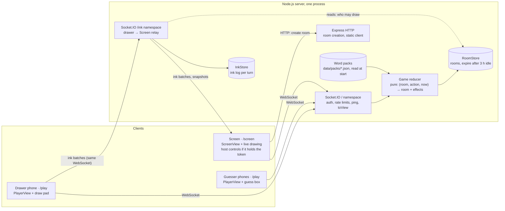
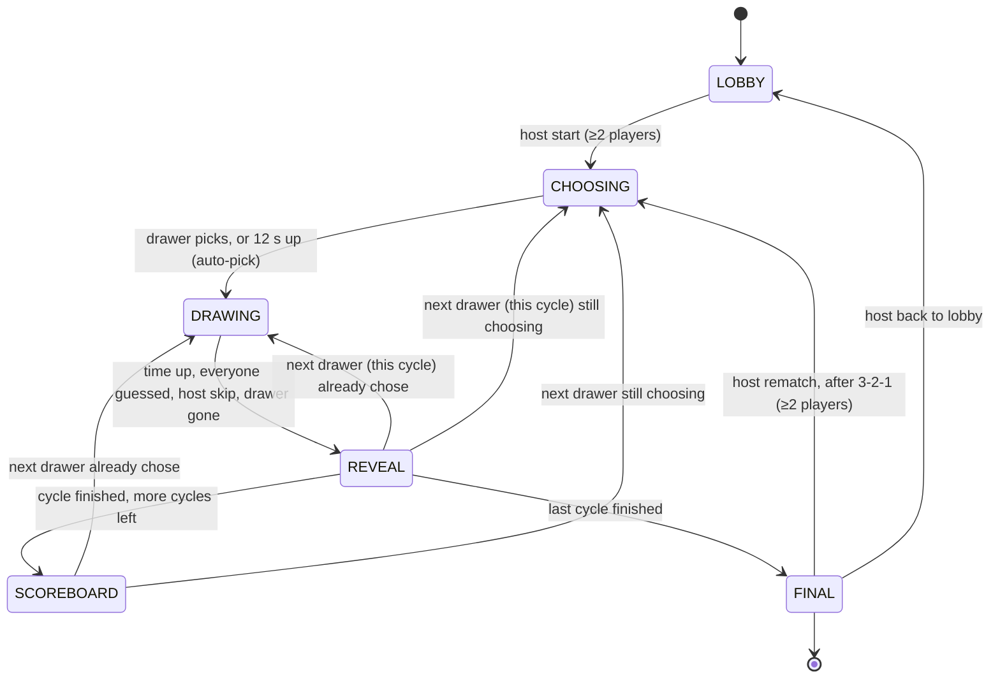

# Sketchy — Build Spec

Oct 30, 2026

## Note to Claude Code

Build this as one TypeScript web app: a Node server with Socket.IO that serves a React client. Work through the Build roadmap near the end one feature at a time, in order, and keep the app runnable after each one.

- The game logic lives in one pure, unit-tested reducer on the server. The server is the only source of truth; clients render the state they are sent.
- Drawing data is the one exception to "everything goes through the reducer": it travels on its own channel (see Drawing data protocol). The reducer decides *who may draw and when*; it never sees individual points.
- Decisions already made by the product owner are marked **[decided]**. Defaults chosen on their behalf are marked **[default]** and can change later.
- If something here is ambiguous, pick the simplest option that satisfies the acceptance criteria and leave a `// SPEC-QUESTION:` comment, rather than inventing features.
- No accounts, no database, no paid services, no analytics.
- Sketchy is a sibling of Buzzr (`../buzzer/`), not part of it. Copy and adapt Buzzr code where this spec says so (see Ported from Buzzr). Never import from `../buzzer/`.

## Overview

A browser party game for a barkada in a living room. One player (the **drawer**) gets a secret word and draws it on their phone. The drawing appears live on a shared **Screen**. Everyone else types guesses on their phones. Faster correct guesses score more, the drawer scores when people get it, and the drawer role rotates so everyone draws. Working name: **Sketchy**.

Audience: groups of 4–6 friends, mostly millennials and Gen Z, first-timers, joining from a browser on a mix of budget and mid-range Android phones and some iPhones, often on mobile data.

### Goals

1. Anyone can join from a phone browser in under 15 seconds: scan a QR code or type a 4-letter room code. No install, no account. A performance budget backs this (see Performance budget).
2. The drawing feels live: a line drawn on the drawer's phone appears on the Screen within **150 ms (median) and 300 ms (95th percentile)** on 4G.
3. Speed scoring is fair: guesses are timed on the server and corrected for each phone's network latency, so slow mobile data doesn't cost points.
4. Secrets stay secret: only the drawer sees the word before the reveal. Only the Screen receives drawing data.
5. Playable by non-gamers with no explanation: one obvious action per screen.
6. Word packs in English and Taglish/Filipino, written for Filipino barkadas.
7. Guesses are private. The design makes typing, not saying, the obvious move: the rule is taught on the Screen, and no phone except the drawer's shows the word before the reveal.
8. Laughing, not tense. Ranks appear only between rounds and at the end, everyone goes home with an award, and a default game takes about 10 minutes so groups play two or three a night.

### Non-goals

- Accounts, saved profiles, cloud history, leaderboards.
- Public lobbies or matchmaking with strangers.
- A mode without a Screen. **[decided]** Every game needs one dedicated Screen device.
- Native apps.
- Teams. **[decided]** Not in v1.
- Text chat between players (guesses are the only free text).
- Fill bucket, shapes, layers, image import.
- Keeping drawings after the room expires.
- An admin UI for word packs. **[decided]** Packs are JSON files in the repo.
- Monetisation and analytics.

### Scope decisions

| Topic | Decision |
| --- | --- |
| Screen | **[decided]** Required. A laptop on a TV, a laptop alone, a tablet, or a spare phone propped up. It is never anyone's controller. |
| Who creates the room | **[decided]** The Screen device. It holds the `hostToken` and shows host controls (on-screen bar and keyboard). |
| Host when everyone plays | **[decided]** One player holds a **host crown**. In the lobby their phone *is* the host view (big **Start game**, settings summary); once the game starts it gains a small controls drawer. It never shows the word unless that player is drawing. The crown is the main way to run the game; the Screen's controls are the fallback. |
| Separate non-playing host remote | Not in v1 (see Open questions). A non-playing host can use the Screen's controls. |
| Word choice | **[decided]** The drawer picks 1 of 3 words within 12 s: one easy, one medium, one hard when the deck has them. When time runs out the **easiest** word is picked for them. No skips; the host's Skip is the only exit. From the second turn on, the next drawer chooses while the Screen shows the reveal. |
| Difficulty | **[decided]** Words have a difficulty (1–3) that filters which words are dealt (Easy or Mixed) and shapes the three choices. Scoring is flat. |
| Word language | **[decided]** English / Taglish / Mixed, **[default]** Mixed. UI copy English or Taglish, **[default]** English. |
| Custom words | **[decided]** A lobby box for the barkada's own words. Session only, never saved. |
| Spicy pack | **[decided]** An opt-in "Pang-inuman" pack, off by default. Adult-ish, never explicit. |
| Players | **[decided]** 2 to 10, designed for 4–6. With 2, the lobby shows "Better with 3+". |
| Wrong-guess feed | **[decided]** On the Screen and the drawer's phone. `guessFeed` **[default]** `'all'` masks only slurs and hate terms; `'clean'` also masks ordinary profanity; `'off'` hides it. Host can change it any time. |
| Gallery | **[decided]** End-of-game gallery on the Screen. PNG download is deferred to the Backlog (people photograph the TV). |
| Awards | **[decided]** FINAL shows Tonight's awards after the podium, at most one per player, so nobody goes home with nothing. |
| Lobby doodle | **[decided]** While waiting in the lobby, each player can doodle themselves; the doodle becomes their avatar on the Screen. Optional. |
| Next game | **[decided]** FINAL offers **Rematch** (straight into the next game after a 3-2-1 countdown, same players and settings, the next player in join order draws first) and **Back to lobby** (to change settings or words). Both are host-only and two taps, because both clear the gallery. |
| Sound | **[decided]** Screen only. Phones are silent except a vibrate on "your turn". |
| Deploy | **[decided]** `https://sketchy.kimnejudne.dev` on Kim's droplet: its own container and nginx vhost, like Buzzr's, on host port 3006 with a `mem_limit` measured in M10. The DNS A record is in place (Oct 30, 2026). |
| Look | **[decided]** Sketchy's own palette and identity; Buzzr's layout conventions (big type, phone-first, viewport-scaled Screen). |
| Browsers | **[decided]** Chrome on Android 10+, Safari on iOS 16.4+ (Screen Wake Lock), current desktop Chrome/Edge/Firefox/Safari for the Screen. |

## Roles and devices

Every room has three roles. The Screen is public, so it never receives the word before the reveal. No role needs a secret except the word itself, so there is no separate host view: being host is a *capability* added to a Screen or a player, not a different set of data.

| Role | Device | URL | Receives | Credential |
| --- | --- | --- | --- | --- |
| Screen | Laptop + TV, laptop, tablet, or spare phone | `/screen/:code` | ScreenView: drawing data, timer, word blanks, players, scores, the guess feed; the word only at the reveal | None to watch. The device that created the room also holds the `hostToken`, which unlocks host controls. Several Screens per room are allowed. |
| Player | Each person's phone | `/play/:code` | PlayerView: their own status, timer, word blanks, scores. The drawer additionally gets the word choices and the word. Never drawing data from others. | A private `playerKey` stored on the device |
| Host | A capability, not a device | n/a | Nothing extra: host controls act on public state only | `hostToken` (Screen) or holding the crown (player) |

### Creating and joining a room

1. **Create (on the Screen device).** The landing page `/` has two equal choices: **Join a game** (code input) and **Start a game on this screen**, with the hint "Use the device everyone can see: a laptop on the TV, a tablet, or a spare phone". Tapping Start calls `POST /api/rooms`, stores the returned `hostToken` in `localStorage` (keyed by room code) and opens `/screen/:code`.
2. **Click to start.** The Screen shows a full-screen **Tap to start** overlay first. The tap unlocks audio, requests fullscreen (where supported) and a Screen Wake Lock.
3. **Players join** by scanning the lobby QR (`/play/:code`) or by typing the code at `/`. They type a display name (1–16 characters, trimmed, unique in the room, case-insensitive) and get the next free colour from the player palette. One screen, one field, one button.
4. **Rejoin.** The phone keeps `{playerKey, name}` in `localStorage` per room code. A refresh or a re-scan rejoins silently as the same player.
5. **Rejoin from another phone.** If a joining name matches a **disconnected** player (case-insensitive), the phone asks "Are you Jun? · **Rejoin as Jun** / Pick another name". Rejoining hands that pid, score and crown to the new device (the new `keyHash` replaces the old one), and the Screen shows "Jun is back (new phone)". Names of connected players stay blocked. A kicked player was removed, so this never brings them back.
6. **Lobby doodle.** After joining, each phone shows the draw pad under "Doodle yourself while you wait!" (the crown holder's sits below Start). It's optional and never blocks anything. The doodle becomes that player's avatar on the Screen's chips for the session (lobby, sidebar, reveal, podium) and teaches the pad before anyone's first turn.
7. **Room codes** are 4 letters from `ABCDEFGHJKMNPQRSTUVWXYZ` (no I, L or O), random, retried on collision and on a blocked-word list (ported from Buzzr, plus Tagalog words: see Security).

### Host crown

- The **first player to join** gets the crown automatically **[default]**. The Screen shows a 👑 on their chip.
- The Screen (with the `hostToken`) can give the crown to any player by tapping their chip in the lobby, or through the players list in its control bar. The crown holder can pass it on from their own controls drawer.
- If the crown holder leaves or is kicked, the crown goes to the longest-connected remaining player. If they disconnect, the crown stays with them; the Screen's controls still work.
- In LOBBY, the crown holder's phone is the host view: "You're the host 👑", a big **Start game ▶** (disabled with "Need 2 players" below 2) and a one-line settings summary with **Change** (see Host controls). Once the game starts, the crown adds a **Host** button that opens a controls drawer. The crown adds controls, never data: the crown holder's PlayerView is exactly a normal PlayerView plus the settings and the player list.
- When the crown moves, the new holder's phone shows a toast: "You're the host now 👑".

## Tech stack and architecture

One TypeScript project, deployed as a single always-on Node process that serves the realtime API and the built React app. Rooms live in memory.



| Layer | Choice | Notes |
| --- | --- | --- |
| Language | TypeScript, `strict: true` | Shared types and pure helpers between client and server |
| Server | Node.js (current LTS), Express, Socket.IO | One instance only: rooms are in memory |
| Client | React + Vite, React Router, Tailwind CSS | Mobile-first; Screen scales with viewport units |
| Client state | Zustand store holding the latest `state` snapshot | No client-side game logic. The draw pad and ink renderer are the only stateful client code. |
| Drawing | Plain `<canvas>` 2D context | No drawing library |
| Validation | zod | Socket payloads, ink batches, word pack files |
| QR codes | `qrcode.react` | Join QR |
| Sound | Howler.js, short files in `client/public/sounds` | Screen only, lazy-loaded |
| Tests | Vitest; `socket.io-client` for integration tests | Reducer, scoring, matching, ink codec, role filtering |
| Deploy | Dockerfile, compose on the droplet, nginx vhost with WebSocket upgrade | `sketchy.kimnejudne.dev` |

Every client keeps one WebSocket. The main namespace `/` carries joins, actions, `state` snapshots and `fx` events. The `/ink` namespace is multiplexed over the **same** WebSocket (Socket.IO namespaces share the underlying connection, so there is no second handshake) and carries only drawing data. Screens and the drawer's phone connect to `/ink`; in LOBBY every player's phone does too, to send its doodle (see Lobby doodles). Nothing on `/ink` is ever sent to a phone except the drawer's own snapshot.

The Socket.IO server sets `pingInterval: 5000` and `pingTimeout: 5000`, so a phone that silently drops off counts as disconnected within 10 s (the defaults allow up to 45 s).

### Performance budget

- `/play` and `/` together ship ≤ 120 KB of gzipped JavaScript and ≤ 30 KB of CSS and fonts. The Screen page, Howler, `qrcode.react`, the gallery and DevBots are separate lazy chunks that the player page never loads. The client doesn't bundle zod; schemas are checked on the server.
- Fonts: one subset weight (Latin), `font-display: swap`, preloaded.
- Socket.IO clients use `transports: ['websocket']` and fall back to polling only if the WebSocket fails.
- Target: from QR scan to a usable name field in ≤ 5 s, and to the lobby in ≤ 15 s including typing a name, on a budget Android over mobile data (or Chrome DevTools "Slow 4G" with 4× CPU slowdown). A bundle-size test in CI fails the build when the budget is exceeded.

### Folder layout

```
sketchy/
  shared/   types.ts, schemas.ts, constants.ts (palettes, limits, timings),
            ink.ts (op codec, action stack, simplification: used by drawer, server, Screen)
  server/   index.ts, http.ts, sockets.ts (main namespace), inkGateway.ts (/ink),
            reducer.ts, views.ts (toView), scoring.ts, match.ts (guess matching),
            profanity.ts, slurs.ts, deck.ts, packs.ts, rng.ts, fairness.ts, codes.ts,
            hostToken.ts, rateLimit.ts, roomStore.ts, inkStore.ts, *.test.ts
  client/   src/pages/{Landing,Screen,Play,DevBots}.tsx
            src/components/{DrawPad,InkCanvas,Toolbar,GuessBox,WordBlanks,TimerRing,
                            PlayerList,GuessFeed,HostControls,Gallery,...}.tsx
            src/lib/{socket,ink,copy,sounds,wakeLock,useCountdown}.ts
            public/sounds/
  data/packs/  en-*.json, tl-*.json, spicy-*.json
  deploy/   compose.deploy.yaml, nginx/
  Dockerfile, README.md, CLAUDE.md
```

`sketchy/` lives in the `portfolio` monorepo (git root `..`), like `buzzer/`. One `package.json`, npm, no workspaces. Commits use the scope `feat(sketchy): F07 <title>`.

## Game flow and state machine

A game is a number of **cycles**; in each cycle every player draws once. One player's go is a **turn**: pick a word → DRAWING → REVEAL. Players see cycles as rounds ("Round 1 of 2"); the code says `cycle` so it never clashes with "turn".

To cut dead air, choosing **overlaps the reveal**: entering REVEAL deals the next drawer's three words at once, and they choose on their phone while the Screen shows the reveal (and the scoreboard, between cycles). Only the first turn of a game, or a turn whose dealt drawer couldn't choose in time, has a standalone CHOOSING phase.



Host **End game** jumps from any phase to FINAL. **Pause** is a flag over the phase (see Pausing), not a phase.

### Phases

| Phase | What happens | Lasts |
| --- | --- | --- |
| LOBBY | Players join; host sets settings and custom words | Until host starts |
| CHOOSING | The drawer sees 3 words and taps one. Everyone else sees "Mika is choosing a word…". Only for the first turn of a game, or when the dealt drawer hasn't chosen by the end of REVEAL/SCOREBOARD | Until 12 s after the deal |
| DRAWING | The drawer draws; guessers guess; correct guesses score | `drawSeconds` (default 60 s), or less if everyone guesses |
| REVEAL | The word, who got it and this turn's points. Meanwhile the next drawer chooses on their phone | 8 s with auto-advance, else until host taps Next |
| SCOREBOARD | Full ranking after each cycle except the last. The next drawer may still be choosing | 6 s with auto-advance, else until Next |
| FINAL | Podium, ranking, gallery; during a rematch, a 3-2-1 countdown over it | Until Rematch, Back to lobby, or the room expires |

### Transitions

Implement these in `server/reducer.ts` as a pure function `reduce(room, action, now) → {room, effects}`. `now` is server monotonic ms (`performance.now()` based). Any action not listed for the current phase is rejected with an error and no change. While `paused` is set, game-progress actions are rejected (`player:guess`, `player:react`, `drawer:choose`, `host:next`, and ink batches); joins, leaves, kicks, crown, settings, visibility and connection actions still work, and `host:skip`, `host:end` and `host:resume` stay available so the host can always move on.

| From | Trigger | To | Effects |
| --- | --- | --- | --- |
| LOBBY | `host:start`, at least 2 connected players | CHOOSING, turn 1 of cycle 1 | Build `turnOrder` from join order; **deal** the turn (below) |
| CHOOSING | `drawer:choose {index}` from the drawer | DRAWING | Set the word; **start drawing** (below) |
| CHOOSING | `timer chooseUp` | DRAWING | As above, with the easiest of the three |
| REVEAL, SCOREBOARD | `drawer:choose {index}` from the `upcoming` drawer | Same | Set `upcoming.word`. Nothing else changes |
| REVEAL, SCOREBOARD | `timer chooseUp` for `upcoming` | Same | Set `upcoming.word` to the easiest of the three |
| DRAWING | `player:guess`, correct | DRAWING | Record the guess and its points; `fx correct`; when every eligible guesser has guessed, schedule `allGuessed` in 1.5 s |
| DRAWING | `player:guess`, close | DRAWING | `fx nearMiss` to that player only; `fx closeAlert` to the drawer; keep it in `closeGuesses` (max 3) for the reveal; nothing on the Screen during the turn |
| DRAWING | `player:guess`, wrong | DRAWING | Append to the feed (masked per `guessFeed`; see Guess feed and rude guesses); `fx wrongGuess` to Screens; count it for awards |
| DRAWING | `timer hint` | DRAWING | Reveal one more letter in the blanks |
| DRAWING | `timer drawUp`, `timer allGuessed`, `host:skip`, `timer drawerGone`, drawer kicked or left | REVEAL | Award the drawer's points; `inkClose`; `fx turnEnd {reason}`; with auto-advance, schedule `revealDone` in 8 s; if a turn remains in the game, **deal** it as `upcoming` |
| CHOOSING | `host:skip`, `timer drawerGone`, drawer kicked or left | CHOOSING for the next drawer, or SCOREBOARD/FINAL as below | No word was chosen, so no reveal and no points; the dealt words go back to the bottom of the deck |
| REVEAL | `timer revealDone` or `host:next` | SCOREBOARD (cycle done, cycles left) · FINAL (last cycle done) · otherwise **take up** `upcoming` (below) | With auto-advance, SCOREBOARD schedules `scoreboardDone` in 6 s |
| SCOREBOARD | `timer scoreboardDone` or `host:next` | **Take up** `upcoming` (below) | |
| Any but LOBBY, FINAL | `host:end` | FINAL | A turn in progress ends as a skip (points already earned stay); `inkClose`; `upcoming` is discarded |
| FINAL | `host:rematch`, no countdown running | FINAL, counting down | Set `rematchAt = now + REMATCH_COUNTDOWN_MS` (3 s); schedule `rematchGo`. Nothing is reset yet, so a cancel loses nothing |
| FINAL, counting down | `host:rematchCancel` | FINAL | Clear `rematchAt`; bump `timerEpoch` |
| FINAL, counting down | `timer rematchGo`, at least 2 connected players | CHOOSING, turn 1 of cycle 1 of the next game | New-game reset (below); build `turnOrder` with the rematch rotation (see Turn order); then as in LOBBY → CHOOSING |
| FINAL, counting down | `timer rematchGo`, fewer than 2 connected players | FINAL | Clear `rematchAt`; `fx notEnoughPlayers` to all. Scores and gallery stay |
| FINAL | `host:backToLobby` | LOBBY | New-game reset (below). Also cancels a running rematch countdown |
| Any | `player:join`, `player:leave`, `player:rename` (LOBBY only), `host:kick`, `host:crown`, `host:settings` (LOBBY only), `host:customWords` (LOBBY only) | Same | See Reducer actions and effects |
| Any, paused | `host:pause` / `host:resume`, connection and visibility actions | Same | See Pausing |

**Deal** (a turn for the next drawer in `turnOrder`; at the end of a cycle, the next cycle's order is built first): draw 3 choices from the deck (Word selection); set `dealtAt = now`; schedule `chooseUp` at `dealtAt + CHOOSE_MS` (12 s); `fx yourTurn` to that drawer. From LOBBY or a skipped CHOOSING the dealt turn is `room.turn` and the phase is CHOOSING; from DRAWING → REVEAL it is `room.upcoming`.

**Take up** `upcoming` at the end of REVEAL or SCOREBOARD: if its drawer has left, been kicked or is disconnected, discard it (words back to the bottom of the deck; a disconnected drawer draws again from the next cycle) and deal to the following eligible drawer with a standalone CHOOSING. Otherwise `turn = upcoming`, `upcoming = null`; if its word is set, **start drawing**; if not, go to CHOOSING (the Screen shows "Jun is choosing…") with `chooseUp` still due at `dealtAt + 12 s`.

**Start drawing**: start the turn clock; schedule `drawUp` at `endsAt + GRACE_MS`; schedule hints; `inkOpen`.

Every phase change bumps `timerEpoch`, so whenever the phase changes while a choice is open the reducer re-schedules `chooseUp` for that choice's remaining time.

**New-game reset** (shared by `rematchGo` and `host:backToLobby`): scores to 0; add the game to `session.totals` and increment `session.gameNumber`; clear `history` and the gallery; `inkReset`; clear `rematchAt`. Keep players, settings, custom words and the used-word list. Joins, leaves, kicks and crown moves still work during a rematch countdown **[default]**; a player who joins during it is in the next game's order.

### Pausing

`room.paused` is `null` or `{reasons, since, remainingMs, resumeAt}`. A room can be paused for several reasons at once and resumes only when all of them are cleared.

| Reason | Set when | Cleared when |
| --- | --- | --- |
| `host` | `host:pause` | `host:resume` |
| `drawerAway` | The drawer's phone has been disconnected or `hidden` for `DRAWER_AWAY_DEBOUNCE_MS` (2 s) during CHOOSING or DRAWING. During the debounce the clock keeps running and the Screen shows a small "Mika's phone reconnecting…" badge; a blip shorter than that pauses nothing (the ink resend covers it) | The drawer is back and visible. After `DRAWER_AWAY_MS` (30 s) the turn is skipped instead and the reason clears. |
| `screenAway` | The last Screen disconnects for `SCREEN_AWAY_MS` (3 s) during CHOOSING or DRAWING | A Screen rejoins |
| `fewPlayers` | Fewer than 2 players are connected during a game | 2 or more are connected again |

- Pausing stores the remaining time of the current phase timer and bumps `timerEpoch`, so every scheduled timer already in flight is ignored.
- Clearing the last reason sets `resumeAt = now + 3000` and schedules `resumeGo`. Every view shows a 3-2-1 countdown. `resumeGo` restarts the phase timers with the stored remaining time and moves the turn clock, and the `dealtAt` of an open choice, forward by the paused duration.
- While paused, guesses and ink batches are rejected; phones show "Paused" with the reason ("Waiting for Mika's phone…", "Waiting for the Screen…").

### Scheduled effects

The reducer never sets timers. It returns `schedule` effects `{at, timer, turnId, epoch}`; the gateway calls `setTimeout` and later dispatches `{type: 'timer', timer, turnId, epoch}`. The reducer ignores a timer whose `turnId` or `epoch` doesn't match the room, so a fast host or a pause never causes a stale transition (ported from Buzzr's opening counter).

| Timer | Scheduled | Fires |
| --- | --- | --- |
| `chooseUp` | a deal (and again on every phase change while that choice is open) | at `dealtAt + 12 s`; carries the dealt turn's id |
| `drawUp` | entering DRAWING | at `endsAt + GRACE_MS` (300 ms) |
| `hint` | entering DRAWING with hints on | at 50% and 75% of `drawSeconds` |
| `allGuessed` | the last eligible guesser is correct | after 1.5 s |
| `revealDone` / `scoreboardDone` | entering REVEAL / SCOREBOARD with auto-advance on | after 8 s / 6 s |
| `drawerAwayCheck` | the drawer disconnects or reports `hidden` during CHOOSING or DRAWING | after 2 s (sets the `drawerAway` pause if still away) |
| `drawerGone` | `drawerAway` pause begins | after 30 s |
| `screenGone` | the last Screen disconnects during CHOOSING or DRAWING | after 3 s (sets the `screenAway` pause) |
| `resumeGo` | the last pause reason clears | after 3 s |
| `rematchGo` | `host:rematch` in FINAL | after 3 s (`REMATCH_COUNTDOWN_MS`) |

### Turn order

- `turnOrder` is the list of player ids in join order, fixed at the start of each cycle.
- **Rematch rotation.** Every game start records the first drawer's `joinedAt` in `session.firstDrawerJoinedAt`. A game started by Rematch begins its join order at the first player whose `joinedAt` is later than that, wrapping to the earliest joiner, so each rematch moves the first drawer on by one. This still works when last game's first drawer has left. A game started from the lobby (`host:start`) always begins with the earliest joiner.
- **Late joiners.** A joiner is appended to this cycle's order if at least one turn remains after the current one. Otherwise they draw from the next cycle; in the last cycle they only guess. A join never makes the game longer than one extra turn.
- A player who leaves or is kicked is removed. A player who is disconnected when their turn comes is skipped for that cycle and draws again from the next cycle.
- The cycle ends after the last player in `turnOrder` has had their turn. The game ends after `settings.cycles` cycles.
- Game length: 5 players × 2 cycles = 10 turns of about 8 s reveal + 0–4 s waiting for a choice + 30–60 s drawing, plus 1 scoreboard: **about 10 minutes, at most 12**.

## Data model

These types live in `shared/types.ts`. Validate every incoming payload with matching zod schemas in `shared/schemas.ts`.

### Room state

```typescript
export type Phase = 'LOBBY' | 'CHOOSING' | 'DRAWING' | 'REVEAL' | 'SCOREBOARD' | 'FINAL';

export interface WordEntry {
  id: string;              // '<packId>/<wordId>', or 'custom/<n>'
  word: string;            // as shown at the reveal, e.g. 'bahay kubo'
  alt: string[];           // other accepted answers, e.g. ['kubo', 'nipa hut']
  difficulty: 1 | 2 | 3;
  lang: 'en' | 'tl' | 'custom'; // 'en' words also accept a plural s/es (Guess matching)
  gloss?: string;          // drawer-only description, e.g. "wide woven farmer's hat"
}

export interface Player {
  pid: string;             // public id, server-generated, appears in views
  keyHash: string;         // SHA-256 of the device's private playerKey; never in a view
  name: string;
  color: string;           // from PLAYER_COLORS
  score: number;           // this game
  connected: boolean;
  hidden: boolean;         // page hidden (phone locked or app switched), from player:visibility
  hasDoodle: boolean;      // the InkStore holds a lobby doodle for this player (Screen avatar)
  joinedAt: number;
}

export interface CorrectGuess {
  pid: string;
  receivedAt: number;      // server monotonic ms
  oneWayMs: number;        // the player's measured one-way latency at that moment
  elapsedMs: number;       // corrected time since the turn started, pauses excluded
  points: number;
}

export interface FeedItem {
  pid: string;
  text: string | null;     // null = masked ("•••")
  at: number;
}

export interface Turn {
  id: number;              // increments every turn in the room; also the ink turnId
  cycle: number;           // 1-based
  drawerPid: string;
  choices: [WordEntry, WordEntry, WordEntry]; // easy, medium, hard when the deck has them
  dealtAt: number;         // monotonic ms of the deal; chooseUp fires 12 s later (moved by pauses)
  word: WordEntry | null;  // null until chosen
  clockStart: number | null; // monotonic ms the drawing clock started, moved forward by pauses
  endsAt: number | null;   // clockStart + drawSeconds * 1000
  hintIndexes: number[];   // letter positions revealed so far
  correct: CorrectGuess[]; // in arrival order
  feed: FeedItem[];        // newest last, max FEED_MAX (8) kept
  closeGuesses: FeedItem[]; // max 3, never in a view before REVEAL
  closeCount: Record<string, number>; // per pid, for awards
  guessCount: Record<string, number>; // per pid, for rate limiting and stats
  drawerPoints: number;    // set at REVEAL
  endReason: 'time' | 'allGuessed' | 'skip' | 'drawerGone' | 'end' | null;
}

export interface TurnSummary {
  turnId: number;
  drawerPid: string;
  word: string;
  points: Record<string, number>; // everyone who scored this turn, drawer included
  correct: { pid: string; elapsedMs: number }[]; // in corrected order, for awards
  close: Record<string, number>;  // close guesses per pid
  wrong: Record<string, number>;  // wrong guesses per pid
  hasInk: boolean;          // the InkStore still has this drawing for the gallery
}

export interface Award {
  kind: 'picasso' | 'bilis' | 'sharpshooter' | 'malapitNa' | 'mostCreative' | 'modernArt';
  pid: string;
  turnId?: number;          // modernArt: the drawing nobody got
}

export interface Paused {
  reasons: Array<'host' | 'drawerAway' | 'screenAway' | 'fewPlayers'>;
  since: number;
  remainingMs: number | null; // what was left on the phase timer
  resumeAt: number | null;    // set during the 3-2-1 countdown
}

export interface RoomSettings {
  drawSeconds: 45 | 60 | 80 | 100;     // default 60
  cycles: 1 | 2 | 3;                   // default 2
  hints: boolean;                      // default true
  difficulty: 'easy' | 'mixed';        // default 'mixed'
  words: 'en' | 'taglish' | 'mixed';   // default 'mixed'
  spicy: boolean;                      // default false
  guessFeed: 'all' | 'clean' | 'off';  // default 'all'
  copy: 'en' | 'taglish';              // phone and Screen language, default 'en', lobby only
  autoAdvance: boolean;                // default true
}

export interface Room {
  code: string;
  hostTokenHash: string;
  settings: RoomSettings;
  players: Record<string, Player>;     // by pid
  kickedKeyHashes: string[];
  crownPid: string | null;
  screens: number;                     // connected Screen sockets, kept by the gateway
  phase: Phase;
  paused: Paused | null;
  timerEpoch: number;                  // bumped on every phase change and pause
  rngState: number;                    // seeded PRNG state (mulberry32), so the reducer stays pure
  cycle: number;                       // 0 in the lobby
  turnOrder: string[];                 // pids for the current cycle
  turnIndex: number;                   // index into turnOrder
  turnCounter: number;                 // last Turn.id used
  turn: Turn | null;
  upcoming: Turn | null;               // dealt during REVEAL/SCOREBOARD; the next drawer chooses meanwhile
  history: TurnSummary[];              // this game, oldest first
  awards: Award[];                     // computed on entering FINAL
  deck: { remaining: WordEntry[]; usedIds: string[] }; // usedIds survives every new game
  customWords: WordEntry[];            // session only
  rematchAt: number | null;            // FINAL only: when a rematch countdown ends
  session: {                           // the night's games
    gameNumber: number;
    totals: Record<string, number>;
    firstDrawerJoinedAt: number | null; // for the rematch rotation (Turn order)
  };
  createdAt: number;
  lastActivityAt: number;
}
```

Randomness (shuffling, the order of the three choices, hint positions) comes from `rngState` with a small seeded PRNG in `server/rng.ts`. `createRoom` seeds it from `crypto.randomInt`. Tests seed it directly, so every reducer test is deterministic.

RTT samples are **not** in the room: the gateway keeps them per socket and passes `oneWayMs` into `player:guess`, so pings don't cause state broadcasts.

### Role views

`toView(room, role, pid?)` in `server/views.ts` builds what each client receives. **This function is where the secrecy rules live**, and it has its own leak tests (see Test plan).

| Field | ScreenView | PlayerView (guesser) | PlayerView (drawer) |
| --- | --- | --- | --- |
| phase, paused, resume countdown, rematch countdown and the next game's first drawer, settings | ✓ | ✓ | ✓ |
| players: pid, name, colour, connected, crown, isDrawer, hasDoodle, guessed ✓ and this turn's points | ✓ | ✓ | ✓ |
| players' total `score` | SCOREBOARD and FINAL only | SCOREBOARD and FINAL only | SCOREBOARD and FINAL only |
| turn number, cycle, drawer name, timer `{remainingMs, totalMs, running}` | ✓ | ✓ | ✓ |
| word blanks (`mask`, with revealed hint letters) | ✓ | ✓ | ✓ |
| `choices` with `gloss` (CHOOSING; for the `upcoming` drawer, REVEAL and SCOREBOARD) | ✗ | ✗ | ✓ |
| `word` with `gloss` during CHOOSING (once chosen) and DRAWING | ✗ | ✗ **never, not even after a correct guess** | ✓ |
| `word` in REVEAL, FINAL and history | ✓ | ✓ | ✓ |
| feed of wrong guesses (masked as needed) | ✓ (empty when `guessFeed: 'off'`) | ✗ | latest one, plus "Bea is close!" alerts (DRAWING) |
| close guesses of the turn (max 3) | REVEAL and later | ✗ | ✗ |
| own last 5 guesses with result | n/a | ✓ | n/a |
| correct-guess announcements `{pid, points, order}` | ✓ | ✓ | ✓ |
| guessed count `{guessed, of}` | ✓ | ✓ | ✓ |
| own points this turn ("+270 this turn") | n/a | ✓ | ✓ |
| own score and rank ("2nd of 5") | n/a | SCOREBOARD and FINAL only | SCOREBOARD and FINAL only |
| awards (FINAL) | ✓ | own award | own award |
| `host` block: room code, settings editor data, player list for kick and crown | when the Screen holds the token | only for the crown holder | only for the crown holder |
| gallery list (turnId, drawer, word) in FINAL | ✓ | ✗ | ✗ |
| drawing data, lobby doodles | **via `/ink` only** | ✗ never | own drawing only, via `/ink` after a reload |

Rules:

- `alt` forms are never sent to anyone before the reveal; at the reveal only `word` is shown. `gloss` is sent only to the drawer, with `choices` and `word`, and never to the Screen or guessers.
- The drawer knows the word, so the latest wrong guess and close-guess alerts in the drawer's view leak nothing.
- The mask shows a `_` per letter and shows spaces, hyphens and apostrophes as themselves, e.g. `bahay kubo` → `_ _ _ _ _   _ _ _ _`. Revealed hint letters replace their `_`.
- Timers are sent as `remainingMs` at send time; clients count down locally and resync on every `state`. No client relies on its own wall clock matching the server's.
- `keyHash`, `hostTokenHash`, `rngState`, the deck, `customWords` and RTTs are never in any view. The crown holder's and the token Screen's `host` block shows custom words only as a count.

## Reducer actions and effects

### Actions

Every action is `{type, ...payload}`. The gateway authenticates the sender and adds `by: {kind: 'screen'|'player', pid?, isHost}`; the reducer checks permissions again (host actions need `isHost`, drawer actions need `pid === turn.drawerPid`).

| Action | Sender | Payload | Allowed in | Result |
| --- | --- | --- | --- | --- |
| `player:join` | player | `{keyHash, name, takeOver?}` (gateway hashes the key) | any | New player, or reconnect of the player with that `keyHash`. New: unique name, next colour, crown if nobody holds it, added to the turn order as in Turn order. Rejected for a kicked key, a full room (10), or a taken name. A name held by a **disconnected** player is rejected with `error: 'nameOfDisconnected'` unless `takeOver: true`, which hands that pid, score and crown to the new `keyHash` and emits `fx rejoined`. |
| `player:leave` | player | `{}` | any | Remove the player. If they were drawing, the turn ends (`skip`). Passes the crown on. |
| `player:rename` | player | `{name}` | LOBBY | Unique name |
| `player:guess` | player | `{text, receivedAt, oneWayMs}` (timing added by the gateway) | DRAWING, not paused | Matched as in Guess matching. Rejected for the drawer, a player who already guessed correctly, after `endsAt` (corrected), or over the rate limit. |
| `player:react` | player | `{emoji}` from `REACTIONS` | DRAWING, REVEAL | Only for players who already guessed correctly (or in REVEAL, anyone). Emits `fx reaction` to Screens. No state change. |
| `player:visibility` | player | `{hidden}` | any | Updates `hidden`; for the drawer may set or clear `drawerAway` |
| `drawer:choose` | player (drawer) | `{index: 0 \| 1 \| 2}` | CHOOSING (the current drawer); REVEAL, SCOREBOARD (the `upcoming` drawer) | CHOOSING → DRAWING; otherwise sets `upcoming.word` |
| `host:start` | host | `{}` | LOBBY | ≥ 2 connected players |
| `host:pause` / `host:resume` | host | `{}` | CHOOSING, DRAWING, REVEAL, SCOREBOARD | Adds or clears the `host` reason |
| `host:skip` | host | `{}` | CHOOSING, DRAWING | Ends the turn as `skip` |
| `host:next` | host | `{}` | REVEAL, SCOREBOARD | Advance now (also works with auto-advance on) |
| `host:kick` | host | `{pid}` | any | Remove the player; their `keyHash` can't rejoin this room; `kick` effect |
| `host:crown` | host | `{pid}` | any | Move the crown |
| `host:settings` | host | `Partial<RoomSettings>` | LOBBY (`guessFeed` also mid-game) | Validated against the allowed values. Presets are a client-side shortcut that sends `host:settings` |
| `host:customWords` | host | `{words: string[]}` | LOBBY | Replaces the custom list (limits in Custom words) |
| `host:end` | host | `{}` | any but LOBBY, FINAL | → FINAL |
| `host:rematch` | host | `{}` | FINAL, no countdown running | Starts the 3-2-1 countdown to the next game |
| `host:rematchCancel` | host | `{}` | FINAL, counting down | Stops the countdown; FINAL as it was |
| `host:backToLobby` | host | `{}` | FINAL | → LOBBY |
| `sys:connected` / `sys:disconnected` | gateway | `{pid}` | any | Updates `connected`; may schedule `drawerAwayCheck` or clear `drawerAway`, set or clear `fewPlayers`; passes the crown only on leave, never on disconnect |
| `sys:doodle` | gateway | `{pid, has}` | LOBBY (`has: false` any time) | Updates `hasDoodle` when the ink gateway stores or drops a doodle |
| `sys:screens` | gateway | `{count}` | any | Updates `screens`; schedules `screenGone` or clears `screenAway` |
| `timer` | gateway | `{timer, turnId, epoch}` | as scheduled | See Scheduled effects |

### Effects

The reducer returns a list of effects; the gateway (`server/sockets.ts`) runs them after storing the new room. After every accepted action the gateway also broadcasts a fresh `state` to every socket in the room, each built with `toView` for that socket's role.

| Effect | Gateway does |
| --- | --- |
| `schedule {at, timer, turnId, epoch}` | `setTimeout` to dispatch the timer action |
| `fx {to, kind, ...}` | Emit `fx` to `screen`, `all`, or one `pid` |
| `inkOpen {turnId, drawerPid}` | Tell the `/ink` gateway the turn is live: create the turn's ink log, emit `ink:turn {turnId}` to Screens (clear canvas) and allow batches from that drawer |
| `inkClose {turnId}` | Stop accepting batches for the turn; keep its log for the gallery |
| `inkReset {}` | Drop every ink log of the room (new-game reset). Lobby doodles stay for the session |
| `kick {pid}` | Emit `kicked` to that player's sockets and disconnect them |

`fx` kinds:

| Kind | To | Payload | Used for |
| --- | --- | --- | --- |
| `yourTurn` | the dealt drawer | `{}` | Vibrate; "Your turn to draw!" (during REVEAL: "You draw next! Pick a word") |
| `crowned` | one pid | `{}` | "You're the host now 👑" toast |
| `rejoined` | screen | `{pid}` | "Jun is back (new phone)" |
| `closeAlert` | the drawer | `{pid}` | "Bea is close!" in amber for 2 s |
| `correct` | all | `{pid, points, order}` | "Jun got it!" banner and ding on the Screen; "+270" on that phone |
| `nearMiss` | one pid | `{}` | "So close!" / "Malapit na!" toast |
| `wrongGuess` | screen | `{pid, text}` (`null` when masked) | Speech bubble from the guesser's chip |
| `wrong` | one pid | `{}` | A small shake of the guess box |
| `hint` | all | `{}` | A letter pop animation |
| `reaction` | screen | `{pid, emoji}` | Emoji floating up from the player's chip |
| `join` | screen | `{pid}` | Chip pop and join sound |
| `turnEnd` | all | `{reason}` | Time's-up sound or "Everyone got it!" |
| `notEnoughPlayers` | all | `{}` | "Need 2 players" when a rematch countdown ends with fewer than 2 connected |

## Realtime events and HTTP API

### HTTP

| Method and path | Auth | Purpose |
| --- | --- | --- |
| `POST /api/rooms` | none, rate-limited (10 per IP per hour) | Body `{settings?}`. Returns `{code, hostToken}`. |
| `GET /api/rooms/:code/exists` | none | For the join form: `{exists, phase, full}` |
| `GET /healthz` | none | Health check |
| `GET /*` | none | The built client (SPA fallback) |

### Client to server

Main namespace `/`. Every event has an acknowledgement callback returning `{ok: true, ...}` or `{ok: false, error}`.

| Event | Sent by | Payload | Action |
| --- | --- | --- | --- |
| `screen:join` | Screen | `{code, hostToken?}` | Subscribe to ScreenView; with a valid token the socket is a host. Counts towards `screens`. |
| `player:join` | Player | `{code, playerKey, name, takeOver?}` | `player:join`; ack `{pid}`, or `{ok: false, error: 'nameOfDisconnected'}` so the phone can ask "Are you Jun?" |
| `ping` | Player | `{t}` | Reply `pong {t}`; RTT sample (every 2 s) |
| `player:guess` | Player | `{text}` | `player:guess` with server timing |
| `player:react` | Player | `{emoji}` | `player:react` |
| `player:visibility` | Player | `{hidden}` | `player:visibility` |
| `player:rename` / `player:leave` | Player | `{name}` / `{}` | as named |
| `drawer:choose` | Player | `{index}` | `drawer:choose` |
| `host:*` | Screen with token, or the crown holder's player socket | as in Actions | as named |

`/ink` namespace: see Drawing data protocol.

### Server to client

| Event | To | Payload |
| --- | --- | --- |
| `state` | each socket | ScreenView or PlayerView |
| `fx` | as in Effects | `{kind, ...}` |
| `pong` | Player | `{t}` |
| `kicked` | Player | `{}` |
| `room:closed` | all | `{reason}` |

Socket.IO rooms per role: `room:<code>:screen`, `room:<code>:player:<pid>`. The `/ink` namespace has `ink:<code>:screen` only.

## Drawing data protocol

### Why a separate channel

A finger produces about 60 position updates per second. Sending those through the reducer would rebuild and re-broadcast every view 60 times a second to every phone, which is exactly the data the guessers must not get. Instead:

- The drawer's phone sends **only new points**, in small batches, on the `/ink` namespace.
- The server checks that the sender is the current drawer of the current turn, appends the batch to the turn's ink log and relays it to the room's Screens. Nothing else.
- The Screen adds each batch to what it already has.
- The reducer only decides turns, timers, guesses and scores. It tells the ink gateway when a turn opens and closes (`inkOpen`, `inkClose`); the ink gateway reads `room.turn` and `room.paused` to authorise batches.

### Ops and encoding

All coordinates are on an integer **1024 × 1024 grid** over the square canvas (0–1023 on each axis), so every device draws the same picture at its own size. Batches are compact JSON arrays.

```text
batch    = [turnId, seq, ops]          seq starts at 1 each turn, +1 per batch
op       = ["b", strokeId, color, size, x, y]     begin a stroke at (x, y)
         | ["p", strokeId, dx1, dy1, dx2, dy2, …] more points, each relative to the previous point
         | ["e", strokeId]                       end the stroke
         | ["u"]                                 undo the last action (a stroke or a clear)
         | ["c"]                                 clear (itself undoable)
color    = 0–7 palette index, 8 = eraser (paints the canvas colour)
size     = 0 | 1 | 2  (S, M, L = 4, 10, 24 grid units wide)
strokeId = 1, 2, 3 … per turn
```

Example: a short stroke in one batch: `[7, 118, [["b",3,0,1,412,300],["p",3,4,-1,6,-2,5,0],["e",3]]]`.

`shared/ink.ts` holds the codec and the **action stack** model used identically by the drawer, the server and the Screen: a list of actions, each a stroke (colour, size, points) or a clear. `u` pops the last action; `c` pushes a clear. The visible picture is every stroke after the last clear still on the stack, drawn in order.

### Drawer client

- Draw locally first, at once, from every pointer event (use `getCoalescedEvents()` where available for smooth lines). The network never delays the drawer's own line.
- Quantise each point to the grid. Drop a point closer than 3 grid units to the last kept point (radial filter). Before flushing, simplify the pending points of each stroke with Ramer–Douglas–Peucker at ε = 1 grid unit, always keeping the stroke's first and last points.
- Flush a batch every **50 ms** while there are pending ops, and immediately on stroke end, undo and clear. No batches while the finger isn't moving.
- Keep every batch of the current turn in memory (a few hundred KB at most) for resending.

### Server relay and ink log

- `inkGateway.ts` accepts `ink:batch` only from the socket of the current drawer (`playerKey` authenticated), only while `room.phase === 'DRAWING'`, not paused, and only for `turnId === room.turn.id`.
- Validate with zod; clamp coordinates to the grid; enforce Limits.
- Sequence: accept only `seq === lastSeq + 1`. A duplicate (`seq ≤ lastSeq`) is ignored. A gap (`seq > lastSeq + 1`) is dropped and answered with `ink:resend {from: lastSeq + 1}`.
- Apply the batch to the turn's action stack in `InkStore` (outside the reducer, in memory, keyed by room and turn), then emit the same batch to `ink:<code>:screen`.
- The log is capped at `INK_TURN_MAX_BYTES` (200 KB encoded). Past the cap, further strokes are refused and the drawer sees "Canvas full: undo or clear to keep drawing". (Undo and clear still work.)
- At `inkClose` the log is frozen and kept for the gallery. A room keeps at most `INK_ROOM_MAX_BYTES` (4 MB) of frozen logs; past that the oldest are dropped and their gallery entries show "Drawing not kept". `inkReset` (Rematch or Back to lobby) and room expiry drop everything.

### Reconnects and snapshots

| Situation | What happens |
| --- | --- |
| A Screen connects or reloads mid-turn | On `/ink` connect it sends `ink:hello {code}`; the server replies `ink:snapshot {turnId, seq, actions}` with the turn's whole action stack (including strokes under a clear, so a later undo of the clear still works), then live batches with `seq > snapshot.seq`. The Screen redraws from the snapshot. |
| A Screen sees a gap in `seq` (dropped connection) | It sends `ink:hello` again and gets a fresh snapshot. |
| The drawer's socket drops briefly | Socket.IO reconnects; the drawer sends `ink:sync {turnId, lastSentSeq}`; the server replies `ink:state {turnId, lastSeq}`; the drawer resends every kept batch with `seq > lastSeq`. |
| The drawer reloads the page (kept batches lost) | The drawer sends `ink:hello`; because it is the current drawer, it gets the snapshot of its own drawing, redraws it, and continues from `seq = snapshot.seq + 1`. This is the only case where a phone receives drawing data, and only its own. |
| A new turn starts | Screens get `ink:turn {turnId}` and clear the canvas. |
| Gallery in FINAL | The Screen asks `ink:get {turnId}` per drawing; the server answers with that turn's frozen action stack. Screen sockets only. |

Anyone with the room code may open a Screen, as in Buzzr; a Screen only ever shows what is already on the TV. The player page connects to `/ink` only as the current drawer, or in LOBBY to send its doodle.

### Lobby doodles

The one exception to "only the drawer sends ink":

- In LOBBY, `/ink` accepts `doodle:batch {ops}` from any joined player socket. Same codec and action stack, sent on stroke end, undo and clear only (no 50 ms flushes), at most `DOODLE_MAX_BYTES` (20 KB) per player.
- The server keeps each player's doodle in InkStore for the session, relays each batch to `ink:<code>:screen` as `doodle {pid, ops}`, and dispatches `sys:doodle` so views carry `hasDoodle`. A Screen that connects gets every doodle in `ink:snapshot`.
- Doodles never go to other phones. They are dropped when the player leaves or is kicked, and kept across Rematch and Back to lobby.
- Outside LOBBY, `doodle:batch` is refused.

### Bandwidth

Drawer upload while the finger is moving:

| Item | Estimate |
| --- | --- |
| Points after filtering and simplification | 30–40 per second |
| Point payload (`dx,dy,` ≈ 6 bytes each) | ≈ 0.2 KB/s |
| Batch framing (Socket.IO packet ≈ 35 B + WebSocket header) × 20 batches/s | ≈ 0.7–0.9 KB/s |
| TCP/IP and TLS overhead (≈ 60 B per packet × 20) | ≈ 1.2 KB/s |
| **Total on the wire** | **≈ 2–2.5 KB/s ≈ 20 kbit/s** |

- A finger moves about half of a 60 s turn: **≈ 75 KB per turn** uploaded (≈ 100 KB at 80 s). Even 3G (≈ 400 kbit/s up) has 20× headroom; mobile data cost is negligible.
- The Screen downloads the same stream. A snapshot is typically 10–40 KB, at most 200 KB.
- Guessers' phones get only `state` snapshots (≈ 1–2 KB each, a few per second at peak) and `fx` events.

### Delay budget

Target from "drawer's finger moves" to "line appears on the Screen": **p50 ≤ 150 ms, p95 ≤ 300 ms** on 4G with the Screen on Wi-Fi.

| Step | Budget |
| --- | --- |
| Waiting for the next 50 ms flush | 0–50 ms (25 average) |
| Drawer phone → server on 4G | 30–80 ms |
| Server validate, log, relay | < 5 ms |
| Server → Screen on Wi-Fi | 10–30 ms |
| Screen paints on the next animation frame | ≤ 17 ms |
| **Total** | **≈ 70–180 ms** |

Measure it with the `?debug=1` overlay (see Test plan) and a slow-motion video check.

### Limits

- Batch ≤ 4 KB; ≤ 40 batches per second per socket; ≤ 200 points per `p` op.
- Socket message size 100 KB (`maxHttpBufferSize`), as in Buzzr.
- A batch that fails validation is dropped and counted; 20 invalid batches in a turn disconnect the drawer's `/ink` socket.

## Canvas and drawing tools

### Canvas model

- **Square, 1:1, white**, on every device. A square fits the full width of a portrait phone and the full height of a landscape TV, and keeps the drawer's picture identical everywhere. **[default]**
- Each device sizes the canvas to the **largest square that fits its drawing area** and letterboxes the rest (the Screen puts its sidebar or info strip in that space; see Screen).
- The backing store is sized in device pixels (`size × devicePixelRatio`, capped at 2048 px) so lines stay sharp on a TV and on a retina tablet. Grid units scale by `canvasPx / 1024`.
- Coordinates are always normalised grid units (Ops and encoding). Nothing about the drawer's screen size reaches the server.

### Stopping scroll and zoom

While the drawer's page shows the draw pad:

- The canvas has `touch-action: none`; the page has `overscroll-behavior: none` and the body is `position: fixed; inset: 0; overflow: hidden` (no pull-to-refresh, no rubber-banding).
- The viewport meta is `width=device-width, initial-scale=1, maximum-scale=1, user-scalable=no`. iOS Safari ignores `user-scalable`, so also `preventDefault()` on `gesturestart`, `gesturechange` and on `touchmove` with more than one touch, and use `touch-action: manipulation` on buttons to stop double-tap zoom.
- `-webkit-touch-callout: none` and `user-select: none` on the pad and toolbar (no long-press menu or text selection).
- Use Pointer Events. Track only the first pointer that goes down on the canvas (`setPointerCapture`); ignore any second finger or palm until it lifts. A `pointercancel` ends the stroke.
- Request a Screen Wake Lock while drawing (re-request on `visibilitychange`), so the phone doesn't sleep mid-drawing.

### Tools

Minimal on purpose: one row of colours, one row of tools. Everything is a big tap target (≥ 44 px).

| Tool | Behaviour | Default |
| --- | --- | --- |
| Colours | 8 swatches: black `#1D1B22`, red `#E5383B`, orange `#F48C06`, yellow `#FFC300`, green `#2DC653`, blue `#2F80ED`, purple `#8E44AD`, brown `#8B5A2B` | black |
| Size | S / M / L = 4 / 10 / 24 grid units, shown as three dots | M |
| Eraser | Paints the canvas colour at the chosen size (colour index 8). Tap a colour to leave the eraser. | off |
| Undo | Removes the last stroke, or undoes the last Clear. Repeats back to an empty canvas. | |
| Clear | Clears the canvas in one tap. Undoable, so no confirm dialog. | |

No fill, shapes, text or opacity in v1.

### Rendering

- Strokes use `lineCap = lineJoin = 'round'` and are smoothed with quadratic curves through the midpoints of consecutive points, on the drawer, the Screen and the gallery alike (one shared `drawStroke` in `client/src/lib/ink.ts`).
- The Screen draws each incoming batch on the next `requestAnimationFrame`. Undo, clear and snapshots trigger a full redraw from the action stack, which takes a few milliseconds for a typical drawing.

## Words

### Word selection

- At the start of every game (from the lobby or by Rematch) the server builds the room's **deck**: every word of the packs allowed by the settings, plus custom words, minus `usedIds`, shuffled with the room PRNG.
  - `words: 'en'` → packs with `language: 'en'`; `'taglish'` → `language: 'tl'`; `'mixed'` → both.
  - `spicy: true` adds packs with `rating: 'spicy'` (of the chosen languages).
  - `difficulty: 'easy'` keeps difficulty 1 only; `'mixed'` keeps 1–3.
- **Choices.** Each deal draws 3 words. With `'mixed'` difficulty they are one easy (1), one medium (2) and one hard (3) when the deck has them, filling a missing level from the nearest one; with `'easy'` they are three easy words. They are shown easiest first with a small "Easy" / "Medium" / "Hard" tag. While custom words remain, one of the three is a custom word (shown as "Ours").
- **Auto-pick.** When `chooseUp` fires before the drawer taps, the **easiest** of the three is picked (a custom word counts as medium).
- **No repeats in a session.** Only the chosen word goes into `usedIds`; the unchosen words go to the bottom of the deck. `usedIds` survives Rematch and Back to lobby. When the deck runs out it is rebuilt from all allowed words, `usedIds` is cleared and the Screen shows "All words used, reshuffling" once.
- The drawer cannot skip. Only the host can skip a turn (`host:skip`).

### Word pack format

One JSON file per pack in `data/packs/`, loaded and validated with zod when the server starts. An invalid pack stops the server with a readable error.

```json
{
  "schemaVersion": 1,
  "id": "tl-pinoy-life",
  "title": "Pinoy Life",
  "language": "tl",
  "rating": "family",
  "words": [
    { "id": "tsinelas", "word": "tsinelas", "alt": ["chinelas", "slippers", "flip-flops"], "difficulty": 1 },
    { "id": "bahay-kubo", "word": "bahay kubo", "alt": ["kubo", "nipa hut"], "difficulty": 2, "gloss": "small bamboo house on stilts" }
  ]
}
```

| Field | Rules |
| --- | --- |
| `id` | Pack id, `[a-z0-9-]`, unique across packs. Word ids are unique within a pack; a word's full id is `<packId>/<wordId>`. |
| `language` | `'en'` (English words) or `'tl'` (Tagalog, Filipino and Taglish words) |
| `rating` | `'family'` or `'spicy'` |
| `word` | 1–30 characters; what the drawer sees and what is revealed |
| `alt` | 0–6 other accepted answers: other spellings, the English or Tagalog form, common short forms |
| `difficulty` | 1 easy (one object, easy to draw), 2 medium, 3 hard (a scene, an action, an idea) |
| `gloss` | Optional, 1–40 characters, English. A plain description for the drawer only, e.g. `salakot` → `wide woven farmer's hat`. **Required** for `language: 'tl'` words of difficulty 2–3; the loader rejects a pack missing one. Never sent to the Screen or guessers. |

`npm run packs:check` validates every pack in `data/packs/` with the same zod schema and rules the server uses at start, and also reports duplicate words across packs.

Writing guide for packs:

- Things a barkada sees every day, food, places, Pinoy life, pop culture without brand names, nothing that needs letters or numbers to draw.
- Every word must be drawable as a thing, a place or an action; no feelings or slang that only work as words.
- `alt` lists every common spelling people type: ts/ch (tsinelas, chinelas), j/dy (jeep, dyip), e/i and o/u (lechon, litson), and the English name where barkadas use it.
- v1 ships ≥ 200 family words per language and ≥ 60 spicy words (roadmap M8). Kim reviews every Taglish and spicy word.

The spicy pack ("Pang-inuman") is adult-ish party humour: drinking, dating, hangover jokes (e.g. `tagay`, `jowa`, `hangover`, `walk of shame`, `pulutan`, `inuman`, `sabit`, `lasing`). Nothing explicit, nothing that targets groups of people.

### Custom words

- In the lobby, the host (the token Screen or the crown phone) opens **Add your own words**: a text box, one word or phrase per line or comma-separated.
- Up to 100 words, each 1–30 characters after trimming; duplicates removed (by normalised form). No alternates; difficulty 2; `lang: 'custom'`.
- Not profanity-filtered: the barkada typed them.
- Kept in room memory only. Gone when the room expires. Never logged.

### Sample English words

`language: 'en'`, `rating: 'family'`. Written for a Filipino barkada: everyday English words, some with the Filipino form as an alternate.

| # | word | alt | difficulty |
| --- | --- | --- | --- |
| 1 | umbrella | payong | 1 |
| 2 | karaoke | videoke | 2 |
| 3 | rice cooker | | 2 |
| 4 | selfie | | 1 |
| 5 | basketball | | 1 |
| 6 | typhoon | storm, bagyo | 2 |
| 7 | mango | mangga | 1 |
| 8 | traffic jam | traffic | 2 |
| 9 | birthday cake | cake | 1 |
| 10 | electric fan | fan, bentilador | 2 |
| 11 | sunglasses | shades | 1 |
| 12 | fried chicken | chicken | 1 |
| 13 | milk tea | milktea, boba | 1 |
| 14 | ice cream | | 1 |
| 15 | guitar | gitara | 1 |
| 16 | airport | | 2 |
| 17 | graduation | toga, graduate | 3 |
| 18 | rooster | tandang | 2 |
| 19 | motorcycle | motor, motorbike, motorsiklo | 2 |
| 20 | sunflower | | 1 |
| 21 | dentist | | 2 |
| 22 | lipstick | | 1 |
| 23 | haunted house | horror house | 3 |
| 24 | volcano | bulkan | 2 |
| 25 | wedding | kasal | 2 |
| 26 | toothbrush | | 1 |
| 27 | spaghetti | pasta | 1 |
| 28 | pimple | tigyawat, taghiyawat, zit | 2 |
| 29 | ghosting | | 3 |
| 30 | hangover | | 3 |

### Sample Taglish and Filipino words

`language: 'tl'`, `rating: 'family'`. Alternates include the English form, so a guesser can answer in either language. Difficulty 2–3 words carry a drawer-only `gloss`.

| # | word | alt | difficulty | gloss |
| --- | --- | --- | --- | --- |
| 1 | tsinelas | chinelas, slippers, flip-flops | 1 | |
| 2 | bahay kubo | kubo, nipa hut | 2 | small bamboo house on stilts |
| 3 | halo-halo | | 1 | |
| 4 | lechon | litson, roast pig | 1 | |
| 5 | tabo | dipper | 1 | |
| 6 | sari-sari store | sari-sari, tindahan | 2 | small neighbourhood corner store |
| 7 | jeepney | dyip, jeep | 1 | |
| 8 | kalabaw | carabao, water buffalo | 1 | |
| 9 | balut | | 2 | boiled duck egg with the chick inside |
| 10 | parol | christmas lantern, lantern | 1 | |
| 11 | salakot | | 2 | wide woven farmer's hat |
| 12 | walis tingting | walis | 2 | broom made of coconut leaf ribs |
| 13 | sampayan | clothesline | 2 | line where laundry hangs to dry |
| 14 | kamote | sweet potato | 2 | sweet potato |
| 15 | fishball | fish ball | 1 | |
| 16 | traysikel | tricycle, trike | 1 | |
| 17 | taho | | 2 | sweet tofu with syrup and pearls |
| 18 | palengke | market, wet market | 2 | wet market with stalls |
| 19 | saranggola | kite | 1 | |
| 20 | trumpo | top, spinning top | 2 | wooden spinning top |
| 21 | pandesal | pan de sal | 1 | |
| 22 | kilay | eyebrow | 1 | |
| 23 | tsismosa | chismosa, marites | 3 | neighbour who gossips |
| 24 | banig | mat | 2 | woven sleeping mat |
| 25 | sabong | cockfight | 3 | cockfight |
| 26 | harana | serenade | 3 | singing under someone's window |
| 27 | lola | grandma | 2 | grandmother |
| 28 | sungka | | 3 | wooden board game with shells |
| 29 | bayanihan | | 3 | neighbours carrying a house together |
| 30 | pila | queue, line | 2 | people standing in a queue |

## Guess matching

Guesses are checked only on the server (`server/match.ts`, pure, table-tested).

### Normalization

`normalize(s)`:

1. Unicode NFKD, then remove combining marks (`ñ` → `n`, `é` → `e`).
2. Lowercase.
3. Replace every character that isn't a letter or digit (spaces, hyphens, apostrophes, punctuation, emoji) with a space; collapse spaces; trim.
4. Drop leading filler words, repeatedly: `the`, `a`, `an`, `ang`, `si`, `mga`, `ng`, `isang`.
5. Remove the remaining spaces.

So `"Halo halo!"`, `"halo-halo"` and `"HALOHALO"` all become `halohalo`; `"ang tsinelas"` becomes `tsinelas`.

### Accepting a guess

The **accepted forms** of a word are `normalize(word)` and `normalize(a)` for each `alt`. A guess is **correct** when `normalize(guess)` equals an accepted form. For `lang: 'en'` words, a guess that equals an accepted form plus a trailing `s` or `es` is also correct (`umbrellas`, `mangoes`).

Rejected without matching: an empty guess after normalisation, more than 40 characters, a guess from the drawer, a guess from a player who already got it, a guess while paused, and more than one guess per 700 ms per player (the phone shows "Slow down").

### Near misses

A wrong guess is **close** when, against any accepted form *f* (lengths after normalisation):

- the Damerau–Levenshtein distance is ≤ 1 when `len(f)` ≤ 6, or ≤ 2 when `len(f)` ≥ 7, **or**
- the guess contains *f*, or *f* contains the guess and the guess is at least 4 characters and at least 60% of `len(f)`.

A close guess gets a private `fx nearMiss` ("So close!" / "Malapit na!") on that phone only, isn't shown on the Screen, and scores nothing.

### After a correct guess

- The phone shows "✓ Nakuha mo! +270" (or "✓ You got it! +270") **without the word**, so a neighbour can't read it off the screen. Everyone sees the word at the reveal.
- The guess box is replaced by a row of **reactions** (`😂 🔥 👏 😱 🤔 💀`), which float up from their chip on the Screen. No free text, so nobody can hint the word.
- On the Screen their chip gets a ✓ and stays lit; "Jun got it!" shows for 2 s in the sidebar (landscape) or the top bar (portrait), never over the drawing.

### Guess feed and rude guesses

The Screen's sidebar shows the last 8 wrong guesses with the guesser's name ("Bea: payong"). Each wrong guess also pops out as a speech bubble from the guesser's chip in their colour, at ≥ 5 vh, for 2 s, never over the drawing; at most three bubbles at once, extras go straight to the list. The rude wrong guess is often the night's best laugh, so the feed shows guesses as typed by default. It must never leak the word:

- **Never shown during the turn:** correct guesses and close guesses (they could reveal the word or how near it is). A close guess isn't added to the feed; it is kept in `closeGuesses` and shown at the reveal ("Almost:"), when the word is public.
- `guessFeed` (host setting, changeable any time; `G` cycles it):
  - `'all'` **[default]**: masks only slurs and hate terms as `•••` (`server/slurs.ts`, English and Tagalog).
  - `'clean'`: also masks ordinary profanity (`server/profanity.ts`), for family nights.
  - `'off'`: hides the feed and bubbles; the Screen shows only "Bea is guessing…" pulses.
- Both lists are matched on normalised words and common letter swaps such as `@`→`a`, `1`→`i`, `0`→`o`. Kim reviews the lists.
- The drawer's phone shows the latest wrong guess with the same masking.
- Feed text is rendered as plain text (React escaping; never `dangerouslySetInnerHTML`).

## Scoring and timing

### Points

Let **T** be the turn's drawing time in ms (`drawSeconds × 1000`) and **t** the guess's corrected elapsed time in ms (see Latency correction).

```text
guesser points = 5 × round( (100 + 200 × max(0, T − t) / T) / 5 )      → 100 to 300
drawer points  = 5 × round( (sum of this turn's guesser points) / 2 / 5 )
```

- A correct guess earns **300** at the very start, falling evenly to **100** at the buzzer, rounded to the nearest 5. Any correct guess is worth at least 100, so slow but right still matters.
- The drawer earns **half of everything the guessers scored** (tune 40–60% after the first playtests). A clear drawing that many people get quickly scores best; a drawing nobody gets scores 0. It scales with the number of guessers, like the guessers' own totals do.
- Points already earned stay when a turn ends early by skip, drawer gone or End game; the drawer still gets half of them.
- `round` is JavaScript `Math.round`. Scores never go negative. Final ranking sorts by score; equal scores share a rank (ported from Buzzr's `ranking.ts`).

### Worked examples

Five players, `drawSeconds` 80 (T = 80 000 ms; the Barkada Night setting). Mika draws; Jun, Ana, Bea and Carlo guess.

**Example 1: a normal turn.**

| Guesser | Corrected time t | 100 + 200 × (T − t)/T | Points |
| --- | --- | --- | --- |
| Jun | 12.4 s | 100 + 200 × 67.6/80 = 269.0 | **270** |
| Ana | 30.0 s | 100 + 200 × 50.0/80 = 225.0 | **225** |
| Bea | 61.6 s | 100 + 200 × 18.4/80 = 146.0 | **145** |
| Carlo | didn't get it | n/a | **0** |
| Mika (drawer) | | (270 + 225 + 145) / 2 = 320 | **320** |

**Example 2: a great drawing, everyone gets it fast.** The turn ends 1.5 s after Carlo's guess.

| Guesser | t | Raw | Points |
| --- | --- | --- | --- |
| Jun | 4.0 s | 290.0 | **290** |
| Ana | 6.2 s | 284.5 | **285** |
| Bea | 9.8 s | 275.5 | **275** |
| Carlo | 15.2 s | 262.0 | **260** |
| Mika (drawer) | | 1110 / 2 = 555 | **555** |

**Example 3: nobody gets it.** Every guesser scores 0 and Mika scores 0. The word is revealed.

**Example 4: latency correction.** Ana is on mobile data (median RTT 240 ms, one-way 120 ms); Bea is on Wi-Fi (one-way 15 ms). Ana's guess reaches the server at 30.180 s, Bea's at 30.100 s.

| | Received | One-way (capped at 250) | Corrected t | Points |
| --- | --- | --- | --- | --- |
| Ana | 30.180 s | 120 ms | **30.060 s** | 225 |
| Bea | 30.100 s | 15 ms | **30.085 s** | 225 |

Ana actually typed first and is listed first ("1st to get it"), though her guess arrived later. Note how small the effect on points is: 100 ms is worth 200 × 0.1/80 = 0.25 points before rounding. Latency correction matters mostly for **order** and for guesses right at the buzzer (the grace window below), which is where a slow phone would otherwise lose.

### Latency correction

Ported from Buzzr's `fairness.ts`:

1. Every player phone sends `ping {t}` every 2 s; the server answers `pong`. The gateway keeps the last 10 RTT samples per socket and uses the **median**; one-way = RTT / 2 (`addRttSample`, `medianRtt`, `oneWayMs`).
2. When a guess arrives, the gateway stamps `receivedAt` (server monotonic ms) and the player's current `oneWayMs` and passes both to the reducer.
3. `t = receivedAt − min(oneWayMs, MAX_LATENCY_CORRECTION_MS) − turn.clockStart`, where `clockStart` has been moved forward by any paused time. `MAX_LATENCY_CORRECTION_MS` is **250** (Buzzr uses 150; budget phones on mobile data often have 300–500 ms RTT). The cap stops anyone gaining from faking a slow link.
4. **Grace window:** the turn ends on every display at `endsAt`, but the server keeps accepting guesses until `endsAt + GRACE_MS` (300 ms). A guess in that window counts only if its corrected time is ≤ `endsAt`. This is what keeps a correct last-second guess from a slow phone.
5. Every correct guess stores `{receivedAt, oneWayMs, elapsedMs}` so close calls can be inspected while testing.

Why `t` is measured from the server's turn start for everyone: guessers watch the **Screen**, so the drawing reaches all of them at the same moment. The only per-player difference is how long their guess takes to reach the server, which is what the correction removes.

### Timing and hints

| Setting | Options | Default |
| --- | --- | --- |
| Drawing time | 45 / 60 / 80 / 100 s | 60 s |
| Choosing time | fixed, from the deal | 12 s |
| Cycles (each player draws once per cycle) | 1 / 2 / 3 | 2 |
| Letter hints | on / off | on |
| Auto-advance (reveal and scoreboard) | on / off | on; reveal 8 s, scoreboard 6 s |

- **Hints:** with hints on, one random unrevealed letter is shown at 50% of the drawing time and another at 75%. Never more than ⅓ of the letters (rounded down), never for words under 4 letters. Hints are the same for the Screen and every phone.
- **Early end:** when every **eligible** guesser has guessed correctly, the turn ends 1.5 s later ("Everyone got it!"). Eligible = connected, not the drawer, in the room when the check runs. A disconnected player doesn't hold the turn open. A join during the 1.5 s `allGuessed` window doesn't cancel it.
- **Last 10 seconds:** the timer ring turns red on every display and the Screen ticks.

## UI by role and phase

### Look and feel

Sketchy's own identity: **marker on paper**. A dark ink background (`#1D1B22`) around a bright white drawing square, one accent (marker orange `#FF6B35`), a rounded friendly display face (self-hosted, e.g. Fredoka or Baloo 2), and hand-drawn touches (wobbly underlines, doodled icons) kept to the chrome. Very large type. Buzzr's layout conventions carry over: phone-first player pages, Screen sized in viewport units and legible from 5 m, one primary action per phone screen.

Each player gets a colour from a 12-colour player palette (distinct from the 8 drawing colours, tuned for contrast on the dark background), used on their phone and wherever their name appears on the Screen.

UI copy comes from `client/src/lib/copy.ts` (ported pattern: one table per language, `settings.copy` picks it). Taglish examples: "Ikaw ang magdo-drawing!", "Pili ka ng word", "Hula mo?", "Malapit na!", "Nakuha mo!", "Sino'ng nakakuha?", "I-type, 'wag isigaw!", "Walang nakakuha!". The landing page stays English. `copy` is a lobby setting.

### Landing page

```
┌──────────────────────────┐
│        ✏️ Sketchy         │
│  Draw it. Guess it. Laugh│
│ ┌──────────────────────┐ │
│ │ Join a game          │ │
│ │ [ K P R W ] [ Join ] │ │
│ └──────────────────────┘ │
│ ┌──────────────────────┐ │
│ │ Start a game on this │ │
│ │ screen               │ │
│ │ Use the device every-│ │
│ │ one can see: laptop  │ │
│ │ on the TV, tablet or │ │
│ │ a spare phone.       │ │
│ │      [ Start ]       │ │
│ └──────────────────────┘ │
└──────────────────────────┘
```

The code input auto-uppercases, accepts 4 letters and checks `GET /api/rooms/:code/exists` before going to `/play/:code`.

### Screen

Two layouts, chosen by aspect ratio, both putting the **largest possible square drawing** first:

- **Landscape** (width/height ≥ 1.2: TV, laptop, landscape tablet or phone): the square takes the full height on the left; a sidebar on the right (at least 28% of the width) holds the timer, blanks, players and feed.
- **Portrait** (≤ 0.85: portrait tablet or propped-up phone): a top bar with the timer and blanks, the full-width square, then a players strip and the feed underneath.
- **In between** (near-square): the landscape layout with the minimum sidebar width; no separate layout or acceptance item.
- Text sizes use `vmin`, with minimums so that names stay ≥ 3.5 vh on a TV. The room-code strip along the bottom is always visible (except during FINAL's gallery).

**Lobby (landscape)**

```
┌────────────────────────────────────────────────────────────────┐
│  ✏️ Sketchy                                       Settings ⚙   │
│                                                                │
│   Join at sketchy.kimnejudne.dev        ┌──────────┐           │
│   Code:  K P R W                        │  QR code │           │
│                                         │          │           │
│                                         └──────────┘           │
│   1 · One person draws on their phone                          │
│   2 · Everyone else types guesses 🤫   3 · Faster = more points │
│   ┌──────┐ ┌──────┐ ┌──────┐ ┌──────┐                          │
│   │👑Mika│ │ Jun  │ │ Ana  │ │ Bea  │   + waiting for more…    │
│   └──────┘ └──────┘ └──────┘ └──────┘                          │
│   👑 Mika is hosting · tap a name to change                    │
│   Classic · 60 s · 2 rounds · Mixed words                      │
│                                         [ Start game ▶ ]       │
└────────────────────────────────────────────────────────────────┘
```

- **How to play** strip under the QR: three icons with at most six words each, "1 · One person draws on their phone", "2 · Everyone else types guesses 🤫", "3 · Faster = more points". Same strip in the Taglish copy.
- Chips show each player's lobby doodle as their avatar once they've drawn one (initial in their colour until then), here and everywhere chips appear (sidebar, reveal, podium).
- With the token, the Screen shows Start, the settings and custom words, and "👑 Mika is hosting · tap a name to change"; tapping a chip offers "Give host crown" and "Kick" (Kick takes two taps: "Remove Jun?"). Without the token, it shows "Waiting for 👑 Mika to start". With 2 players: "Better with 3+".
- Tablet and phone Screens show "Keep this device plugged in".

**Choosing** (first turn, or when the next drawer is still choosing): the canvas area shows the drawer's name and colour large: "Mika is choosing a word…" with a ring counting down to 12 s from the deal. The sidebar shows the players.

**Drawing (landscape)**

```
┌────────────────────────────────────────────────────────────────┐
│ ┌────────────────────────────────────┐   ◔ 0:47                │
│ │                                    │   _ _ _ _ _ _ _ _  (8)  │
│ │                                    │   Round 2/2 · Turn 3/5  │
│ │                                    │   ✏️ Mika is drawing    │
│ │                                    │  ───────────────────    │
│ │          live drawing              │   ✏️ Mika               │
│ │          (square, white)           │   ✓ Jun        +270     │
│ │                                    │   ✓ Ana        +225     │
│ │                                    │     Bea   💬 sapatos    │
│ │                                    │     Carlo               │
│ │                                    │  ───────────────────    │
│ │                                    │   Bea: payong           │
│ │                                    │   Carlo: •••            │
│ └────────────────────────────────────┘   Bea: sapatos          │
│  sketchy.kimnejudne.dev · KPRW                                 │
└────────────────────────────────────────────────────────────────┘
```

**Drawing (portrait Screen)**

```
┌────────────────────────┐
│◔0:47 _ _ _ _ _ _ _ _(8)│
│ ┌────────────────────┐ │
│ │                    │ │
│ │   live drawing     │ │
│ │                    │ │
│ │                    │ │
│ └────────────────────┘ │
│ ✏️Mika ✓Jun ✓Ana Bea Carlo│
│ Bea: payong            │
│ Carlo: •••             │
│ KPRW · sketchy.kimn…   │
└────────────────────────┘
```

- **Players** are listed in turn order (stable positions, ✏️ on the drawer) with ✓ and this turn's points after a correct guess. No totals or ranks during a turn.
- **"Jun got it!"** in Jun's colour for 2 s with a ding, in the sidebar (landscape) or the top bar (portrait), never over the drawing. Reactions float up from chips.
- **Wrong guesses** pop as speech bubbles from the guesser's chip (Guess feed and rude guesses).
- **Blanks** show the letter count per word after them: `_ _ _ _ _   _ _ _ _  (5, 4)`. They scale down to stay on one line.
- **Caption** under the drawing during the first two turns of every game: turn 1 reads "Mika is drawing. Everyone else: type your guess on your phone 🤫", turn 2 "Type your guess. Don't say it! 🤫" (Taglish: "I-type, 'wag isigaw! 🤫").
- **Drawer reconnecting**: a small "Mika's phone reconnecting…" badge during the 2 s before a `drawerAway` pause.
- **Portrait priority**: always the timer, blanks, drawer name and player chips with ✓, then the two latest guesses. Round and turn numbers are dropped in portrait.
- **Hint**: the revealed letter pops into the blanks.
- **Paused**: the drawing stays visible under a dark overlay with the reason and, when resuming, a big 3-2-1.

**Reveal**

```
┌────────────────────────────────────────────────────────────────┐
│ ┌────────────────────────────────────┐   It was…               │
│ │                                    │   TSINELAS              │
│ │        the finished drawing        │                         │
│ │                                    │   Got it: Jun +270      │
│ │                                    │   Ana +225 · Bea +145   │
│ │                                    │   Almost: sapatos       │
│ │                                    │   +320 Mika's drawing   │
│ └────────────────────────────────────┘   Next: Jun draws       │
└────────────────────────────────────────────────────────────────┘
```

- The drawing stays where it is. The sidebar shows "It was…" and then the word as the largest text on screen (≥ 12 vh), with an entrance pop and the reveal sting.
- Below it: "Got it" chips in corrected order with points, then "Almost:" up to three guesses (close guesses first, then the most recent wrong ones), safe to show now that the word is public.
- If nobody got it, the headline is "Walang nakakuha! 😱" / "Nobody got it!" and no points rows are shown. The drawer line ("+320 for Mika's drawing") appears only when it's above 0. No "+0" rows ever.

**Scoreboard** (after each cycle except the last): full-width ranked list with animated reordering, "Round 1 of 2 done".

**Final**

```
┌────────────────────────────────────────────────────────────────┐
│                🥇 Ana 1,840                                     │
│        🥈 Jun 1,610          🥉 Mika 1,425                      │
│   4. Bea 1,100   5. Carlo 760                                  │
│                                                                │
│  Gallery ─────────────────────────────────────────────────     │
│  ┌──────┐ ┌──────┐ ┌──────┐ ┌──────┐ ┌──────┐   ◀ ▶            │
│  │      │ │      │ │      │ │      │ │      │                  │
│  └──────┘ └──────┘ └──────┘ └──────┘ └──────┘                  │
│  tsinelas  kalabaw  karaoke  selfie   pila                     │
│  by Mika   by Jun   by Ana   by Bea   by Carlo                 │
│  Tonight's awards: 🎨 Picasso Mika · ⚡ Bilis! Jun · …          │
│                          [ Rematch ]  [ Back to lobby ]        │
└────────────────────────────────────────────────────────────────┘
```

- **Rematch countdown**: a big "Game 2 starts in 3… 2… 1…" over the Final screen with "Jun draws first" under it. The gallery stays usable until the countdown ends.
- "Need 2 players" toast when a rematch countdown ends with fewer than 2 connected; the Final screen stays as it was.
- **Tonight's awards** after the podium, one card per award, computed when the game enters FINAL: 🎨 Picasso (most drawer points), ⚡ Bilis! (fastest correct guess), 🎯 Sharpshooter (most correct guesses), 😅 Malapit na! (most close guesses), 🤪 Most creative (most wrong guesses), 🖼️ Modern art (the drawing nobody got). Each player gets at most one award. Awards are assigned lowest-ranked player first where they qualify, and an award nobody qualifies for is skipped.
- Tapping a gallery drawing opens it large. Arrow keys page through. (PNG download is in the Backlog.)
- From game 2, a **Tonight** panel shows `session.totals`, as in Buzzr.

**Sound** (Screen only): join pop, "your turn" chime, correct ding, last-10-s tick, time-up, reveal sting, final fanfare. A sound button and the `M` key cycle Sound on / Quiet / Muted, as in Buzzr.

### Drawer phone

**Choosing**

```
┌──────────────────────────┐
│  Your turn to draw! ◔ 10s│
│  Hold your phone close 🤫 │
│ ┌──────────────────────┐ │
│ │ tsinelas        Easy │ │
│ └──────────────────────┘ │
│ ┌──────────────────────┐ │
│ │ salakot       Medium │ │
│ │ wide woven farmer's  │ │
│ │ hat                  │ │
│ └──────────────────────┘ │
│ ┌──────────────────────┐ │
│ │ harana          Hard │ │
│ │ singing under some-  │ │
│ │ one's window         │ │
│ └──────────────────────┘ │
│  Tap one. No letters or  │
│  numbers in your drawing!│
└──────────────────────────┘
```

**Drawing**

```
┌──────────────────────────┐
│ tsinelas · ◔ 0:47 · 2/4 ✓│
│ Bea: sapatos             │
│ ┌──────────────────────┐ │
│ │                      │ │
│ │                      │ │
│ │   draw pad (square)  │ │
│ │                      │ │
│ │                      │ │
│ └──────────────────────┘ │
│ ● ● ● ● ● ● ● ●          │
│ [●S/M/L] [Eraser] [↶] [✕]│
└──────────────────────────┘
```

- The word is large on the choosing cards and **small (≈ 16 px) in the top bar while drawing**, so the next person on the couch can't read it. The gloss shows under each card.
- From the second turn the next drawer chooses during the previous reveal: their phone shows the three cards with "You draw next! Pick a word" while the Screen shows the reveal.
- The top bar's second line shows the latest wrong guess ("Bea: sapatos") with the feed's masking, and "Bea is close!" in amber for 2 s on a close guess. The guessed count updates live.
- If the pad has no ink 10 s into DRAWING: "Start with one big shape. Anything helps!" above the pad, gone on the first stroke.

**Drawer layout**

- Minimum supported viewport: **360 × 560 CSS px**. From the top: a 56 px bar (word, small; timer; "2 of 4 got it"; one line with the latest guess), the pad, then exactly two toolbar rows of 48 px.
- Pad size = min(viewport width − 8, viewport height − 56 − 2 × 48 − 16).
- Row 1: the 8 colour swatches, each a 40 px circle with a 44 px hit area. Row 2: one size button that cycles S/M/L (shown as a dot of that size), Eraser, Undo, Clear.
- No scroll and no overflow at 360 × 560, 390 × 664 (iPhone with Safari bars) and 412 × 780.
- Any phone is held in portrait; the page asks to rotate back if turned landscape.
- **Reveal / scoreboard / final**: same as a guesser's, plus "+320 for your drawing" when above 0.

### Guesser phone

**Lobby**: "You're in, Jun! Waiting for 👑 Mika to start", their colour, the list of who's here, Change name and Leave (two taps). Below: the doodle pad, "Doodle yourself while you wait!" (Lobby doodles). The crown holder's lobby is the host view instead (Host controls).

**Mid-game join**: a player who joins during DRAWING lands on the guess box with "You're in! Mika is drawing. Type your guess."

**Choosing**: "Mika is choosing a word…" with the countdown.

**Drawing**

```
┌──────────────────────────┐
│ ◔ 0:47   ✏️ Mika drawing  │
│  _ _ _ _ _ _ _ _         │
│ ┌──────────────────┐ ┌─┐ │
│ │ Hula mo?         │ │➤│ │
│ └──────────────────┘ └─┘ │
│   So close! (toast)      │
│  payong ✗   sapatos ✗    │
│                          │
│  👀 Watch the Screen      │
│  +0 this turn            │
└──────────────────────────┘
```

- The guess box sits near the **top**, so the on-screen keyboard never covers it. It keeps focus after each send (keyboard stays up). `autocomplete="off"`, `autocorrect="off"`, `autocapitalize="off"`, `spellcheck="false"`, `enterkeyhint="send"`.
- There is no drawing on the phone, on purpose: everyone looks up at the Screen.
- **After a correct guess**: green panel "✓ Nakuha mo! +270", without the word, then the reaction buttons.
- During CHOOSING, DRAWING and REVEAL the phone shows this turn's points ("+270 this turn"), never a rank.
- **Reveal**: the word and this turn's points. **Scoreboard**: rank and score. **Final**: the player's award first ("⚡ Bilis! Fastest guess of the night"), then final rank and score and "See the gallery on the Screen".
- **Leave** mid-game takes two taps and says "Your points will be lost".
- **Kicked**: "You were removed from this game" and a link home. During a rematch countdown: "Game 2 starts in 3…" and who draws first; the first drawer then gets the usual "Your turn to draw!" and vibrate.
- **Paused**: full-screen "Paused: waiting for Mika's phone…" and the countdown on resume.
- Connection dot (green/amber/red) and auto-reconnect, as in Buzzr. Wake Lock requested during a game.

### Host controls

**On the crown holder's phone, in LOBBY**: the lobby view itself is the host view. "You're the host 👑", a big **Start game ▶** (disabled with "Need 2 players" below 2), and under it a one-line settings summary ("Classic · 60 s · 2 rounds · Mixed words · **Change**"). Change opens presets (Quick / Classic / Barkada Night, a client-side shortcut for `host:settings`), the settings, Add your own words and the players list (Kick in two taps, Give crown). Settings stay collapsed; the defaults are good enough that most hosts never open them. The doodle pad sits below Start.

**Once the game has started**: a 👑 **Host** button in the top bar opens a bottom drawer over the normal player view (the player keeps playing underneath). It holds only public controls:

| Phase | Controls in the drawer |
| --- | --- |
| CHOOSING, DRAWING | Pause / Resume, Skip turn (two taps: "Tap again to skip"), guess feed All / Clean / Off, players list (Kick in two taps), End game (two taps) |
| REVEAL, SCOREBOARD | Next, Pause, End game |
| FINAL | **Rematch** (big; two taps: "Tap again to rematch: the gallery will be cleared"), Back to lobby (two taps **[default]**, it also clears the gallery), End (back to landing), players list |
| FINAL, rematch countdown | **Cancel** |

When the crown holder is the drawer, the drawer stays closed by default and opens only from the button, so it never covers the pad by accident. Nothing in the drawer ever shows the word.

**On the Screen with the token**: the same actions in a collapsible control bar along the bottom edge (auto-hides after 3 s without mouse movement or touch), and keyboard shortcuts listed on a `?` overlay:

| Key | Action |
| --- | --- |
| Space | Primary action: Start / Next / Resume; on FINAL, Rematch (press twice within 2 s); during a rematch countdown, Cancel |
| Esc | Cancel a rematch countdown **[default]** |
| L, L | Back to lobby on FINAL (press twice within 2 s) |
| P | Pause / Resume |
| S, S | Skip turn (press twice within 2 s) |
| E, E | End game (press twice within 2 s) |
| N | Next (reveal or scoreboard) |
| G | Guess feed All → Clean → Off |
| F | Fullscreen |
| M | Sound on / Quiet / Muted |
| ? | Shortcuts help |

## Settings

| Setting | Values | Default | Changeable |
| --- | --- | --- | --- |
| `drawSeconds` | 45, 60, 80, 100 | 60 | Lobby |
| `cycles` | 1, 2, 3 | 2 | Lobby |
| `hints` | on, off | on | Lobby |
| `difficulty` | easy, mixed | mixed | Lobby |
| `words` | en, taglish, mixed | mixed | Lobby |
| `spicy` | on, off | off | Lobby |
| `guessFeed` | all, clean, off | all | Any time |
| `copy` | en, taglish | en | Lobby |
| `autoAdvance` | on, off | on | Lobby |
| Custom words | 0–100 | none | Lobby |

| Preset | Drawing time | Cycles | Hints | Notes |
| --- | --- | --- | --- | --- |
| Quick | 45 s | 1 | on | About 4–5 min for 5 players |
| **Classic** (default) | 60 s | 2 | on | About 10 min |
| Barkada Night | 80 s | 3 | on | About 20 min |

Presets are a client-side shortcut: picking one sends `host:settings` with its values.

Fixed constants (in `shared/constants.ts`): choosing 12 s from the deal, reveal 8 s, scoreboard 6 s, early end 1.5 s, grace 300 ms, latency cap 250 ms, drawer-away debounce 2 s, drawer-away limit 30 s, Screen-away debounce 3 s, doodle 20 KB per player, resume countdown 3 s, rematch countdown 3 s, 2–10 players, names 1–16 characters, guesses ≤ 40 characters and 1 per 700 ms, feed of 8, room idle expiry 3 h.

Screen-local (stored on the Screen device, not in the room): sound mode, fullscreen.

## Reconnects, security and edge cases

### Reconnects

| Who | How |
| --- | --- |
| Player | `{playerKey, name}` in `localStorage` per room code. A refresh, re-scan or dropped connection rejoins with `player:join` and the same key: same pid, score, guessed state and crown. A disconnected player stays in the list, greyed out, for the whole game. |
| Player on another phone | A dead battery or a different browser has no `playerKey`. Typing the same name as a disconnected player offers "Rejoin as Jun" (Creating and joining a room), which moves the pid, score and crown to the new device. |
| Drawer | As a player, then `/ink` resync (Reconnects and snapshots). The pad is restored and drawing continues. |
| Screen | `hostToken` in `localStorage` per room code; a refresh rejoins silently with host controls. The drawing comes back from `ink:snapshot`. |
| Everyone after a server restart | Rooms live in memory, so a restart ends all games; clients show "This game has ended" with a link home. Acceptable for v1, as in Buzzr. |

Rooms are deleted after 3 hours without activity.

### Security

- `hostToken`: 32 random bytes, base64url; the server stores only its SHA-256 hash and compares in constant time (ported `hostToken.ts`).
- `playerKey`: 21-character nanoid made on the device; the server stores only its SHA-256 hash. Views carry the public `pid`, never the key, so no one can act as another player.
- Host actions are accepted from a Screen socket that joined with a valid token, or from the crown holder's authenticated player socket. Every host action is re-checked in the reducer.
- **Word secrecy**: the word, its alternates, its gloss and the choices exist only in the server's room state and in `toView` output for the drawer (and the `upcoming` drawer's own choices), and the word alone for everyone at the reveal. No guesser ever receives the word before the reveal, not even after a correct guess. Guesses are checked on the server; clients never get accepted forms to compare against. Enforced by the leak tests in Test plan.
- **Drawing data** and lobby doodles are emitted only on the `/ink` namespace to `ink:<code>:screen`, plus the drawer's own snapshot. Enforced by a socket integration test.
- Escape all user text (React default; never `dangerouslySetInnerHTML`).
- Rate limits: room creation 10 per IP per hour; `player:join` 10 per IP per minute; guesses 1 per 700 ms per player; reactions 1 per second; ink as in Limits; host actions 10 per second per socket.
- Room code blocked words: Buzzr's list plus Tagalog ones (codes are 4 letters, so only words of 4 letters or fewer matter, e.g. `PUTA`, `TITE`, `PEPE`, `GAGO`, `BOBO`, `TAE`; Kim reviews the list).
- Limits: 10 players per room, names 1–16 characters trimmed, socket message size 100 KB.

### Edge cases

| Case | Behaviour |
| --- | --- |
| **Drawer disconnects or locks their phone mid-turn** | The phone reports `hidden` on `visibilitychange`, or the socket drops. A blip under 2 s only shows "Mika's phone reconnecting…"; after 2 s: `drawerAway` pause. Screen: "Waiting for Mika's phone…". The drawing stays on the Screen. If Mika comes back within 30 s: 3-2-1 and continue, pad restored. If not: the turn ends as `drawerGone` (reveal; points earned so far stay; the drawer gets half of them). Mika isn't re-queued this cycle. |
| **The next drawer leaves or disconnects during the reveal** | Their dealt words go back to the deck; the following eligible player is dealt and chooses in a standalone CHOOSING. A disconnected drawer draws again from the next cycle. |
| **Drawer away during CHOOSING** | Same pause. After 30 s the turn is skipped without a reveal; the next drawer chooses. |
| **A guesser disconnects** | Greyed out on the Screen (only `connected: false` greys a chip; a `hidden` guesser looks normal); doesn't hold up "everyone got it". On return they can guess if they haven't already, with their time still measured from the turn's start. A player skipped because they were disconnected draws again from the next cycle. |
| **The Screen disconnects or sleeps** | After 3 s without any Screen during CHOOSING or DRAWING: `screenAway` pause on every phone ("Waiting for the Screen…"). A Screen rejoining gets the state and the ink snapshot, then 3-2-1. In REVEAL, SCOREBOARD and LOBBY nothing pauses. The Screen requests Wake Lock and the lobby tells phone/tablet Screens to stay plugged in. |
| **Two correct guesses at nearly the same time** | No conflict: every correct guess scores on its own corrected time. The order shown ("1st to get it") is by corrected time; equal corrected times fall back to `receivedAt`, then join order (Buzzr's tie-break). Announcements on the Screen appear in arrival order; the reveal list is in corrected order. |
| **Only 2 players** | Allowed. One draws, one guesses; the turn ends early as soon as the one guesser gets it. Lobby shows "Better with 3+". |
| **Drops to 1 connected player mid-game** | `fewPlayers` pause until someone is back. The host can End game. |
| **Someone joins mid-game** | Allowed (up to 10). They start at 0, land on the guess box and can guess in the current turn right away (their time still counts from the turn start, so they earn less). They draw as in Turn order (Late joiners); in the last cycle they only guess. |
| **A phone dies and the player borrows another** | Same name → "Are you Jun? · Rejoin as Jun" hands them their pid, score and crown. Only possible while the old phone is disconnected. |
| **Rude guesses** | Shown as typed by default (`guessFeed: 'all'` masks only slurs and hate terms); 'clean' masks profanity too; 'off' hides the feed. `G` cycles. Close and correct guesses never appear during the turn. |
| **The drawer writes the word in letters** | Not detectable. The choosing screen says "No letters or numbers"; the host can Skip. |
| **The drawer is kicked or leaves** | The turn ends as a skip. The kicked phone shows "You were removed from this game" and a link home. |
| **The crown holder leaves or is kicked** | The crown passes to the longest-connected remaining player. |
| **Two host devices act at once** | Actions are processed in arrival order; a stale action fails its phase check and shows a brief toast (as in Buzzr). |
| **Pack exhausted** | The deck reshuffles all allowed words (Word selection). |
| **A guess just after the buzzer** | Counts if it arrives within the 300 ms grace window and its corrected time is before `endsAt`. |
| **Phone rotated to landscape while drawing** | The pad keeps its square size where it fits, otherwise shows "Turn your phone upright". The drawing isn't affected because coordinates are normalised. |
| **Room is full (10)** | Join form shows "This game is full". |

## Ported from Buzzr

Copy and adapt these from `../buzzer/` (never import across projects). Credit the source file in a comment at the top of each copy.

| Buzzr source | Sketchy | Changes |
| --- | --- | --- |
| `server/codes.ts` | `server/codes.ts` | Add Tagalog blocked words |
| `server/fairness.ts` (`addRttSample`, `medianRtt`, `oneWayMs`, `makeBuzz`) | `server/fairness.ts` (`makeGuessTiming`) | Cap 250 ms instead of 150; no collection window, ranking or gaps |
| `server/ranking.ts` | `server/ranking.ts` | As is (shared ranks) |
| `server/hostToken.ts`, `server/rateLimit.ts` | same | As is |
| RoomStore with 3 h idle sweeper | `server/roomStore.ts` | As is |
| `server/room.ts` (`createRoom`) | `server/room.ts` | New room shape, PRNG seed |
| Reducer contract and scheduled-effect tokens (`openingCounter`) | `server/reducer.ts` | `turnId` + `timerEpoch` |
| `toView` per role and its leak test | `server/views.ts` | The secret is the word, not the answer |
| Socket gateway: role rooms, ack callbacks, `state` + `fx`, ping/pong | `server/sockets.ts` | No host room; host is a socket capability |
| `client/src/lib/copy.ts` pattern | `client/src/lib/copy.ts` | New strings |
| QR, Wake Lock, connection dot, Tap-to-start overlay, fullscreen, `?` shortcuts overlay, sound modes | client | Restyled |
| `/dev/bots/:code` fake players | `client/src/pages/DevBots.tsx` | Bots join, guess random words, and one bot can "draw" a scripted doodle |
| `Dockerfile`, `deploy/compose.deploy.yaml`, nginx vhost | same | `sketchy.kimnejudne.dev`, own container, own port (3006), own env, own `mem_limit`; the deploy waits for live games like Buzzr's |
| `.claude/` workflow: `roadmap.mjs`, `spec.mjs`, `/next-feature`, `/verify`, `/playtest`, CLAUDE.md layout | `.claude/` (local only, gitignored) | `spec.mjs` reads `docs/spec.md`; the roadmap lives in `docs/ROADMAP.md` |

Not ported: question sets and the set editor, IndexedDB, images, built-in sets and admin, teams, the category board, the buzz collection window, host judging, undo of judgements, host pairing PIN.

### What's new

- The `/ink` drawing channel: op codec, action stack, simplification, InkStore, snapshots and resend.
- The draw pad and the ink renderer.
- Turn rotation, word choosing, decks and word packs, custom words.
- Server guess matching with near misses, profanity masking and the guess feed.
- Time-based speed scoring with the grace window.
- The host crown with a host-view lobby, and automatic pauses (drawer away with a debounce, Screen away, too few players).
- Overlapped choosing (the next drawer picks during the reveal).
- Onboarding: the How to play strip, first-turn captions and lobby doodles as avatars.
- Rejoin by name from another phone.
- Responsive Screen layouts for landscape and portrait.
- The end-of-game gallery and Tonight's awards.
- A performance budget for the player page.

## Build roadmap

The roadmap lives in `docs/ROADMAP.md`, in Buzzr's entry format, driven by `roadmap.mjs` and `/next-feature`. Each entry's `Spec:` line cites headings of this file in `spec.mjs` form: `Heading (Subheading, Subheading)`.

- **M1 Thin slice** (F01–F09): one full cycle on a laptop Screen and phones, one pen colour, a hard-coded word list, exact-match guesses.
- **M2 Fair and secret**, **M3 Game shape**, **M4 Host and onboarding**, **M5 Drawing tools**, **M6 Screen and phone polish**, **M7 Resilience**, **M8 Language and content**, **M9 Gallery and awards**.
- **Barkada night release** after M9: the version Kim brings to a real barkada night.
- **M10 Deploy** to `sketchy.kimnejudne.dev`.

## Test plan

### Automated tests

Vitest, run by `npm test` and `/verify`.

| Area | File | What it proves |
| --- | --- | --- |
| Reducer transitions | `reducer.*.test.ts` | One test per row of the Transitions table; a table-driven test that every phase rejects every action not listed for it; stale timers (wrong `turnId` or `epoch`) do nothing; choosing during REVEAL and SCOREBOARD, auto-pick of the easiest word, and the next drawer leaving before their turn |
| Pausing | `reducer.pause.test.ts`, `reducer.away.test.ts` | Each reason sets and clears; combined reasons; remaining time restored; paused time excluded from `t`; a drawer blip under 2 s pauses nothing; drawer-away limit skips the turn |
| Scoring | `scoring.test.ts` | The four worked examples to the point; 100 at the buzzer; 300 at 0 s; drawer half rounded to 5; points kept on skip |
| Latency | `fairness.test.ts` | Median of < 10 and > 10 samples; cap at 250 ms; grace window accept and reject; tie-break order |
| Guess matching | `match.test.ts` | The matcher table below |
| Profanity | `profanity.test.ts` | Slurs masked under 'all' and 'clean'; ordinary profanity masked only under 'clean'; English and Tagalog words and letter swaps; ordinary words containing a short bad word are not (e.g. `scunthorpe`-style cases) |
| Awards | `awards.test.ts` | Each award's rule; at most one per player; lowest-ranked first; skipped when nobody qualifies |
| Join budget | `bundle.test.ts` | The built `/play` + `/` chunks stay within the Performance budget |
| Ink | `ink.test.ts`, `inkStore.test.ts` | Codec round-trip; simplification bounds; action stack undo and clear; sequence gaps and duplicates; caps |
| Secrecy | `views.leak.test.ts` | No word, alternate, gloss or choice in any non-drawer view before REVEAL (a correct guesser included), across a scripted game with crown, overlapped choosing, late join and pause; close guesses only from REVEAL on |
| Ink routing | `inkGateway.test.ts` (socket.io-client) | Guesser and crown sockets never receive `/ink` events, doodles included; only the current drawer can send turn ink; doodles only in LOBBY; snapshots go to Screens and the drawer only; `ink:get` only for Screens |
| Words | `packs.test.ts`, `deck.test.ts` | Pack validation (a `tl` word of difficulty 2–3 without `gloss` fails); no repeats in a session, including across Rematch and Back to lobby; only the chosen word is used; easy/medium/hard choices; language and spicy filters |
| Rejoin | `reducer.join.test.ts` | Same name as a disconnected player: rejected without `takeOver`, hands over pid, score and crown with it; a connected player's name stays blocked; a kicked player can't come back this way |
| Determinism | `rng.test.ts` | Same seed → same deck, auto-pick and hint positions |
| Copy | `copy.test.ts` | English and Taglish tables have the same keys |

Matcher table (`match.test.ts`):

| Word (alternates, language) | Guess | Expected |
| --- | --- | --- |
| tsinelas (chinelas, slippers, flip-flops; tl) | `Tsinelas` | correct |
| | `ang tsinelas!` | correct |
| | `flip flops` | correct |
| | `slippers` | correct |
| | `tsinela` | close |
| | `tsinelas ko` | close |
| | `sapatos` | wrong |
| halo-halo (tl) | `halo halo` | correct |
| | `HALOHALO` | correct |
| | `halo` | wrong (shorter than 60%) |
| umbrella (payong; en) | `umbrellas` | correct (plural) |
| | `payong` | correct |
| | `umbrela` | close |
| mango (mangga; en) | `mangoes` | correct (plural) |
| | `manga` | close |
| pila (queue, line; tl) | `lines` | close (no plural rule for tl) |
| sari-sari store (sari-sari, tindahan; tl) | `sari sari` | correct |
| kamote (sweet potato; tl) | `kamóte` | correct (accents stripped) |
| any | `   ` | rejected (empty) |
| any | 41 characters | rejected (too long) |

### Ink delay measurement

- **Debug overlay** (F16): with `?debug=1`, the drawer adds its send time to each batch. Every client estimates its clock offset to the server from `pong {t, serverNow}` (offset = `serverNow − (t + rtt/2)`, median of the last 10). The Screen converts both ends to server time and shows the p50 and p95 of "drawer send → Screen paint" over the last 200 batches, plus the average 25 ms flush wait, plus every player's RTT.
- **Ground truth:** film the drawer's phone and the Screen together with a phone camera in slow motion (240 fps), draw 10 quick strokes, and count frames from finger movement to the line appearing (1 frame ≈ 4.2 ms). Use this to sanity-check the overlay once per milestone that touches ink.

### Manual playtest checklist

Devices: a laptop on a TV (Screen), a portrait tablet (Screen), a spare phone propped in landscape (Screen), a budget Android phone (Chrome, ≤ 4 GB RAM), a mid-range Android phone, an iPhone (Safari). At least two phones on **mobile data** with Wi-Fi off, against the deployed URL.

- [ ] First-time players join by QR and by typed code in under 15 s each; the name field is usable within 5 s of scanning on the budget Android over mobile data
- [ ] A full Classic game (5 players, 2 cycles) runs start to finish from the crown phone only; the crown phone never shows the word except on its own turn
- [ ] The same game runs from the Screen keyboard only, and the word never appears on the Screen before the reveal
- [ ] Drawing on the budget Android: no page scroll, zoom, pull-to-refresh, text selection or long-press menu; a second finger does nothing; lines are smooth; the pad and both toolbar rows fit with no overflow
- [ ] Lobby doodles appear as avatars on the Screen and never on another phone
- [ ] A correct guesser's phone never shows the word; the drawer's word is small while drawing
- [ ] From turn 2 the next drawer picks during the reveal and drawing starts straight after it
- [ ] Drawing on the iPhone: pinch and double-tap don't zoom; the page doesn't bounce
- [ ] Ink delay by slow-motion video: median ≤ 150 ms with the drawer on mobile data
- [ ] Every Screen: the drawing is the largest square that fits; timer, blanks and names legible from across the room (5 m for the TV, 2 m for the tablet and the phone)
- [ ] Rotate the tablet Screen mid-turn: the layout switches and the drawing is intact
- [ ] Lock the drawer's phone mid-turn: every device pauses; unlock within 30 s: 3-2-1 and the drawing continues where it was. Lock it again for 35 s: the turn is skipped and points earned stay
- [ ] Reload the Screen mid-turn after an undo and a clear-then-undo: the drawing returns exactly
- [ ] Close the Screen tab: phones pause within about 3 s; reopen it: the game resumes
- [ ] Turn a guesser's Wi-Fi off and on mid-turn: they rejoin with their score and can still guess
- [ ] Two players send a correct guess at the same moment: both score; the order looks right
- [ ] A correct guess sent right at 0:01 from a phone on mobile data counts
- [ ] A rude guess shows as typed under 'all' and as `•••` under 'clean'; a slur is masked under both; `G` (or the crown toggle) cycles the feed; a close guess never appears on the Screen during the turn and shows "Malapit na!" on that phone
- [ ] A player whose phone "dies" rejoins by name from another phone with their score
- [ ] A 2-player game plays through, ending each turn as soon as the guesser gets it
- [ ] Someone joins during turn 3: they can guess right away and draw this cycle
- [ ] Taglish copy and Mixed words on; custom words appear in choices; the spicy pack appears only when switched on
- [ ] FINAL gallery shows every drawing; Tonight's awards give at most one award per player
- [ ] Rematch: 3-2-1 on the Screen and every phone, the next player draws first, no word repeats, Tonight totals appear. Cancel during the countdown: the gallery is still there
- [ ] Back to lobby: settings can change; the next game has no word repeats
- [ ] The drawer's mobile data use for a whole game is under 1 MB (Android data usage screen)
- [ ] The budget Android doesn't overheat or sleep during a 15-minute game

## Open questions

1. **Drawer's share.** Half of the guessers' total gives the drawer about a third of a player's points over a game. Tune (40–60%) after the first playtests.
2. **Lists to review.** Kim reviews the Tagalog profanity and slur lists, the blocked room-code words, the Taglish copy, the glosses and the spicy pack.
3. **Non-playing host remote.** A `/host/:code` page reusing the crown's controls drawer is cheap. Add it if a group wants a quizmaster.
4. **Difficulty calibration.** Difficulty tags are guesses. Log guess rate per word in development to retag after playtests?

Settled by the spec review (Oct 30, 2026; see `docs/spec-review.md`): a correct guesser sees a plain ✓, not the word; no "Letters!" reaction (the "No letters" line, the host's Skip and heckling are enough); the iOS floor is 16.4; players doodle themselves in the lobby; no "Scan to host" QR.

Settled by Kim (Oct 30, 2026): the name stays Sketchy, at `sketchy.kimnejudne.dev` (A record created). The live URL stays unlisted until the Barkada night release; the root README gets its row with the deploy, and the kimnejudne.dev hub links it only once a case study exists, like Buzzr.
